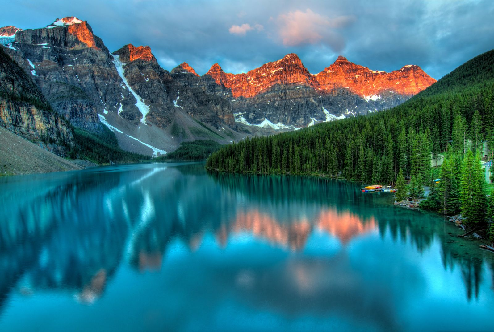

<!-- stage
layout: cover
align: center
notes: 스톡 사진과 자체 제작 작품을 엮은 가상 사진 에세이입니다. 사진 속 인물의 실제 경험이나 관계를 서술하지 않습니다.
-->
# 보는 범위를 바꾸면,
# 이야기도 달라집니다.

스톡 사진으로 만든 가상의 사진 에세이

---

<!-- stage
layout: gallery
variant: portraits
quiet: true
notes: SF 키노트 48:30의 상단 설명과 세로 사진 6개 구성을 16:9로 재구성했습니다. 원래 색을 유지하며 행동이 보이는 크롭을 선택했습니다. 서로 다른 스톡 사진이며 통일 촬영 시리즈를 재현한 것은 아닙니다. 사진 작가와 원본은 assets/CREDITS.md에 있습니다.
-->

```stage
{
  "items": [
    {
      "src": "../../assets/photos/capture.jpg",
      "alt": "휴대폰으로 장면을 기록하는 인물",
      "label": "시선을 담아,\n장면을 기록합니다.",
      "fit": "cover",
      "focalPoint": "68% 45%"
    },
    {
      "src": "../../assets/photos/listen.jpg",
      "alt": "헤드폰을 쓰고 노트북을 사용하는 인물",
      "label": "소리를 듣고,\n작업에 집중합니다.",
      "fit": "cover",
      "focalPoint": "52% 40%"
    },
    {
      "src": "../../assets/photos/write.jpg",
      "alt": "야외 테이블에서 노트에 글을 쓰는 인물",
      "label": "생각을 적어,\n다음으로 이어갑니다.",
      "fit": "cover",
      "focalPoint": "45% 50%"
    },
    {
      "src": "../../assets/photos/observe.jpg",
      "alt": "눈에 돋보기를 대고 관찰하는 인물",
      "label": "작은 차이를,\n다시 들여다봅니다.",
      "fit": "cover",
      "focalPoint": "48% 34%"
    },
    {
      "src": "../../assets/photos/portrait-one.jpg",
      "alt": "작업 공간에 앉아 현금을 들고 있는 인물",
      "label": "일상 가까이,\n가능성을 발견합니다.",
      "fit": "cover",
      "focalPoint": "48% 30%"
    },
    {
      "src": "../../assets/photos/portrait-two.jpg",
      "alt": "도시 거리에서 갈색 옷을 입고 서 있는 인물",
      "label": "밖으로 나가,\n새로운 시선을 만납니다.",
      "fit": "cover",
      "focalPoint": "49% 28%"
    }
  ]
}
```

---

<!-- stage
layout: media
quiet: true
notes: 사진 한 장의 색과 구도를 크게 보여줍니다. 직접 촬영한 사진이나 실제 여행 경험을 소개하는 장면이 아닙니다.
-->


Moraine Lake · James Wheeler / Pexels · 스톡 사진

```stage
{ "fit": "cover", "focalPoint": "50% 48%" }
```

---

<!-- stage
layout: statement
align: center
notes: 풍부한 컬러 사진 다음에는 중립 문장으로 정보량을 줄입니다. 이어지는 비교는 카메라 성능이 아닌 디지털 표시 크롭입니다.
-->
# 넓게 보던 장면에서,
# 작은 차이를 발견합니다.

다음 화면은 같은 사진을 디지털로 확대한 예시입니다.

---

<!-- stage
layout: gallery
variant: strip
quiet: true
tone: yellow
notes: 같은 사진을 같은 초점 위치에서 디지털로 확대했습니다. 렌즈 초점거리, 광학 줌, 별도 촬영 결과를 비교한 것이 아닙니다.
-->
# 같은 사진을, 다른 범위로.

촬영 조건이 아닌 표시 프레임의 디지털 확대입니다.

```stage
{
  "items": [
    { "src": "../../assets/photos/landscape.jpg", "alt": "호수 사진의 기본 표시 프레임", "label": "기본 프레임", "caption": "전체의 맥락", "fit": "cover", "focalPoint": "46% 32%", "zoom": 1 },
    { "src": "../../assets/photos/landscape.jpg", "alt": "같은 호수 사진의 1.4배 디지털 표시 확대", "label": "1.4× 디지털 크롭", "caption": "산과 호수", "fit": "cover", "focalPoint": "46% 32%", "zoom": 1.4 },
    { "src": "../../assets/photos/landscape.jpg", "alt": "같은 호수 사진의 2배 디지털 표시 확대", "label": "2× 디지털 크롭", "caption": "능선의 모양", "fit": "cover", "focalPoint": "46% 32%", "zoom": 2 },
    { "src": "../../assets/photos/landscape.jpg", "alt": "같은 호수 사진의 2.8배 디지털 표시 확대", "label": "2.8× 디지털 크롭", "caption": "더 좁은 범위", "fit": "cover", "focalPoint": "46% 32%", "zoom": 2.8 }
  ],
  "source": "James Wheeler / Pexels · 같은 원본 사진의 디지털 표시 확대 예시"
}
```

---

<!-- stage
layout: mosaic
quiet: true
notes: 사진과 자체 제작 작품을 섞은 가상 모음입니다. 모든 자료를 같은 정방형으로 자르지 않고 원래의 색과 방향을 고려합니다.
-->
# 장면과 작품을, 다시 엮습니다.

```stage
{
  "items": [
    { "src": "../../assets/examples/poster-wide.svg", "alt": "큰 보라 타이포가 있는 자체 제작 가로 포스터", "span": 2, "fit": "contain" },
    { "src": "../../assets/photos/listen.jpg", "alt": "헤드폰을 쓴 인물의 스톡 사진", "span": 1, "fit": "cover", "focalPoint": "50% 28%" },
    { "src": "../../assets/examples/objects.svg", "alt": "푸른 도형과 주황 구체의 자체 제작 이미지", "span": 1, "fit": "cover" },
    { "src": "../../assets/photos/portrait-two.jpg", "alt": "도시 거리에 서 있는 인물의 스톡 사진", "span": 1, "fit": "cover", "focalPoint": "50% 24%" },
    { "src": "../../assets/examples/report.svg", "alt": "관찰 기록을 담은 자체 제작 가상 문서", "span": 1, "fit": "contain" },
    { "src": "../../assets/photos/landscape.jpg", "alt": "호수와 산이 보이는 풀컬러 풍경 사진", "span": 2, "fit": "cover" }
  ],
  "source": "사진은 Pexels 스톡 이미지 · 포스터, 도형, 문서는 자체 제작"
}
```

---

<!-- stage
layout: closing
align: center
notes: 스톡 사진으로 만든 가상 구성을 마무리합니다. 실제 발표에서는 자신이 고른 이미지와 정확한 크레딧으로 교체하세요.
-->
# 다음 이야기는,
# 당신의 장면으로.

사진의 색은 살리고, 프레임과 간격으로 묶습니다.

```stage
{ "action": "직접 고른 사진과 정확한 크레딧으로 바꾸세요." }
```
