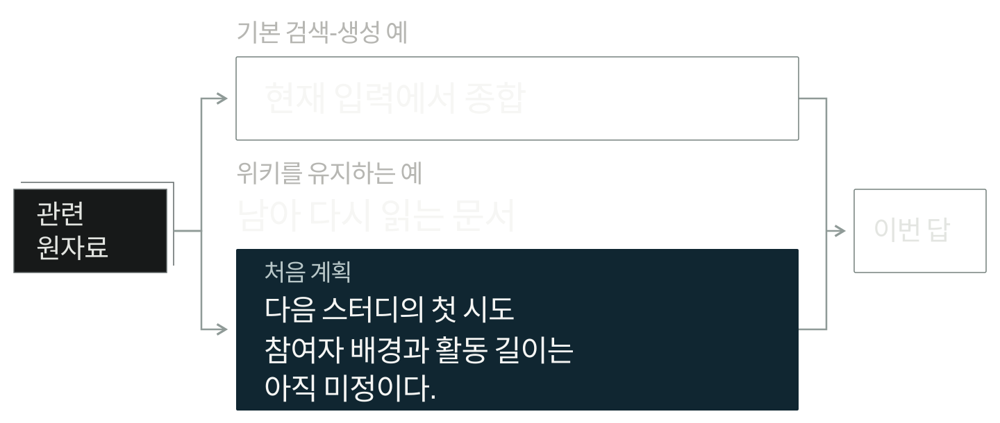
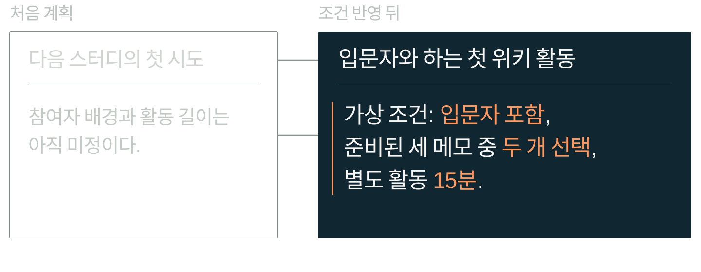
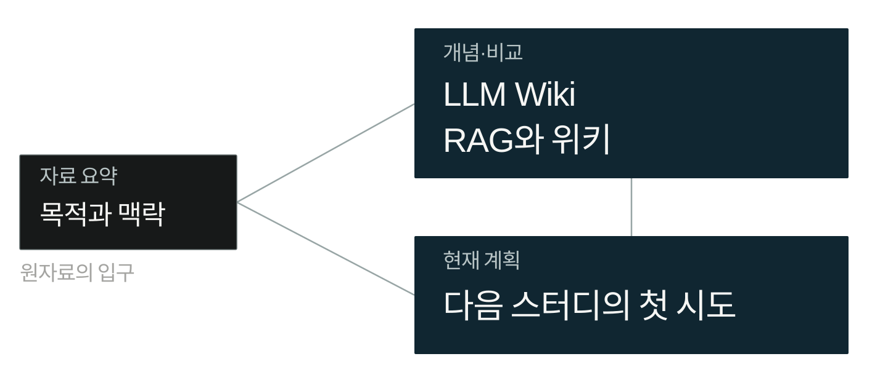
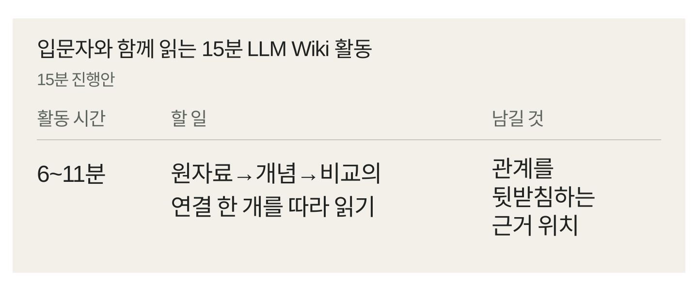
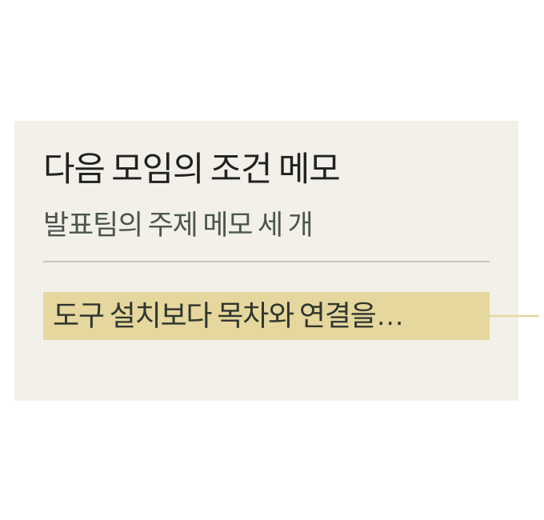

<!-- stage-slide
compose: message
tone: neutral
-->
# LLM Wiki

내 자료를 AI와 함께 정리하는 방법

---

<!-- stage-slide
compose: quote
tone: neutral
-->
> 나와 AI가 함께 읽고 고치는\
> **나만의 지식 문서.**

---

<!-- stage-slide
compose: quote
tone: orange
support:
  label: 선택 이유의 원문과 예시 지위를 글로 읽기
  href: ./materials/keynote-notes.md#선택-이유-메모
-->
# 내가 고른 이유

> LLM Wiki와 RAG의 차이를 설명하고\
> 다음 스터디의 진행안을 만들고 싶어서\
> **이 메모를 골랐다.**

「목적과 맥락」· 사람이 채울 선택 이유의 예

발표팀이 구성한 예문입니다.

---

<!-- stage-slide
compose: message
tone: neutral
-->
# 다음 질문에 다시 씁니다

---

<!-- stage-slide
compose: media
fit: contain
quiet: true
support:
  label: 같은 질문의 두 예와 비교 범위를 글로 읽기
  href: ./materials/keynote-notes.md#검색과-지속-문서
tone: neutral
-->
# 다음 AI 스터디에서 LLM Wiki를 어떻게 시도할까?

두 예는 함께 쓸 수 있습니다.

---

<!-- stage-slide
compose: media
fit: contain
quiet: true
support:
  label: 같은 계획에서 바뀐 제목과 조건을 글로 읽기
  href: ./materials/keynote-notes.md#계획이-바뀐-근거
tone: neutral
-->
# 같은 계획에 조건을 반영합니다

---

<!-- stage-slide
compose: media
fit: contain
quiet: true
support:
  label: 세 무방향 관계와 실제 문서 구절을 글로 읽기
  href: ./materials/keynote-notes.md#세-무방향-관계
tone: neutral
-->

함께 읽고 고칠 기존 문서의 세 무방향 관계입니다.
발표팀의 설명용 재구성입니다.

---

<!-- stage-slide
compose: media
fit: contain
quiet: true
support:
  label: 조건과 첫 선택을 글로 읽기
  href: ./materials/keynote-notes.md#원자료와-정리한-이해
tone: neutral
-->

---

<!-- stage-slide
compose: quote
tone: neutral
-->
# 자료를 고르기 전에

> 앞으로 만들 결과와\
> **관련된 자료인가?**

---

<!-- stage-slide
compose: quote
tone: orange
-->
> 목적과 내 판단은\
> **내가 적습니다.**

감정 · 생각 · 판단 · 선택 이유를\
**직접 남깁니다.**

---

<!-- stage-slide
compose: document
quiet: true
tone: neutral
-->
# 기록은 구분해서 남깁니다

| 기록의 지위 | 내용 예 |
| --- | --- |
| 원자료의 구절 | 본편 뒤 별도 활동은 15분만 배정한다. |
| 내가 직접 쓸 기록 | 선택 이유: **[내가 직접 적기]** |
| AI의 요약·해석 | 설치보다 문서 읽기부터 |

발표팀 구성 예

---

<!-- stage-slide
compose: editorial
variant: centered
quiet: true
tone: neutral
-->
# 어디에 다시 쓰나요?

## 공부

읽은 자료를\
**개념·질문과 연결하기**

## 프로젝트

배경과 결정 이유를\
**함께 읽기**

## 글과 발표

모아 둔 근거로\
**초안 만들기**

---

<!-- stage-slide
compose: media
fit: contain
quiet: true
support:
  label: 활동안의 정확한 한 행과 전문을 글로 읽기
  href: ./materials/keynote-notes.md#활동안과-미확인-범위
tone: neutral
-->

발표팀의 설명용 활동안 · 한 행 발췌

---

<!-- stage-slide
compose: editorial
variant: centered
quiet: true
tone: neutral
-->
# 함께 읽고, 고치고, 다시 씁니다

## 읽기

**설명과 근거**가\
문서로 남습니다.

## 고치기

**내 경험과 판단**을\
보탭니다.

## 다시 쓰기

정리한 개념과 연결을\
**다음 질문에 씁니다.**

---

<!-- stage-slide
compose: split
variant: evidence
fit: contain
quiet: true
support:
  label: 확인 질문과 조건 메모의 정확한 구절을 글로 읽기
  href: ./materials/keynote-notes.md#선택의-근거-확인
tone: neutral
-->

본편 뒤 별도 활동 15분,\
입문자와 함께라면 ‘읽기부터’?

> 도구 설치보다 목차와\
> 연결을 따라 다음 질문의\
> 근거를 찾는 경험을\
> 먼저 하고 싶다.

---

<!-- stage-slide
compose: editorial
variant: centered
quiet: true
tone: neutral
-->
# 지금 필요한 쪽부터

## 다시 묻는 주제

관련 자료 두 개를\
**연결해 보기**

## 한 번 확인할 질문

간단한 노트와\
**검색부터 시작하기**

---

<!-- stage-slide
compose: quote
tone: neutral
-->
# 첫 요청

> 다음 AI 스터디에서\
> LLM Wiki를 설명하고 싶어.\
> **내가 고른 두 자료를 함께 읽어 줘.**

---

<!-- stage-slide
compose: editorial
variant: centered
quiet: true
tone: neutral
-->
# 결과에는 이것을 남겨 주세요

## 근거

중요한 결론은\
**어디에서 왔는가**

## 바꾼 파일

어떤 문서를\
**왜 고쳤는가**

## 모르는 점

추가로 확인할\
**질문을 남기기**

---

<!-- stage-slide
compose: closing
tone: neutral
-->
# 다음 질문에 쓸 자료 두 개부터

---

<!-- stage-slide
compose: message
tone: neutral
-->
# 어떤 질문을 다시 묻고 싶나요?

[해설과 복사할 첫 요청](./materials/keynote-notes.md#시작-요청과-선택-기준) · [예제 팩 전문](./assets/expanded-study.txt)
