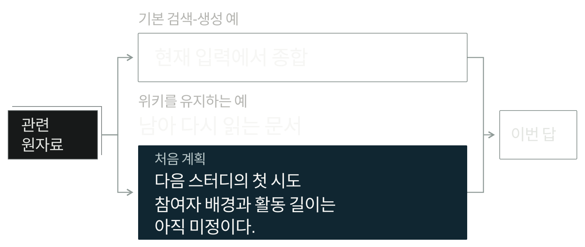
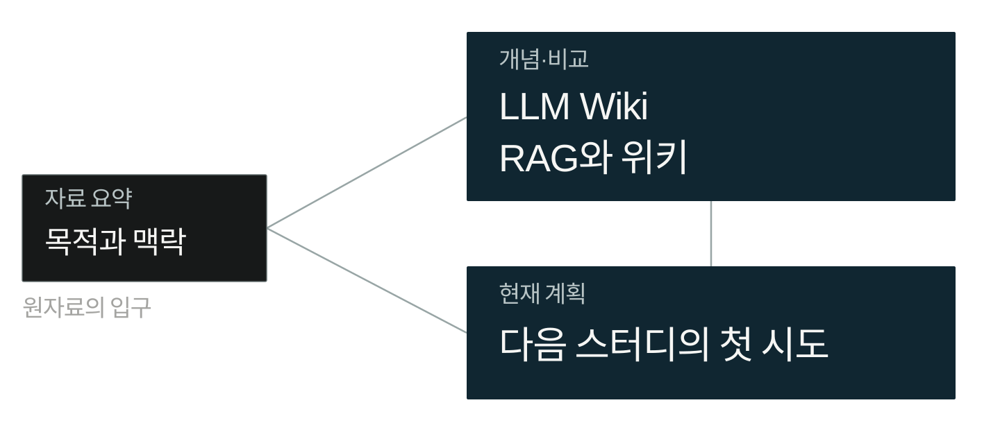
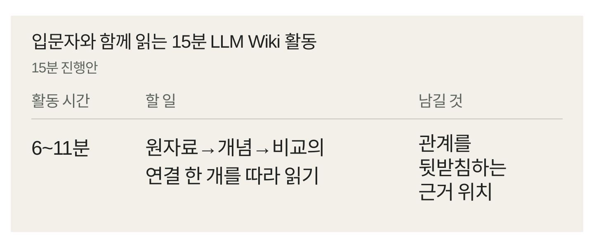
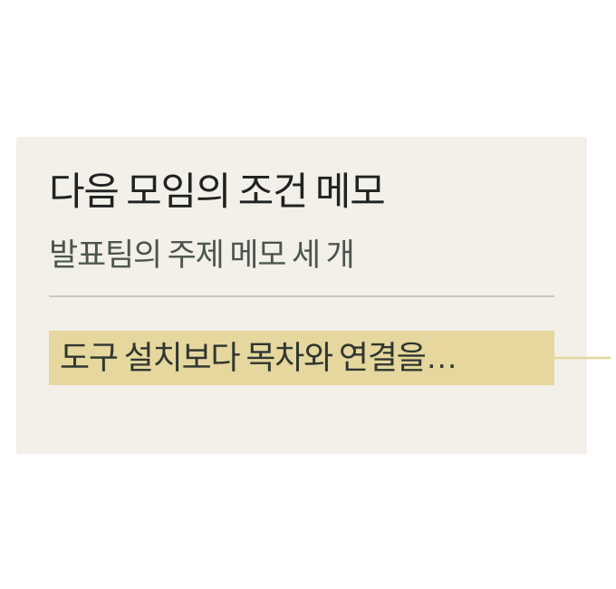

<!-- stage-slide
compose: media
fit: contain
quiet: true
support:
  label: 같은 질문의 두 예와 비교 범위를 글로 읽기
  href: ./materials/notes.md#검색과-지속-문서
tone: neutral
-->
# 다음 AI 스터디에서 LLM Wiki를 어떻게 시도할까?

두 예는 함께 쓸 수 있습니다.

---

<!-- stage-slide
compose: media
fit: contain
quiet: true
support:
  label: 세 무방향 관계와 실제 문서 구절을 글로 읽기
  href: ./materials/notes.md#세-무방향-관계
tone: neutral
-->

함께 읽고 고칠 기존 문서의 세 무방향 관계입니다.
발표팀의 설명용 재구성입니다.

---

<!-- stage-slide
compose: media
fit: contain
quiet: true
support:
  label: 활동안의 정확한 한 행과 전문을 글로 읽기
  href: ./materials/notes.md#활동안과-미확인-범위
tone: neutral
-->

발표팀의 설명용 활동안 · 한 행 발췌

---

<!-- stage-slide
compose: split
variant: evidence
fit: contain
quiet: true
support:
  label: 확인 질문과 조건 메모의 정확한 구절을 글로 읽기
  href: ./materials/notes.md#선택의-근거-확인
tone: neutral
-->

본편 뒤 별도 활동 15분,\
입문자와 함께라면 ‘읽기부터’?

> 도구 설치보다 목차와\
> 연결을 따라 다음 질문의\
> 근거를 찾는 경험을\
> 먼저 하고 싶다.

