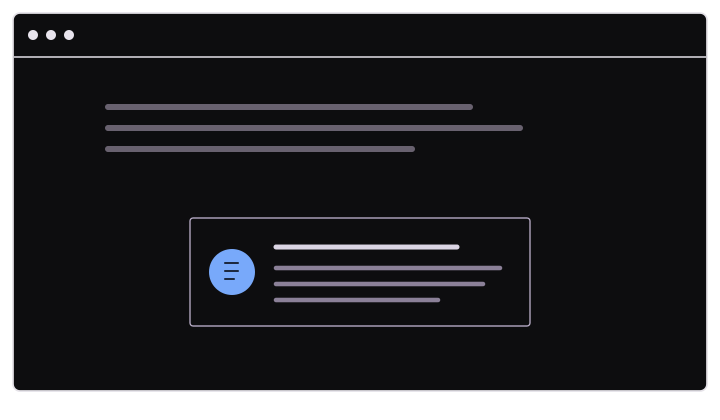
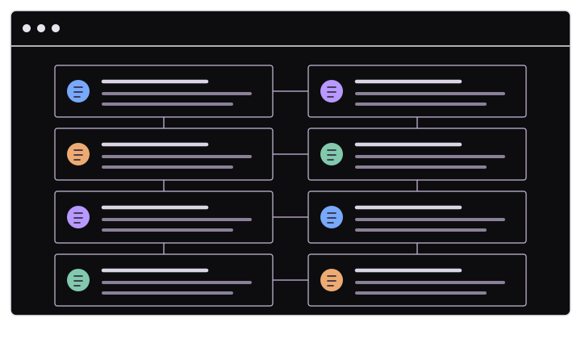
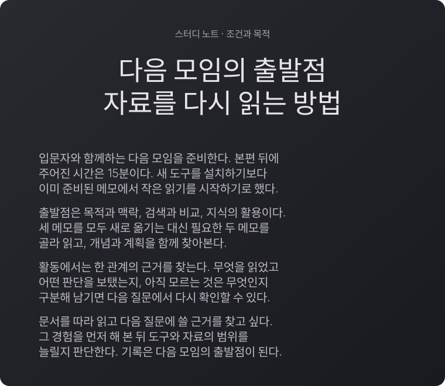

<!-- stage-slide
compose: message
variant: declaration
quiet: true
tone: orange
support:
  label: 이 이야기의 범위
  href: ./materials/notes.md#답변을-넘어
-->
지식을 남기는 방식이\
**다음 질문을 바꿉니다**
====================

---

<!-- stage-slide
compose: gallery
variant: comparison
fit: contain
quiet: true
tone: neutral
support:
  label: 두 작업 방식과 비교 범위
  href: ./materials/notes.md#두-작업-방식
-->




---

<!-- stage-slide
compose: split
variant: quote-card
tone: blue
fit: contain
quiet: true
support:
  label: 조건 메모의 원문과 맥락
  href: ./materials/notes.md#먼저-하고-싶은-경험
-->


> 문서를 따라 읽고\
> 다음 질문에 쓸\
> 근거를 찾고 싶다

---

<!-- stage
layout: results
variant: unframed
quiet: true
-->

```stage
{
  "title": "읽은 자료가\n다음 작업으로",
  "items": [
    {"src": "../../assets/output-plan.png", "alt": "발표팀이 직접 작성한 입문자 활동 계획표", "fit": "contain"},
    {"src": "../../assets/output-map.png", "alt": "발표팀이 직접 작성한 개념과 비교의 연결 지도", "fit": "contain"},
    {"src": "../../assets/output-question.png", "alt": "발표팀이 직접 작성한 질문과 검토할 답의 노트", "fit": "contain"},
    {"src": "../../assets/output-brief.png", "alt": "발표팀이 직접 작성한 모임의 준비 안내", "fit": "contain"}
  ]
}
```
