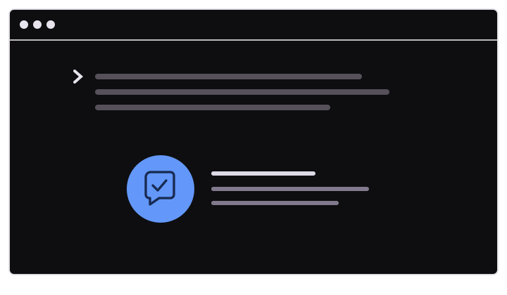
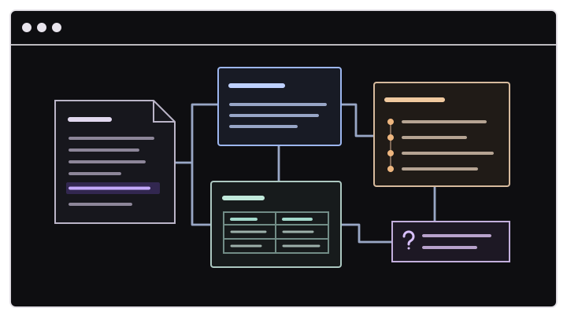
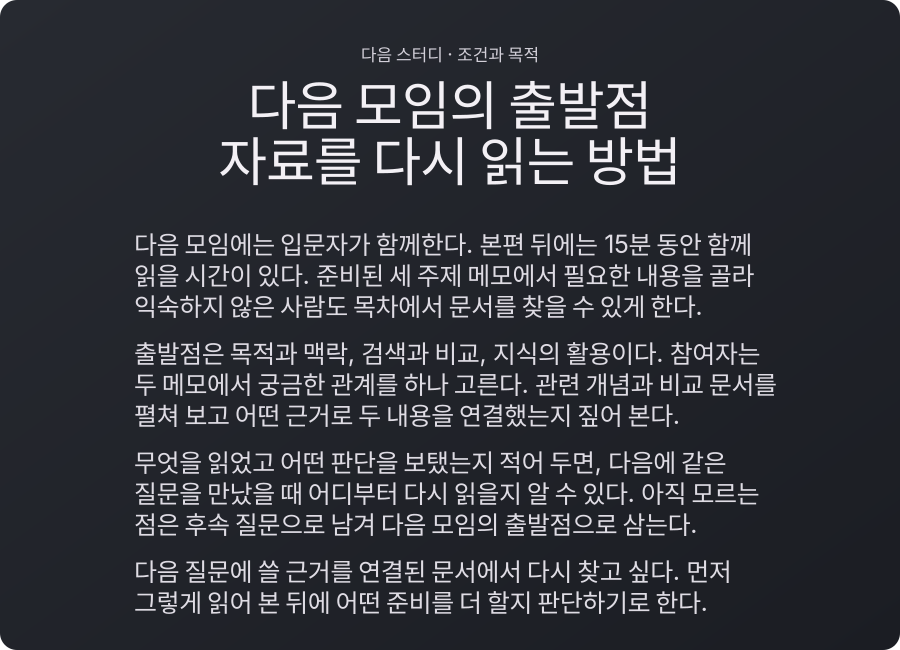
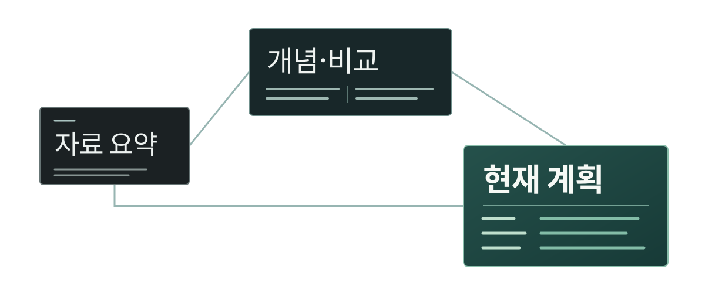

<!-- stage-slide
compose: message
variant: declaration
quiet: true
tone: orange
support:
  label: LLM Wiki의 정의와 개인 맥락
  href: ./materials/keynote-notes.md#정의와-개인-맥락
-->
지식을 남기는 방식이\
**다음 질문을 바꾼다**
====================

---

<!-- stage-slide
compose: gallery
variant: comparison
fit: contain
quiet: true
tone: neutral
support:
  label: 이번 답과 지속 문서의 비교 범위
  href: ./materials/keynote-notes.md#검색과-지속-문서
-->




---

<!-- stage-slide
compose: split
variant: quote-card
tone: blue
fit: contain
quiet: true
support:
  label: 사례의 원문과 발표용 인용
  href: ./materials/keynote-notes.md#다음-모임의-출발점
-->


> 다음 질문에 쓸 근거를\
> 연결된 문서에서\
> 다시 찾고 싶다

---

<!-- stage-slide
support:
  label: 네 결과물의 전문과 확인 범위
  href: ./materials/keynote-notes.md#네-가지-작업-결과
-->

<!-- stage
layout: results
variant: unframed
quiet: true
-->

```stage
{
  "title": "읽은 자료가\n다음 작업으로",
  "items": [
    {"src": "./assets/devday-current/output-plan.svg", "alt": "입문자 활동안의 시간과 할 일이 행으로 나뉜 일정표", "fit": "contain"},
    {"src": "./assets/devday-current/output-map.svg", "alt": "주제 메모와 개념·비교, 질문 노트와 활동안을 연결한 지도", "fit": "contain"},
    {"src": "./assets/devday-current/output-question.svg", "alt": "입문자가 무엇부터 할지 정리한 질문과 답", "fit": "contain"},
    {"src": "./assets/devday-current/output-brief.svg", "alt": "모임 전 준비와 근거 위치·다음 질문을 적을 기록칸", "fit": "contain"}
  ]
}
```

---

<!-- stage-slide
compose: message
quiet: true
tone: neutral
support:
  label: 정리한 이해와 원자료의 역할
  href: ./materials/keynote-notes.md#원자료와-작업-약속
-->
# LLM Wiki

내 자료를 AI와 함께 읽고 연결하는 마크다운 위키

---

<!-- stage-slide
compose: editorial
variant: centered
quiet: true
tone: neutral
support:
  label: 사람의 판단과 AI 해석을 구분하는 방법
  href: ./materials/keynote-notes.md#사람의-선택과-기록
-->
# 같은 문서를 함께 고칩니다

<!-- stage-group
tone: orange
-->
## 사람

목적과 고른 이유를 남깁니다

<!-- stage-group
tone: blue
-->
## AI

자료를 연결해 문서를 고칩니다

---

<!-- stage-slide
compose: media
quiet: true
fit: contain
tone: neutral
support:
  label: 함께 읽고 고칠 세 관계
  href: ./materials/keynote-notes.md#세-무방향-관계
-->
# 자료는 연결되고 계획은 갱신됩니다



---

<!-- stage-slide
compose: editorial
variant: centered
quiet: true
tone: neutral
support:
  label: 같은 계획의 전후 원문과 새 조건
  href: ./materials/keynote-notes.md#계획이-바뀐-근거
-->
# 입문자가 오면 계획이 바뀝니다

<!-- stage-group
tone: neutral
-->
## 처음 계획

참여자와 활동 시간 미정

<!-- stage-group
tone: orange
-->
## 갱신된 계획

입문자와 근거 하나 찾기

---

<!-- stage-slide
compose: editorial
variant: centered
quiet: true
tone: neutral
support:
  label: 작은 예제로 따라 하는 첫 단계
  href: ./materials/keynote-notes.md#시작-요청과-선택-기준
-->
# 자료 두 개로 시작합니다

<!-- stage-group
tone: orange
-->
## 고르기

목적과 선택 이유 적기

## 연결하기

문서에 근거 연결하기

## 확인하기

원자료로 결론 확인하기

---

<!-- stage-slide
compose: quote
variant: spacious
quiet: true
tone: orange
support:
  label: 복사해서 고쳐 쓸 시작 요청 전문
  href: ./materials/keynote-notes.md#시작-요청과-선택-기준
-->
# 첫 요청

> 이 자료 두 개를 읽고\
> 내 목적에 맞춰 연결해 줘.\
> **근거와 모르는 점도 남겨 줘.**

---

<!-- stage-slide
compose: closing
quiet: true
tone: neutral
support:
  label: 자료와 예제 읽기
  href: ./materials/keynote-notes.md#다음-질문
-->
어떤 질문을\
다시 묻고 싶나요?
=================
