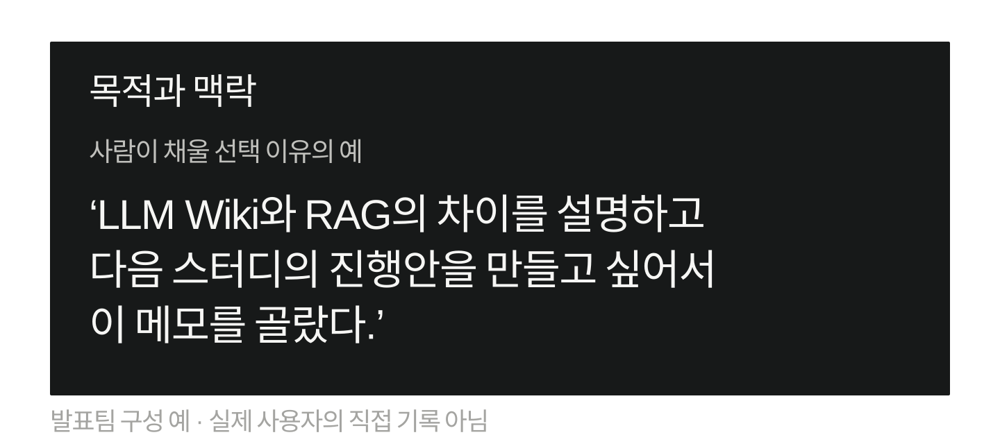
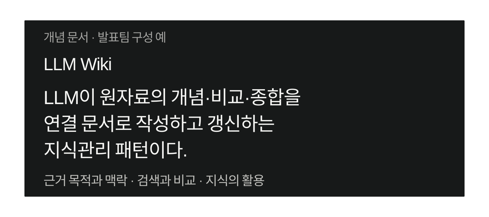
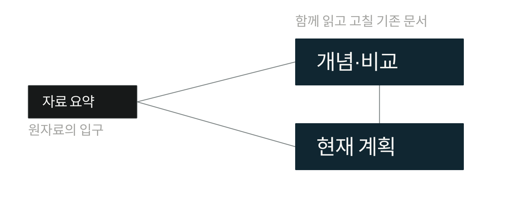
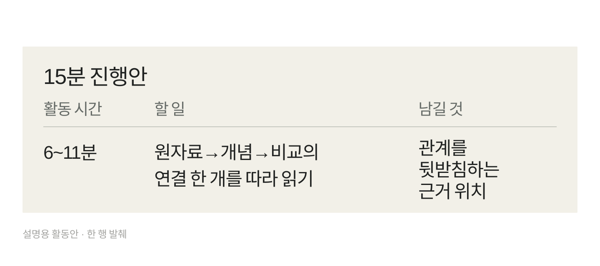
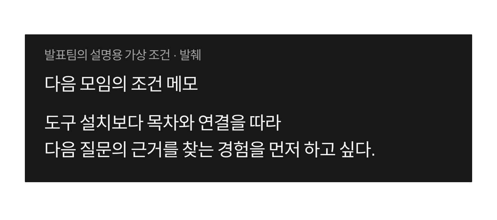

<!-- stage-slide
compose: message
tone: neutral
-->
# LLM Wiki

내 자료를 AI와 함께 정리하는 방법

---

<!-- stage-slide
compose: quote
tone: neutral
-->
> 나와 AI가 함께 읽고 고치는\
> **나만의 지식 문서.**

---

<!-- stage-slide
compose: media
fit: contain
quiet: true
tone: neutral
-->

---

<!-- stage-slide
compose: message
tone: neutral
-->
# 다음 질문에 다시 씁니다

---

<!-- stage-slide
compose: editorial
variant: centered
quiet: true
tone: neutral
-->
# 중심 작업이 다릅니다

## RAG

필요한 근거를 찾아\
**현재 질문에 답하기**

## 작은 LLM Wiki

다시 읽을 문서를\
**정리하고 연결하기**

---

<!-- stage-slide
compose: media
fit: contain
quiet: true
tone: neutral
-->

---

<!-- stage-slide
compose: media
fit: contain
quiet: true
tone: neutral
-->
# 요약을 기존 문서와 연결합니다

---

<!-- stage-slide
compose: media
fit: contain
quiet: true
tone: neutral
-->

---

<!-- stage-slide
compose: quote
tone: neutral
-->
# 자료를 고르기 전에

> 앞으로 만들 결과와\
> **관련된 자료인가?**

---

<!-- stage-slide
compose: quote
tone: neutral
-->
> 목적과 내 판단은\
> **내가 적습니다.**

감정 · 생각 · 판단 · 선택 이유를 직접 남깁니다.

---

<!-- stage-slide
compose: document
quiet: true
tone: neutral
-->
# 기록은 구분해서 남깁니다

| 기록의 지위 | 내용 예 |
| --- | --- |
| 원자료의 구절 | 본편 뒤 별도 활동은 15분만 배정한다. |
| 내가 직접 쓸 기록 | 선택 이유: **[내가 직접 적기]** |
| AI의 요약·해석 | 설치보다 문서 읽기부터 |

발표팀 구성 예 · 실제 사용자 기록이나 모델 출력이 아닙니다.

---

<!-- stage-slide
compose: editorial
variant: centered
quiet: true
tone: neutral
-->
# 어디에 다시 쓰나요?

## 공부

읽은 자료를\
**개념·질문과 연결하기**

## 프로젝트

배경과 결정 이유를\
**함께 읽기**

## 글과 발표

모아 둔 근거로\
**초안 만들기**

---

<!-- stage-slide
compose: media
fit: contain
quiet: true
tone: neutral
-->

---

<!-- stage-slide
compose: editorial
variant: centered
quiet: true
tone: neutral
-->
# 함께 읽고, 고치고, 다시 씁니다

## 읽기

**설명과 근거**가\
문서로 남습니다.

## 고치기

**내 경험과 판단**을\
보탭니다.

## 다시 쓰기

정리한 개념과 연결을\
**다음 질문에 씁니다.**

---

<!-- stage-slide
compose: media
fit: contain
quiet: true
tone: neutral
-->

---

<!-- stage-slide
compose: editorial
variant: centered
quiet: true
tone: neutral
-->
# 지금 필요한 쪽부터

## 다시 묻는 주제

관련 자료 두 개를\
**연결해 보기**

## 한 번 확인할 질문

간단한 노트와\
**검색부터 시작하기**

---

<!-- stage-slide
compose: quote
tone: neutral
-->
# 첫 요청

> 다음 AI 스터디에서\
> LLM Wiki를 설명하고 싶어.\
> **내가 고른 두 자료를 함께 읽어 줘.**

---

<!-- stage-slide
compose: editorial
variant: centered
quiet: true
tone: neutral
-->
# 결과에는 이것을 남겨 주세요

## 근거

중요한 결론은\
**어디에서 왔는가**

## 바꾼 파일

어떤 문서를\
**왜 고쳤는가**

## 모르는 점

추가로 확인할\
**질문을 남기기**

---

<!-- stage-slide
compose: closing
tone: neutral
-->
# 다음 질문에 쓸 자료 두 개부터

---

<!-- stage-slide
compose: message
tone: neutral
-->
# 어떤 질문을 다시 묻고 싶나요?

그 질문에 쓸 자료 두 개를 골라 보세요.

[해설과 복사할 첫 요청](./materials/keynote-notes.md#시작-요청과-선택-기준) · [예제 팩 전문](./assets/expanded-study.txt)
