<!-- stage-slide
compose: message
tone: neutral
-->
# 다음 질문에 다시 씁니다

---

<!-- stage-slide
compose: media
fit: contain
tone: neutral
-->
# 원자료는 보존하고, 이해는 갱신합니다

[발췌의 원문과 작업 약속](./materials/reading.md#원자료와-정리한-이해)

---

<!-- stage-slide
compose: media
fit: contain
tone: neutral
-->
# 요약에서, 기존 문서와 연결합니다

[관계의 뜻과 원자료](./materials/reading.md#요약과-기존-문서의-관계)
