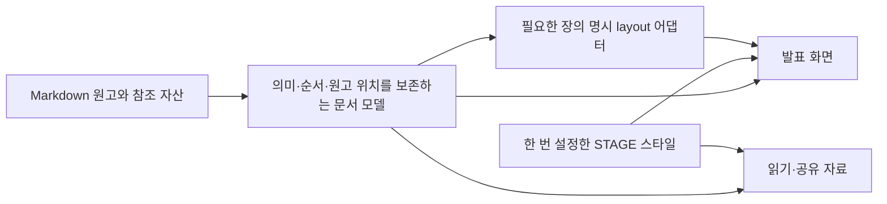

# Markdown으로 반복 사용하는 STAGE — 구조 검사와 합의

2026-10-27 · 기준 `835453787bd3fdf75837a618674e6fb20828ee7a`

**공통 스타일·검증·슬라이드 양식은 재사용하기 좋다. 사용자가 원하는 “간단한 Markdown 원본으로 여러 발표와 자료를 만드는 흐름”은 입력·본문 표현·원본 관리·출력을 정리해야 한다.** 두 팀의 내부 검사와 두 차례 매니저 회의는 Markdown 파일 + 자동 미리보기를 기본 경로로 권고했다. React 편집기나 전체 재작성은 선행 조건이 아니다.

## 확인한 현행과 바꿀 경계

| 경계 | 현재 확인 | 합의한 방향 |
| --- | --- | --- |
| 원고 | Markdown은 선택 경로이며 최신 스타터는 content.js 편집 중심 | 새 모드의 작성 원본은 Markdown 하나. JS/HTML은 생성물 |
| 기본 Markdown | 제목·문단 일부 가능. 일반 목록/코드/표/인용에 제한, inline 링크/강조는 문자 그대로 | 본문 blocks/inline 의미를 보존하는 모델과 renderer 추가 |
| 스타일 | STAGE 토큰·타이포·20양식·native 자료 renderer 공유 | 공통 설정에서 한 번 정하고 모든 원고에 적용. 필요한 장만 명시 layout 사용 |
| 편집 | 브라우저 수정은 MD에 돌아가지 않고 content.js로 내보냄 | 처음에는 MD 수정→자동 preview. 생성물 수정본을 또 다른 원본으로 만들지 않음 |
| 여러 발표 | 일괄 예제 build의 5개 Markdown 경로가 코드에 고정 | 작은 프로젝트 규칙/도구 관리 registry로 원고·ID·주소·출력 연결 |
| 공유 | 기존 읽기는 슬라이드를 펼친 화면. compiled 폴더는 공통 파일에 의존 | 같은 문서에서 발표와 읽기 생성. 웹 공유와 독립 package를 구분 |

현재의 제한을 고장으로 단정하지 않는다. 기존 설계는 특정 20양식을 정확히 작성하는 데 맞춰져 있고, 새 목표는 일반 원고의 의미를 보존하는 작성 흐름이다. 기존 기능은 명시적인 legacy 경로로 유지한다.

## 작성자가 쓰게 될 원고

아래는 **새 모드의 목표 문법이며 아직 구현하지 않았다.** 현재 compiler에 그대로 넣으면 일반 목록 부분이 거절된다. 프로젝트의 기본 STAGE 스타일은 한 번 설정하며 매 발표에 CSS/JS/JSON을 작성하지 않는 방향이다.

```md
# 다음 경험을 만듭니다

이번 발표에서 전할 한 문장입니다.

---

# 바꿀 것은 세 가지입니다

- 먼저 문제를 설명합니다.
- 근거와 자료를 보여줍니다.
- 다음 행동을 정합니다.
```

일반 원고에는 제목·문단·목록·이미지·링크·코드·인용·표를 쓴다. 사진과 첨부가 있으면 원고 옆 자산 폴더에서 참조한다. 숫자를 큰 지표로 표시하거나 특정 시각자료·혼합 타일을 쓰고 싶을 때만 선택 설정을 더한다. 일반 표를 임의 차트로 바꾸거나 글을 자동 요약하지 않는다. [6장 상세 제안](research/authoring-contract.md)

## 목표 구조



본문을 subtitle 문자열 하나로 합치는 구조를 넘어서되, 공통 모델/미디어 처리/20양식/모션/발표자를 모두 버리지는 않는다. 먼저 현재 player에 기본 본문 분기와 작은 renderer helper를 추가할 수 있다. 명칭·실제 파일 분할·parser 라이브러리는 구현 단계에서 정한다. 모노레포나 플러그인 체계를 먼저 만들 필요는 없다.

첫 의미 블록이 H1일 때만 장 제목으로 한 번 사용하고, 앞 문단과 나머지 heading 순서는 보존한다. 기존 반복 `#` 제목 줄바꿈과 새 일반 문법을 자동으로 혼동하지 않게 모드를 구분한다. 발표에서 넘치는 내용은 위치를 알려 진단하고 읽기에서는 전체를 보존한다.

## 실제 검사 근거

- 현재 compiler로 **18입력: 8개 build 성공, 10개 거절**을 임시 폴더에서 재현했다. 이는 새 Markdown 구현의 테스트 통과 수가 아니다.
- 구문·모델·없는 이미지의 세 preflight 실패에서 이전 성공 index/content가 보존됐다. 파일 쓰기 장애의 원자성은 시험하지 않았다.
- 생성 content.js를 수정한 뒤 재build하면 원래 MD에서 다시 생성돼 수정이 덮어써졌다. MD 원고 자체는 바뀌지 않았다.
- `alpha/slides.md`, `beta/slides.md`의 fallback ID는 같지만 출력 경로는 달랐다. 현재 저장키에는 pathname도 있으므로 현재 저장 충돌을 입증한 것은 아니다.
- compiled에는 index/content 두 파일만 있고 공통 runtime·미디어는 밖을 참조했다. 단독 폴더 공유의 완결성은 정적 경로 검사로 확인했으며 브라우저 offline 실행으로 표시하지 않는다.
- notes는 생성 데이터에 남으며 별도 표 생성 코드도 notes를 표시한다. 향후 청중 출력의 역할 분리를 데이터/자산 단계에서 다룬다. PUBLIC Git 원본을 비공개로 만드는 기능과 혼동하지 않는다.
- 실행 전후 제품 8파일 SHA가 같았다. 기존 185개 회귀는 같은 제품 코드의 직전 검증을 재사용했다. 이번 검사에서 제품 재작성·새 배포는 하지 않았다.

[구조 감사](engineering/architecture-audit.md) · [compiler 감사](engineering/compiler-audit.md) · [실제 입력·출력 JSON](engineering/evidence/compiler-probe.json) · [재현 스크립트](engineering/evidence/compiler-probe.cjs)

## 회의에서 정리한 구현 범위

1. **먼저:** 일반 MD 문법·기본 본문 renderer·기존 STAGE 스타일·발표/읽기·자동 preview. 같은 스타일의 두 발표를 독립 생성하고 legacy 의미를 보존한다.
2. **공유 품질:** 공개 자료/원고/노트의 역할, 첨부와 원고 간 링크, ID/주소, 누락 자산과 이전 성공본 보존을 검증한다. 원본 다운로드·부록 정책은 팀의 기본 제안으로 두며 사용자 확정 요구와 구분한다.
3. **필요할 때:** portable/offline package·Markdown 변경의 CI 배포·원본 편집 UI. source patch와 React 도입은 필수 과제가 아니다.

두 매니저는 제목 승격의 원문 순서, 진단/복제본의 구조 보존, 원격 미디어의 offline 한계, 원고를 첨부로 자동 복사하는 문제를 서로 반박·수정했다. 상세 결정과 미구현 선택은 [회의록](MEETING.md)에 있다.

이번 산출물은 내부 구조 검사·실행 근거·팀 합의 설계다. 새 parser·본문 renderer·watch·공유 packager·공개 projection은 후속 구현 범위다. [리서치 검수](research/manager-review.md)와 [엔지니어링 검수](engineering/manager-review.md)를 함께 확인할 수 있다.
