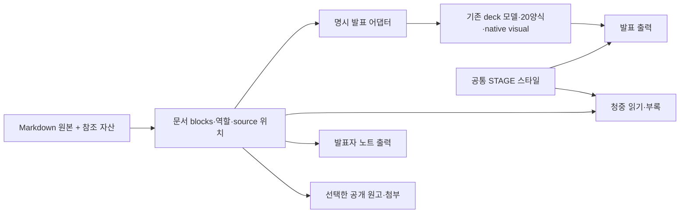

# Markdown 단일 원본·재사용 구조 — 팀 회의 반영

2026-10-27 · 기준 `main` / `835453787bd3fdf75837a618674e6fb20828ee7a` · 취합 `/root/research_manager/react_researcher`

**단계:** 리서치·엔지니어링 감사와 두 매니저의 두 차례 직접 회의를 마친 설계 합의다. 새 Markdown 문법·renderer·preview·공개 패키저의 구현 완료를 뜻하지 않는다. 제품·기존 원고·배포는 변경하지 않았다.

## 권고

**Markdown 파일 하나를 주원본으로 삼고, 기존 STAGE 스타일로 발표와 청중용 읽기를 생성하는 최소 흐름을 만든다.** Markdown 편집기 + 자동 preview/build만으로 요구를 충족하면 React 작성 UI는 필요하지 않다. Vite는 도구 선택이며 문법·원본·공유 계약을 대신하지 않는다. AI는 원고를 도울 수 있는 선택 수단이고 실행·레이아웃·자료 생성의 필수 조건이 아니다.

현재 Markdown compiler와 모델·20양식·native visual·타이포를 재사용하되, 일반 본문을 기존 layout 필드에 억지로 넣는 경계를 확장한다. 한 원본에서 발표·읽기·부록/자료를 투영하며 공개용 원본 파일과 발표자 노트는 별도 선택으로 다룬다. Node·watch·preview·build·CI는 허용한다. 기존 content.js 직접 편집과 file/portable 결과는 호환 경로다.

## 실제 감사 결과

| 현재 가능한 것 | 현재 부족한 것 |
| --- | --- |
| Markdown 하나→공통 모델 검증→content.js/index.html 생성 | 일반 Markdown 문서의 block/inline 의미와 순서를 보존하는 파서 |
| 기본 `#`+문단은 statement로 변환, 명시 layout/구조 데이터는 20양식 사용 | `##`, 기본 목록·이미지, 표·인용·code를 자연스럽게 쓰는 기본 원고 |
| 같은 슬라이드 DOM의 읽기 모드, native 자료와 동일 데이터 표 | 슬라이드 장면과 별개인 완전한 청중 문서·부록/보충설명 투영 |
| 브라우저 편집·localStorage·content.js 다운로드 | 화면 수정의 Markdown 원본 저장·patch·충돌 처리 |
| 고정된 5개 Markdown 예제 생성과 직접 원본/스타터 갱신 | 컬렉션에 새 원고를 추가하는 명시 목록·안정 id/slug·공유 출력 설정 |
| 공통 runtime 상대 참조와 선언 미디어 실재 검사 | 임의 출력 폴더의 standalone package·모든 공개 entry/asset 묶음 생성 |

현행 `parseMarkdown()` 순수 메모리 실행에서 `##`, 기본 `-` 목록, statement 이미지, pipe 표, 인용, 일반 code fence가 오류였고 inline 강조·링크·HTML은 문자열로 남았다. 같은 이름 `/alpha/slides.md`, `/beta/slides.md`는 fallback id가 모두 `slides`였다. 현재 localStorage는 pathname도 포함하므로 이 결과를 현재 저장 충돌이라고 해석하지 않는다. [코드 경계·재현 결과](workflow-audit.md)

엔지니어링은 현재 compiler의 18입력(8성공/10거절), 3종 preflight 실패의 정상본 보존, generated 수정의 재빌드 덮어쓰기, 출력 폴더 외부 의존을 `/tmp`에서 재현했다. notes가 생성 content에 남았고 `StageVisual.renderDataPage()`도 notes를 표시한다. 이는 새 문법 구현 검증이나 기존 노트 비공개 약속의 위반을 뜻하지 않는다. [구조 감사](../engineering/architecture-audit.md), [실행 근거](../engineering/evidence/compiler-probe.json)

## 최소 구조 제안

문서 blocks는 기존 deck 모델을 폐기하는 새 프레임워크가 아니다. 원문 heading·paragraph·list·image·quote·table·code와 inline 의미를 보존하는 작은 작성 중간 표현이고, 발표 어댑터가 필요한 부분을 기존 모델로 연결한다. 현 20양식에는 임의 blocks를 담는 범용 필드가 없으므로 parser 변경뿐 아니라 최소 본문 모델·renderer 확장도 필요하다. 일반 prose의 기본 구도만 기존 토큰·타이포에 맞춰 보완하고 명시 layout은 계속 재사용한다. 복잡한 플러그인·모노레포·범용 디자인 시스템을 새로 만들지 않는다.

R1에서 제목 승격의 위치 조건을 수정했다. **장의 첫 의미 블록이 H1일 때만** rich inline을 가진 제목으로 한 번 소비한다. 앞에 문단이 있거나 뒤에 나오는 heading은 본문 순서를 유지한다. 연속 H1은 새 모드에서 첫 제목+후속 본문 heading이고 legacy만 제목 배열이다. 검색/목록 label은 파생 plain text로 둔다. 새 dialect는 프로젝트/명령에서 명시 선택하고 기존 원고를 조용히 재해석하지 않는다. 새 노드는 schema·renderer·source/넘침 진단과 thumbnail/presenter 복제를 함께 확장하며 plaintext `[data-field]` 편집에 넣지 않는다. 덱별 HTML 격리로 시작해 전면 player 재작성은 피한다.

| 역할 | 기본 제안 | 확정/구현 시 확인 |
| --- | --- | --- |
| 일반 본문·자료 | 발표와 청중 읽기의 공통 내용, 원문 순서와 자료 보존 | 긴 문단을 자동 요약·생략하지 않고 overflow 또는 원고 분리 진단 |
| 슬라이드 경계 | `---` 등 명시 경계와 단순한 고정 규칙 | frontmatter·code fence·표와 충돌하지 않는 parser 규칙 |
| 레이아웃 선택 | 기본 본문 구도 + 필요한 경우만 명시 layout/어댑터 | 제목 카드·demo.steps·stage JSON을 일반 원고에 강요하지 않음 |
| 부록·보충설명 | 선택 확장. 같은 원고에서 역할을 명시하고 청중 읽기 별도 구역 포함을 기본 후보로 둠 | 발표 포함 여부·구문 명칭은 사용자 미확정 사항 |
| 발표자 노트 | notes 역할은 발표자 출력에만 포함하는 기본 후보 | 청중 페이지뿐 아니라 생성 데이터·다운로드 artifact에서도 제외하는지 확인 |
| 원본·첨부 공유 | 기본은 발표+청중 읽기. raw 원고·별도 자료모음 다운로드는 opt-in, 본문이 참조한 일반 공개 첨부는 출력 의존성 | 입력 MD 링크는 공개 읽기 URL로 연결하거나 위치 오류. raw source를 첨부로 우회 포함하지 않음 |

표의 기본값은 사용자 확정 요구가 아닌 리서치 제안이다. 원고 공개를 자동 선택하면 notes 분리가 무의미해질 수 있다. **내부 작성 원본 하나와 공개 artifact 하나는 동일한 개념이 아니다.** 단순 DOM 숨김을 notes 제외나 비공개의 보장으로 삼지 않는다.

이미 PUBLIC Git의 원고·이력에 노트가 있으면 공개 artifact에서 notes를 제외해도 그 원본은 공개돼 있다. 이 합의는 선택한 공개 산출물에서 제외하는 범위이며 새 인증·보안 플랫폼을 추가하지 않는다. notes 전용 자산은 공개 목록에서 제외하되 본문과 함께 쓰는 공개 자산은 남긴다. 등록된 입력 MD는 공개 읽기 URL로 해석하고 매핑할 수 없으면 공개 build를 진단과 함께 중단한다. 링크를 조용히 지우거나 모든 MD의 비공개를 자동 보장하지 않는다.

## 화면 편집과 작성 권위

최소 구현은 Markdown editor/파일 수정→자동 preview이며 preview는 읽기 전용이다. 기존 inline 편집을 Markdown으로 되돌리는 역변환은 필수가 아니다. 화면 편집을 유지할 때는 저장하지 않은 임시 draft임을 명시하고, source 저장/patch를 지원할 때만 Markdown 원본에 커밋한다. content.js 다운로드를 Markdown 원본 저장이라고 안내하지 않는다.

source patch를 후속 도입하면 source 위치·id·동시 파일 변경을 확인하고 주석·줄바꿈·표·code·노트·알 수 없는 확장을 보존해야 한다. 구조화 deck 전체에서 원고를 자동 복원하는 기능은 현재 없고 이번 설계에서 구현 완료를 주장하지 않는다. 같은 deck에 md와 generated content.js를 동등한 두 원본으로 두지 않는다.

## 여러 발표와 자료 공유

작은 목록 또는 경로 규칙에서 원고 경로, deck id, 출력 slug, 공통 스타일 참조와 공개 옵션을 정하는 안을 권한다. 기존 숫자 #n 링크는 기본 호환으로 유지하고 장 삽입 뒤에도 유지할 영구 slide anchor는 선택 확장으로 둔다. 모든 장에 id를 직접 쓰는 설정을 일반 작성자에게 요구하지 않는다. 공통 runtime/style 버전·개별 deck 출력 교체·asset 경로를 분리해 같은 원고와 스타일을 다른 발표에 재사용한다. 구체 목록/경로 규칙과 id 생성법은 후속 구현 선택으로 남겼다.

웹 컬렉션은 공통 runtime을 공유하고, portable 산출물은 필요한 runtime과 자산을 묶는다. Markdown 주원본의 재빌드는 허용되며 보는 사람이 Node나 AI를 설치해야 하는 출력으로 제한할 이유는 없다. 새 문법/빌드 이행과 GitHub Pages 배포·Vite/React 이행을 하나의 필수 전환으로 묶지 않는다.

R2 합의에서 registry는 도구 관리 등록/경로 규칙으로 두고 작성자가 수동 동기화할 두 번째 원본을 만들지 않기로 했다. 원격 media도 현 build에서 성공하므로 로컬 package closure와 offline 보장을 구분한다. 선택 portable은 필수 runtime/로컬 참조와 원격 의존 목록을 검사하고, 명시 offline 출력은 미해결 원격 필수 media를 진단/실패시킨다. 외부 참고 링크를 자동 다운로드하지 않는다.

단계는 **1단계 일반 MD 보존·STAGE 발표/읽기·읽기 전용 자동 preview·두 덱 독립성 → 2단계 공개 출력의 notes/source/첨부 투영 → 선택 portable/offline**으로 나눴다. CI는 같은 build의 선택 실행환경이고 source patch는 후속이다. 기존 legacy/standalone file 호환은 보존한다. 새 staging/교체의 I/O 실패 수용은 구현 후 검증하며 현 preflight 보존 결과를 원자 교체 보장으로 확대하지 않는다.

## 후속 구현의 검증 항목

1. 현행 parser의 지원·오류 사례를 임시 출력에서 재현하고, 일반 Markdown 5~6장 계약이 본문·표·code·이미지·인용·역할을 잃지 않는지 확인한다. 제안 예제를 현재 compiler가 이미 처리한다고 표시하지 않는다.
2. 두 다른 주제의 원고에서 같은 공통 스타일/renderer를 재사용하고, 새 deck 추가를 위한 고정 slug 코드 수정과 원고별 runtime 복제가 필요한 범위를 확인한다.
3. 발표와 청중 읽기에서 원문/자료의 보존·source 연결을 확인한다. 화면 밀도와 긴 문장·폭넓은 표·모바일·overflow는 기존 타이포 기준으로 검수한다. 자동 축약·차트 추론·수치 재작성은 하지 않는다.
4. Markdown 변경→preview/build→artifact 갱신, invalid 입력 시 이전 성공본 보존, deck별 독립 출력 교체, missing asset, 복사/이동 후 상대 경로와 deep link를 확인한다.
5. 회의에서 정한 notes/source·부록의 설계 기본안과 read-only preview를 실제 출력에 반영하고 청중 산출물에 notes/source 전용 참조가 남는 반례를 검사한다. parser/schema·역할 구문·registry 직렬화/등록 UX·원자 교체 방식·source patch는 미구현 후속 선택이다.

## 재사용 근거와 협의

- [흐름 감사](workflow-audit.md): README/MARKDOWN, parser/compiler, 예제 목록, 화면 편집/export·발표자·표 경계를 실제 코드와 순수 parse 실행으로 확인했다.
- [작성 계약](authoring-contract.md): 상대 담당이 일반 Markdown 문법·6장 제안 원고와 현재 compiler가 처리하지 못하는 경계를 정리했다. 두 담당이 실제 초안을 상호 재독했고 일반 blocks의 모델/renderer 확장 비용, 단방향 원본, 공개 projection과 선택 부록, React 비필수에 합의했다.
- [Vite·React 결과](../../vite-react-20261027/RESULT.md)의 공통 모델·경량 재생기·DOM 경계를 재사용하지만, “React 작성기 우선”을 이번 요구의 필수 전제로 가져오지 않는다. Markdown+preview면 충분한지 먼저 평가한다.
- [글 배치 권고](../../type-layout-20261025/manager/final-decision.md)의 역할별 읽기 폭·wide/split·원문 보존·모바일 native 내용과 표, [native visual 계약](../../visual-redesign-20261024/engineering/contract-proposal.md)의 동일 자료→그림/강조값/표를 재사용한다. 새 공식 재조사·새 디자인을 하지 않았다.
- 두 실무자는 일반 MD와 현재 layout adapter의 차이, prose blocks와 기존 deck 모델의 병렬 역할, 화면 draft/원본 저장 경계, notes와 공개 원본의 반례를 직접 주고받았다. 이어 두 매니저가 R1 제목 승격/진단·복제 반례, R2 원격 의존/source 첨부 우회 반례에 대해 초기안을 수정하고 합의했다. 최종 회의 기록 `MEETING.md`는 총괄이 취합한다.

상태 기록은 루트 `WORK_LOG.md` 한 곳을 따른다. 실무자에게 인수한 이 종합 문서는 리서치 매니저가 회의 합의를 갱신했으며 편집을 종료한다.
