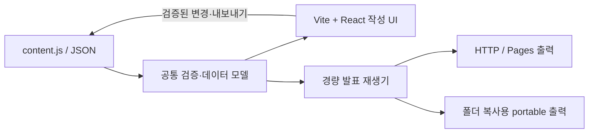

# Vite·React 전환 및 성능 검토 결과

2026-10-27 · 기준 `main` / `a1b621c26d7e124a3c8d33eb288723ac7683c950`

**Vite 기반 React로 전환할 수 있다. 권장 경로는 Vite로 개발·빌드를 정리하고, React는 편집 UI부터 도입하면서 재생기의 실제 작업량을 개선하는 것이다.** React로 바꾸면 자동으로 빨라진다는 근거는 확보하지 않았다. 전면 전환의 주된 이득은 컴포넌트·상태 관리이며, 성능은 같은 기능의 production 구현으로 비교해야 한다.

사용자가 요청한 `git pull`은 완료했다. 원격 4커밋을 fast-forward해 `main`과 `origin/main`을 일치시켰고, 로컬 조사 로그와 원격 작업 기록을 함께 보존했다. 이번 검토는 원격에 추가된 native 시각화·JSON 편집·독립 스타터·타이포 배치까지 포함한다. [pull 보존 근거](evidence/pull-receipt.json)

## 두 팀의 합의

리서치팀과 엔지니어링팀을 각각 실제 매니저 1명·실무자 2명으로 순차 운영했다. 두 실무자는 각자 초안을 작성하고 상대 결과를 직접 검토했으며, 양 팀 매니저가 최신 기준과 미확인 항목을 직접 인계했다.

| 선택 | 얻는 것 | 판단 |
| --- | --- | --- |
| Vite 도입 | 모듈화, 개발 서버/HMR, production minify·자산/entry 관리 | 도입할 가치가 있다. 개발 피드백 속도와 청중 재생 성능은 구분한다. |
| React 점진 도입 | 시각자료 편집의 초안·오류·적용·취소 등 UI 상태 관리 | 독립 작성 영역부터 적용하는 경로를 권고한다. 현재 textarea 하나만으로 React가 필수인 것은 아니다. |
| React 전면 전환 | 재생·작성·발표자를 컴포넌트/상태 모델로 통합 | 기술적으로 가능하다. 20양식·inline 편집·저장·발표자·미디어 회귀가 커서 성능만을 이유로 우선 선택할 근거는 부족하다. |
| 재생 작업량 개선 | 미디어 준비, 치수 측정, 발표자 및 JSON 적용의 갱신 범위 축소 | 프레임워크와 별도로 검증할 성능 후보다. 절감률은 아직 측정하지 않았다. |

Vite는 React 없이도 사용할 수 있고 정적 호스팅용 산출물을 만든다. React 공식 문서도 기존 페이지의 일부에 도입하는 방식을 지원한다. 현재 모델·시각화 엔진을 유지하고 독립 편집 컨테이너를 React가 소유하도록 설계할 수 있다. [Vite production build](https://vite.dev/guide/build), [React 부분 도입](https://react.dev/learn/add-react-to-an-existing-project), [React DOM 소유권](https://react.dev/reference/react-dom/client/createRoot)

## 현재 코드에서 확인한 성능 후보

현재는 HTML shell 위에서 공통 JavaScript 렌더러가 동작하는 웹 앱이다. 일반 장 이동은 기존 DOM을 재사용한다. “매번 전체 발표를 다시 그리므로 React가 해결한다”는 설명은 현행과 맞지 않는다.

1. **초기 미디어 준비 범위:** 루트의 텍스트 표지에서도 숨긴 장에 있는 이미지 13개 URL이 요청됐다. 해당 로컬 원본 파일 합계는 2,108,987B다. 현재/인접 장을 먼저 준비하고 먼 장의 요청을 늦추는 정책과 이미지 크기·압축을 비교할 가치가 있다. 이 파일 합계는 실제 네트워크 전송량이 아니다.
2. **텍스트 치수 측정:** `fitTextLayouts()`가 class/style 변경과 치수 읽기를 섞고 여러 경로에서 예약된다. 같은 frame의 호출 병합과 읽기/쓰기 분리를 프로파일링한다. 실제 forced layout 시간은 아직 미측정이다.
3. **발표자 갱신 범위:** 관객의 장 이동도 발표자에서는 full deck 전송·clone·검증·전체 stage 생성과 current/next 미리보기 생성으로 이어진다. 내용 변경과 장 이동을 구분하면 갱신 범위를 줄일 수 있다. 이번 브라우저 기준 측정은 발표자 연결을 포함하지 않았다.
4. **JSON 적용과 전역 순회:** 한 장의 JSON 적용도 전체 검증·저장·렌더를 거친다. 일반 이동은 모든 장/필드 상태를 순회한다. 원본·표·그림·저장·동기화의 일관성을 유지하면서 국소화할 수 있는지 검증한다.

위 순서는 조사할 순서이며 실측한 비용 순위가 아니다. 미디어 준비나 layout 작업을 개선한 효과를 React 자체의 효과로 합산하지 않는다. [엔지니어링 성능 감사](engineering/performance-audit.md), [브라우저 이미지 지연 로딩](https://web.dev/articles/browser-level-image-lazy-loading), [layout 비용과 읽기/쓰기 순서](https://web.dev/articles/avoid-large-complex-layouts-and-layout-thrashing)

## 실행한 검증

| 검증 | 결과와 한계 |
| --- | --- |
| 최신 코드 회귀 | 기존 테스트 **185/185 통과**. [근거](evidence/tests.json) |
| 실제 브라우저 기준 | 루트20·DevDay7·visual12·text8장 덱을 각각 3회 로드하고, 실제 키보드 43회로 끝 장까지 이동했다. [요약](evidence/baseline-summary.json) |
| 문서 FCP | 중앙값 84/136/64/88ms. localhost·1440×1000·CPU/네트워크 제한 없음의 소표본이며 toolbar도 FCP에 포함될 수 있다. 첫 장 완료 시간이나 현장 CWV로 해석하지 않는다. |
| 파일 규모 | 루트 HTML + CSS 2개 + JS 4개는 269,472B, 파일별 gzip 추정 합계 62,689B. 오프라인 크기 추정이며 실제 Pages 전송 압축은 미측정이다. [근거](evidence/source-sizes.json) |
| Vite·React 최소 빌드 | 격리된 `/tmp` fixture에서 Vite **8.3.5**, React/React DOM **19.3.1**의 production build를 실행했다. MPA entry/base·외부 content/model/visual 파일과 독립 React 패널을 정적으로 확인했다. [빌드 결과](engineering/evidence/probe-results.json), [로그](engineering/evidence/probe-build-log.txt) |
| 어댑터 계약 | Node VM에서 현재 model·visual 원본과 작은 bridge의 초기화·정상 적용·무효 입력 거절을 확인했다. 실제 `app.js` 통합·브라우저 DOM·file 실행·IME·발표자 회귀는 포함하지 않는다. |

최소 빌드는 패널 구성의 실행 가능한 출발점이다. 전체 STAGE 변환이나 동등 기능의 성능 비교는 아니다. classic script를 public 파일로 유지한 부분은 Vite가 자동 번들하지 않는 경고도 기록했다. 작은 fixture의 bundle 크기나 빌드 시간을 제품의 개선율로 사용하지 않는다.

text-layout에서 관찰된 단일 249.7ms 동기 키 이벤트는 추가 16회에서 최대 8.2ms로 재현되지 않았다. 원시값을 보존했고 원인·INP·기술 간 성능 우열을 확정하지 않았다. [이상값 확인](evidence/keyboard-outlier-check.json)

## 권장 구조와 다음 구현 범위

작성자는 계속 `content.js` 한 파일을 바꿔 재사용할 수 있게 하고, 개발자용 도구 체인은 Vite로 정리한다. React는 별도 DOM 영역에서 편집 초안·검증·적용/취소를 담당하며 재생기는 공통 모델과 명시적 명령/이벤트로 연결한다. 향후 속성 패널·undo·다중 문서가 커지면 작성 UI의 React 범위를 넓힌다.

현재 `file://` 더블클릭·폴더 복사와 기본 Vite ESM 출력은 실행 조건이 다르다. 상대 `base`만으로 file 호환이 보장되지는 않는다. HTTP/Pages 출력과 portable 출력을 별도로 검증하면 Vite·React 도입과 기존 재사용 방식을 함께 설계할 수 있다. `content.js`를 bundle에 고정하면 교체 후 재빌드가 필요하므로 외부 데이터 계약도 함께 유지한다. [Vite file protocol 안내](https://vite.dev/guide/troubleshooting#built-file-does-not-work-because-of-cors-error)

다음 구현에서는 현재/인접 장 미디어 준비·fit 호출 병합·발표자 갱신 분리를 개별 비교하고, 같은 입력·DOM/미디어 정책의 Vite+vanilla와 React 작성 UI를 production으로 비교한다. 기존 deep link·Pages base·저장 서명/경로·내보내기·한글 IME·발표자 동기화·모바일을 인수 조건으로 둔다. PDF는 현재 사용 우선순위에 따라 필수 게이트에서 제외한다. [전환 설계](engineering/migration-design.md)

현재 확보한 결과는 최신 코드 조사·현행 브라우저 기준·기존 회귀·최소 격리 빌드다. 실제 제품 전환, portable 빌드의 동등성, 제한된 장치/네트워크에서의 개선율은 후속 구현·비교 항목으로 남는다. [리서치 종합](research/synthesis.md), [엔지니어링 종합](engineering/synthesis.md), [매니저 검수](engineering/manager-review.md)

두 팀의 매니저와 실무자 4명 모두 완료·편집 종료했다. 총괄은 보고 해시·실제 빌드 파일 10개의 크기/해시·제품 원본 일치·문서 링크·JSON·로그 보존을 별도로 검증했다. [총괄 검증 기록](evidence/integration-receipt.json)
