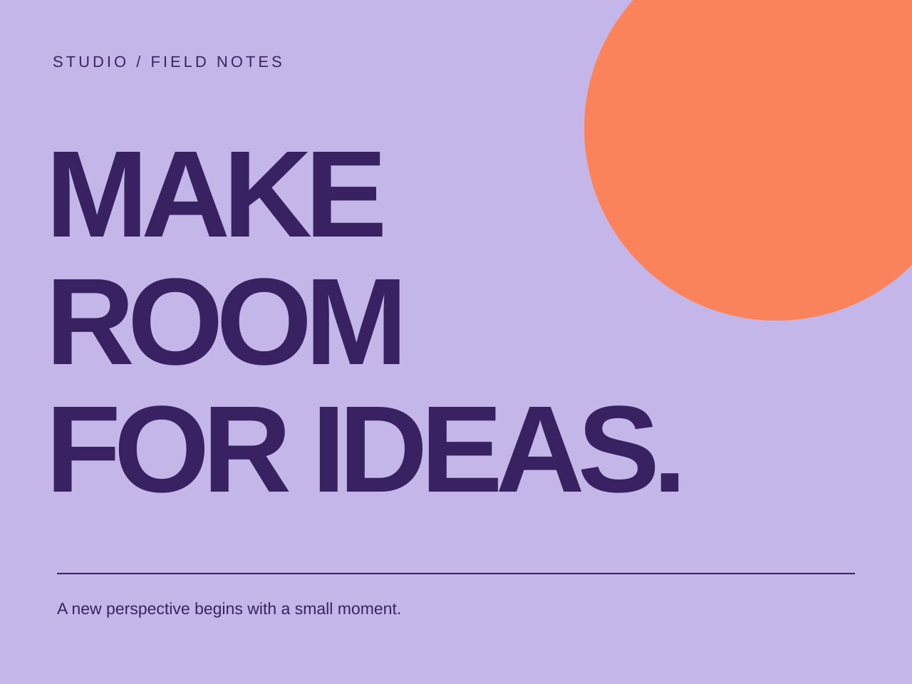
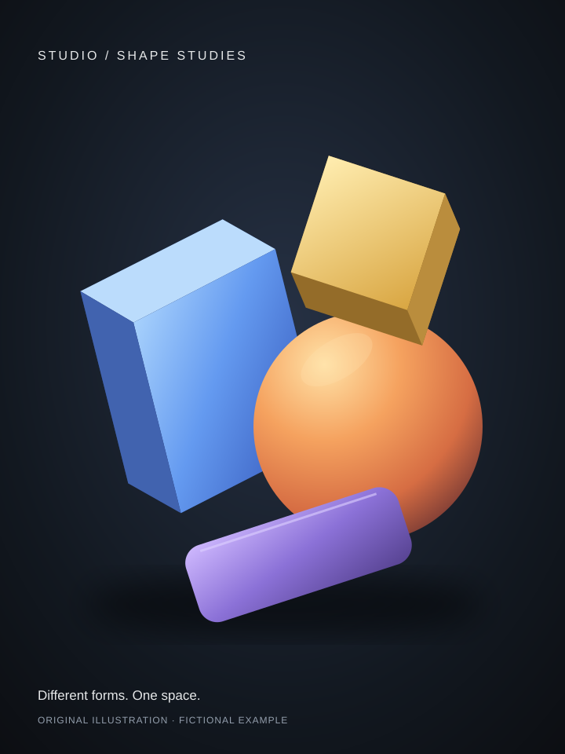

<!-- stage-slide
tone: purple
-->
# 작은 전시를, **함께 엽니다.**

작품과 질문을 놓아 보는 가상의 동네 전시 준비 이야기입니다.

사진은 스톡 이미지이며 실제 참여자나 행사 기록이 아닙니다.

---

<!-- stage-slide
fit: cover
focus: '45% 43%'
-->
# 작품보다 먼저, 만날 장면을 생각합니다.

- 들어오면 무엇부터 보게 될까요?
- 작품 옆에는 어떤 질문이 있을까요?
- 돌아갈 때 무엇을 남길 수 있을까요?

---

# 보여 줄 약속을, 한 장에.

---

> 완성한 작품만큼,
> 시작할 질문도 잘 보이게.

가상 전시의 준비 원칙

---

<!-- stage-slide
compose: bento
variant: seoul
-->

<!-- stage-group
tone: blue
icon: image
-->
## 놓아 볼 작품

**12** 점

가상 전시 계획

<!-- stage-group
fit: cover
focus: '45% 43%'
-->
## 준비의 기록

<!-- stage-group
tone: orange
icon: brain
-->
## 함께 던질 질문

**3** 개

관람을 여는 단서

<!-- stage-group
primary: true
fit: contain
-->
## 작은 전시의 표지

<!-- stage-group
tone: purple
icon: voice
-->
## 첫 질문

> 어떤 장면이 남았나요?

<!-- stage-group
fit: contain
-->
## 형태의 단서

<!-- stage-group
tone: green
icon: record
-->
## 세 가지 관점

- 장면
- 질문
- 다음 행동

<!-- stage-group
icon: select
-->
## 첫 안내

작품 하나를 먼저 골라 보세요.

<!-- stage-group
fit: contain
-->
## 함께 읽을 안내

<!-- stage-group
tone: purple
icon: calendar
-->
## 함께 읽는 시간

**2** 회

가상 운영 계획

<!-- stage-group
icon: share
-->
## 관람의 흐름

1. 들어오기
2. 살펴보기
3. 남기기

<!-- stage-group
icon: check
-->
## 문을 열기 전에

- 표지 놓기
- 동선 걷기
- 질문 읽기

---

# 계획은, 걸어 보며 다시 읽습니다.

1. 입구의 한 문장이 다음 행동을 알려 주는지 봅니다.
2. 작품 옆 질문과 기록할 자리를 함께 확인합니다.
3. [검토 체크리스트](../product-notes/checklist.txt)로 관찰과 해석을 나눕니다.

앞장의12점·3개 질문·2회는 가상 계획이며 서로 다른 작업 단위입니다. 측정한 실적이나 전환율이 아닙니다.

---

<!-- stage-slide
compose: icon-wall
icons: [folder, {icon: image, tone: purple}, {icon: record, tone: blue}, {icon: voice, tone: orange}, brain, search, select, check, calendar, share, mail, globe]
-->
# 함께 여는 전시.

- 모으기
- 고르기
- 기록하기
- 듣기
- 묻기
- 살피기
- 안내하기
- 점검하기
- 약속하기
- 공유하기
- 연락하기
- 이어가기

---

<!-- stage-slide
compose: icon-wall
-->
# 보고, 묻고, 남기는 표식.

이 키트에서 새로 그린 안내용 SVG입니다. 실제 브랜드 로고가 아닙니다.

-  보기
-  묻기
-  남기기

---

<!-- stage-slide
compose: closing
tone: purple
-->
# 다음 만남은, **관람자의 질문에서.**

[사진 에세이](../photo-essay/slides.md#6)로 돌아가 아직 모르는 질문 하나를 남겨 보세요.

사진·자체 제작 자료의 [크레딧과 원본](https://github.com/OU9999/stage-presentation-kit/blob/main/assets/CREDITS.md)을 함께 보관합니다.
