# 원본 그림과 상세 자료

본편은 쉬운 설명과 핵심 도식 9개로 구성한 26장입니다. 원래 사용하던 17개 발표 도식과 2개 학습서 도식을 아래에 모두 남겼습니다. 자세한 구조와 예는 질문에 따라 골라 읽으세요.

현재 본편의 10·20장은 별도 개선 그림을 사용하며, 아래 19개 원본은 그대로 보존합니다. 작은 화면에서는 [도식의 대상과 관계](./diagram-reading.md)를 문장으로 읽고 개선 그림과 원본을 각각 열 수 있습니다.

## 수정 전 원문 그대로 읽기

- [48장 슬라이드 원고 · Markdown 텍스트](../assets/archive/48-slide-original/slides.md.txt)
- [48장 발표 대본 · Markdown 텍스트](../assets/archive/48-slide-original/speaker-script.md.txt)
- [기존 시간표](../assets/archive/48-slide-original/speaker-guide.txt)
- [기존 발표 소개](../assets/archive/48-slide-original/README.md.txt)

위 파일은 간소화 직전의 원문 그대로입니다. 당시 장 번호와 상대 경로도 원본대로 남아 있습니다. 지금 발표의 장 링크로 사용하려면 아래 그림이나 현재 학습 자료를 이용하세요.

## 사례와 직접 읽는 자료

[예제 팩](../assets/expanded-study.txt) · [자료 읽는 방법](./workshop.md) · [15분 활동 진행안](./session-plan.md) · [원문과 근거](./reference-library.md) · [고정 교정 기록](./demo-log.md)

스터디 파일·새 조건은 설명용 구성 예입니다. 실제 실행 성과와 구별해서 읽습니다.

## 전체 그림

### 1. 자료에서 다시 읽을 지식으로

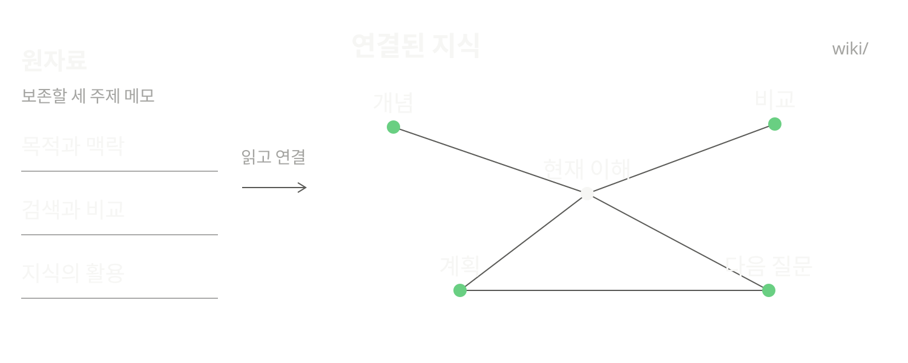

### 2. 질문할 때 근거를 모읍니다

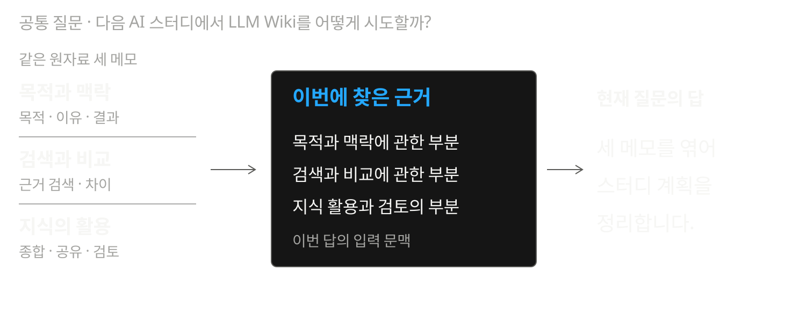

### 3. 연결된 설명을 먼저 써 둡니다

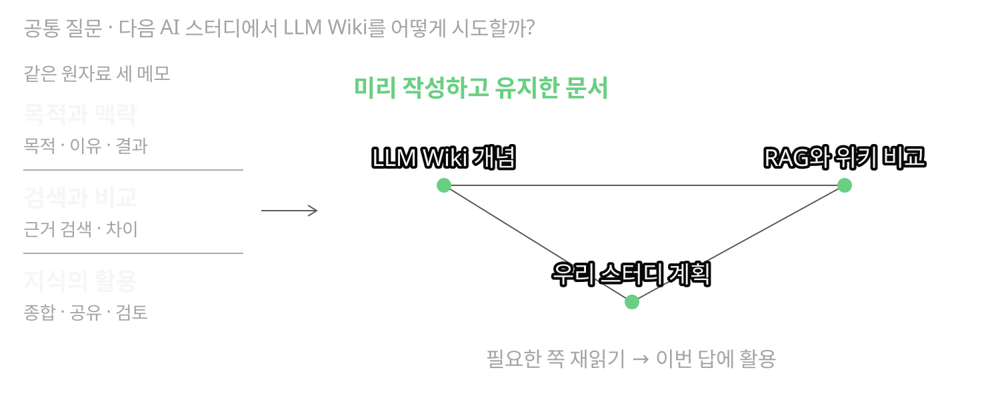

### 4. 검색 판단을 맡기는 에이전틱 RAG

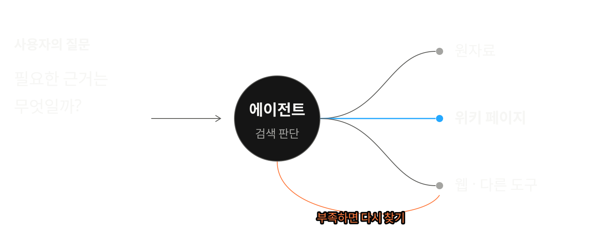

### 5. 원자료 · 위키 · 작업 규칙

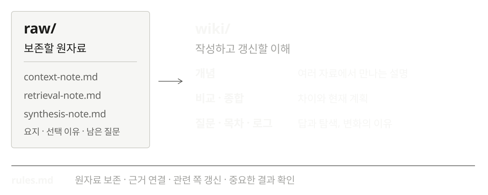

### 6. 왜 골랐고, 어디에 쓸까요?


### 7. 인제스트는 관계를 남깁니다

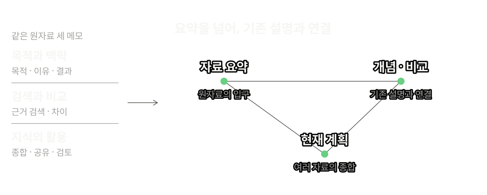

### 8. 자료 요약과 개념의 역할

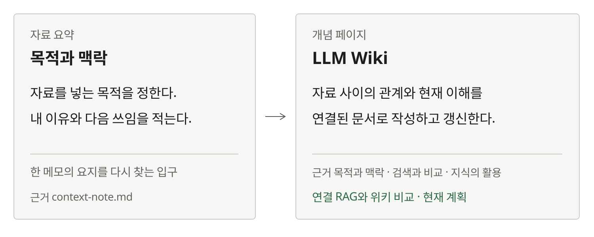

### 9. 비교에서 현재 계획으로

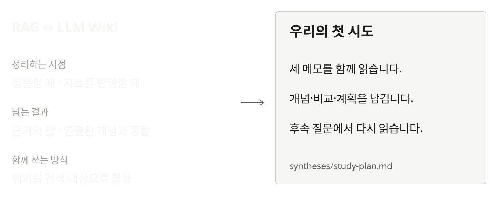

### 10. 그래프는 연결, 규칙은 기준

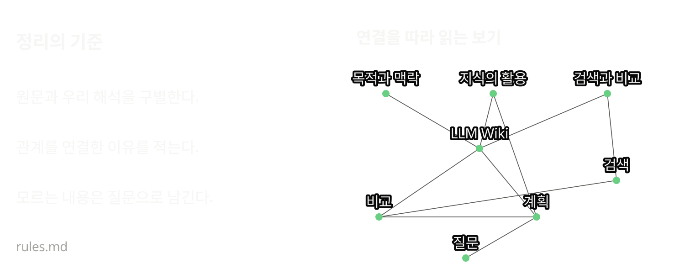

### 11. 관련 설명도 함께 갱신합니다


### 12. 필요한 페이지를 실제로 읽습니다

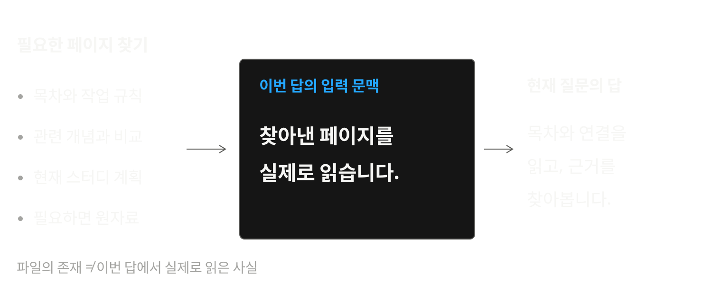

### 13. 답을 다음 탐색의 입구로

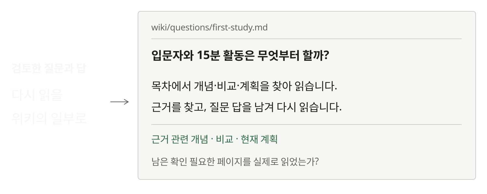

### 14. 같은 위키를 함께 읽습니다


### 15. 맥락 · 요청 · 논의 · 결과

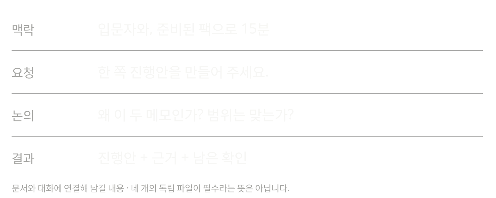

### 16. 지식으로 만든 한 쪽 진행안

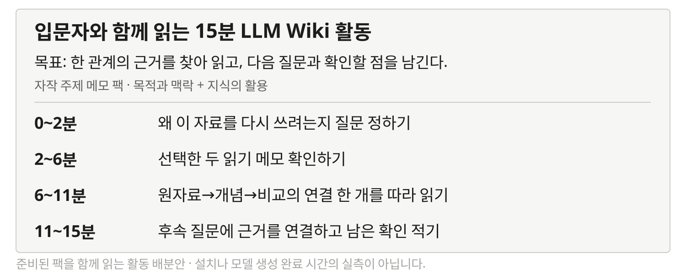

### 17. 검토 결과와 이유도 남깁니다


### 18. 개인 기록을 연결하는 다섯 겹

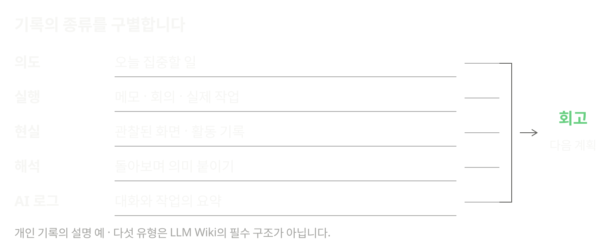

### 19. 기록과 회고를 다시 읽기

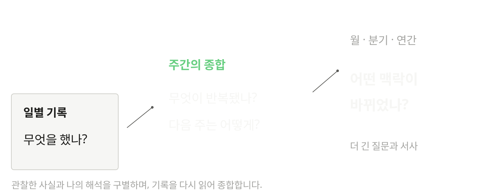
