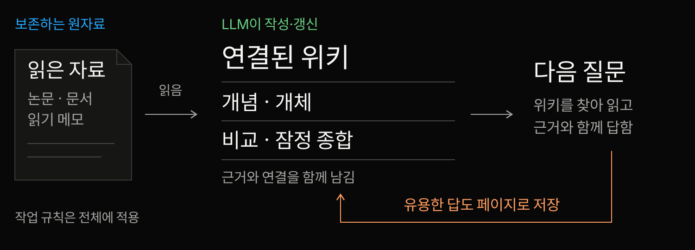
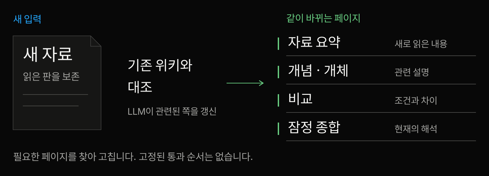
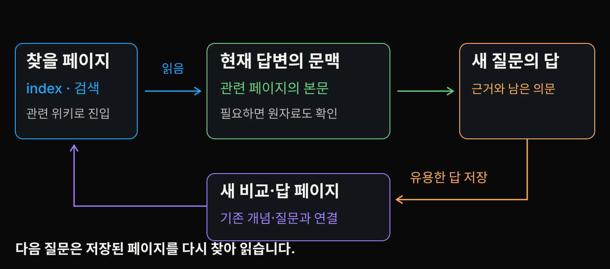
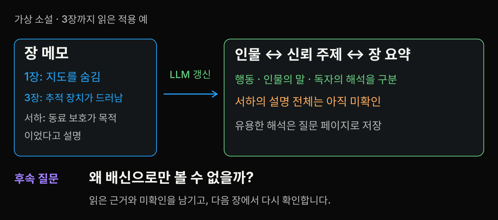
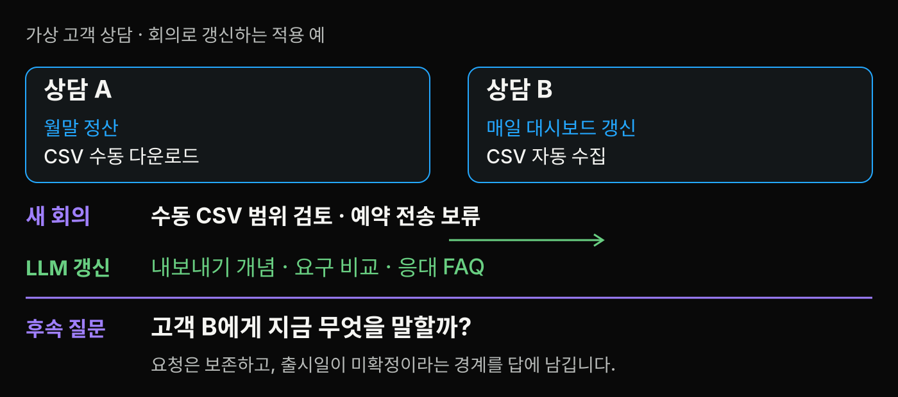
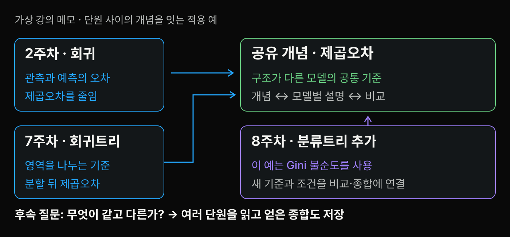

<!-- stage-slide
compose: media
tone: blue
fit: cover
focus: '50% 75%'
-->
# 읽은 자료의 관계를 다음 질문에도 쓸 수 있을까


자료를 함께 읽으며 얻은 **개념과 비교**를 남겨 봅시다.

---

<!-- stage-slide
compose: quote
tone: blue
-->
# LLM이 쓰고 계속 갱신하는 지식 위키

> LLM이 원자료 사이의 개념·비교·연결을 Markdown 위키로 작성하고 계속 갱신해, 다음 질문이 이전 정리에서 출발하도록 하는 지식관리 방식입니다.

**개념 · 비교 · 종합**이 연결된 채 남습니다.

Karpathy의 설계 아이디어를 발표팀이 풀어 쓴 정의 · [고정 원문](https://gist.github.com/karpathy/442a6bf555914893e9891c11519de94f/ac46de1ad27f92b28ac95459c782c07f6b8c964a)

---

<!-- stage-slide
compose: editorial
tone: orange
-->
# 같은 자료를 매번 다시 엮고 있다면

<!-- stage-group
tone: orange
-->
## 이번 질문

자료 다섯 개를 읽는다.

조건과 차이를 비교해 답한다.

<!-- stage-group
tone: purple
-->
## 다음 질문

이전 비교가 정리되어 있지 않으면,

자료의 관계를 다시 찾아 엮는다.

그 **관계와 잠정 종합을 남겨 갱신**하려는 설계입니다.

---

<!-- stage-slide
compose: media
tone: green
fit: contain
-->
# 답만 남기는 대신 개념과 비교를 남긴다



한 자료의 요약을 넘어 **여러 자료를 함께 읽은 결과**를 유지합니다.

[순환 그림 원본](./assets/wiki-maintenance-loop.svg)

---

<!-- stage-slide
compose: bento
tone: blue
-->
# LLM은 위키를 쓰고 사람은 탐색을 이끈다

<!-- stage-group
tone: purple
-->
## LLM 에이전트

파일을 현재 문맥에 읽고 Markdown 작성

요약 · 관련 페이지 갱신

연결 · 답 저장 · 점검

<!-- stage-group
tone: green
-->
## 사람

자료 · 범위 · 질문 선택

분석 방향 · 결과 확인

<!-- stage-group
tone: blue
-->
## 읽는 도구

페이지와 링크 탐색

Obsidian 등에서 읽기

---

<!-- stage-slide
compose: media
tone: blue
fit: contain
-->
# 원자료와 위키 그리고 작업 규칙


**원자료는 보존 · 위키는 갱신 · 규칙은 전체 작업에 적용**

[구조 그림 원본](./assets/wiki-layers.svg) · [Architecture](https://gist.github.com/karpathy/442a6bf555914893e9891c11519de94f/ac46de1ad27f92b28ac95459c782c07f6b8c964a#architecture)

---

<!-- stage-slide
compose: media
tone: green
fit: contain
-->
# 새 자료 한 개가 여러 설명을 바꾼다



**Ingest:** 새 요약과 함께 기존 개념·비교·종합을 갱신합니다.

[갱신 그림 원본](./assets/wiki-ingest-update.svg)

---

<!-- stage-slide
compose: media
tone: purple
fit: contain
-->
# 다음 질문은 저장된 위키를 찾아 읽는다



**Query:** 관련 파일을 현재 문맥에 읽어 답하고, 유용한 답을 다시 저장합니다.

파일 갱신과 모델 가중치 학습은 별개의 작업입니다.

[질문과 저장 그림 원본](./assets/wiki-query-return.svg)

---

<!-- stage-slide
compose: bento
tone: yellow
-->
# 낡은 설명과 빠진 연결을 점검한다

<!-- stage-group
tone: orange
-->
## 낡은 설명 · lint

새 자료가 들어왔는데

옛 상태만 남아 있나?

<!-- stage-group
tone: purple
-->
## 다른 조건

두 설명이 충돌하나?

서로 다른 범위인가?

<!-- stage-group
tone: green
-->
## 빠진 연결

중요한 개념이 빠졌나?

다시 찾아갈 길이 있나?

---

<!-- stage-slide
compose: media
tone: purple
fit: contain
-->
# 소설을 읽으며 인물과 주제를 쌓는다



가상 자료로 만든 적용 예 · 소설 독서

1장: **서하는 지도를 숨기고 북문을 떠났다.** 동기는 아직 모릅니다.

[독서 파일 읽기](./materials/study-guide.md#소설-독서) · [입력과 전후 파일](./assets/examples/reading.txt)

---

<!-- stage-slide
compose: editorial
tone: purple
-->
# 새 장은 인물의 동기 해석을 바꾼다

가상 소설 · `characters/seoha.md` 구성 파일 발췌

<!-- stage-group
tone: blue
-->
## 1장까지

> 서하의 의도는 아직 확인하지 못했다.

<!-- stage-group
tone: purple
-->
## 3장까지

> 서하는 동료를 피신시키려 했다고 설명한다.

> 미확인: 서하의 설명 전체와 이후 선택

인물 · 신뢰 주제 · 3장 요약을 함께 갱신합니다.

---

<!-- stage-slide
compose: quote
tone: purple
-->
# 다음 질문은 관계와 남은 의문을 다시 쓴다

> 서하의 선택을 왜 배신으로만 볼 수 없을까?

가상 소설 · 저장할 질문 페이지

도윤의 판단과 서하의 자기 설명을 구별해 답하고, **인물·신뢰 페이지에 연결해 저장**합니다.

**다음 질문:** 서하의 이후 행동은 이 설명과 일치할까?

[질문 답의 구성 파일](./assets/examples/reading.txt)

---

<!-- stage-slide
compose: bento
tone: neutral
-->
# 같은 CSV 요청으로 묶어도 될까요?

<!-- stage-group
tone: neutral
-->
## 고객 A · 가상 상담

월말 정산에 사용

화면에서 CSV 다운로드

회계 담당자에게 전달

<!-- stage-group
tone: neutral
-->
## 고객 B · 가상 상담

매일 대시보드 갱신

새벽에 CSV 자동 수신

매일 새 자료를 수집

---

<!-- stage-slide
compose: media
tone: green
fit: contain
-->
# 새 회의가 요구 비교와 현재 상태를 바꾼다



가상 고객 요구 · 상담 두 건과 새 회의

같은 CSV여도 목적과 자동화 범위가 다릅니다. **요구는 보존하고 상태를 갱신**합니다.

[고객 요구 파일 읽기](./materials/study-guide.md#고객-요구) · [입력과 전후 파일](./assets/examples/team.txt)

---

<!-- stage-slide
compose: quote
tone: green
-->
# 고객에게 답할 때 이전 구분을 다시 쓴다

> 예약 전송은 운영 비용 검토가 남아 보류 중이며 출시일은 확정하지 않았다.

가상 응대 초안 · `questions/what-to-tell-b.md`

**질문:** 고객 B에게 지금 무엇을 말할까?

내보내기 개념·요구 비교·회의 근거를 읽고 답을 저장합니다.

다음에 확인할 것: 일별 수동 다운로드로도 업무를 해결할 수 있을까?

---

<!-- stage-slide
compose: media
tone: blue
fit: contain
-->
# 떨어진 강의에서 같은 개념을 만난다



가상 자료로 만든 적용 예 · 강의 메모

2주차 회귀와 7주차 회귀트리에서 **제곱오차**를 다시 만납니다.

[강의 메모 파일 읽기](./materials/study-guide.md#강의-메모) · [입력과 전후 파일](./assets/examples/course.txt)

---

<!-- stage-slide
compose: document
tone: blue
-->
# 새 강의는 비교할 기준을 늘린다

가상 강의 · 기존 비교에 8주차를 추가

| 읽은 메모 | 모델 | 이 예의 기준 |
| --- | --- | --- |
| 2주차 | 회귀 | 제곱오차 |
| 7주차 | 회귀트리 | 제곱오차 |
| **새 8주차** | **분류트리** | **Gini 불순도** |

새 개념과 근거를 더하고, **비교·관련 질문도 함께 갱신**합니다.

---

<!-- stage-slide
compose: quote
tone: blue
-->
# 질문에서 얻은 종합도 다음 학습에 남긴다

> 구조가 다른 모델이 같은 기준을 쓸 수 있고, 같은 트리 계열에서도 과제에 따라 기준이 다를 수 있다.

가상 강의 · `synthesis/error-and-trees.md` 구성 파일 발췌

이 세 메모의 근거를 함께 연결해 저장합니다.

**다음 질문:** 분할 기준을 바꾸면 무엇을 새로 확인해야 할까?

---

<!-- stage-slide
compose: document
tone: orange
-->
# 입력은 달라도 남기는 구조는 같다

가상 적용 예 세 가지 비교

| 입력 | 유지할 위키 | 다음 질문에서 재사용 |
| --- | --- | --- |
| 소설의 장 메모 | 인물 · 주제 · 해석 | 행동을 어떻게 해석할까? |
| 고객 상담과 회의 | 요구 · 비교 · 응대 답 | 무엇을 말하고 확인할까? |
| 여러 주차의 강의 | 개념 · 비교 · 종합 | 무엇이 같고 다른가? |

**새 입력 → 여러 페이지 갱신 → 다음 질문 → 유용한 답 저장**

[세 가지 적용 예 자세히 읽기](./materials/study-guide.md#세-가지-적용-예)

---

<!-- stage-slide
compose: editorial
tone: blue
-->
# 위키도 필요한 페이지를 찾아야 한다

<!-- stage-group
tone: blue
-->
## index · 읽을 입구

질문과 관련된 쪽을 찾습니다.

필요한 페이지의 본문을 읽습니다.

<!-- stage-group
tone: purple
-->
## 검색 · 필요한 근거로

위키와 원자료를 함께 찾을 수 있습니다.

새 범위나 세부 사항은 원자료로 돌아갑니다.

파일이 있다는 것과 **이번 답이 읽었다는 것**을 구별합니다.

---

<!-- stage-slide
compose: bento
tone: orange
-->
# 저장된 설명에도 오류와 누락은 남는다

<!-- stage-group
tone: purple
-->
## 독서의 해석

인물의 자기 설명을

확정 동기로 바꾸지 않기

<!-- stage-group
tone: green
-->
## 고객의 요구

접수된 요청을

출시 약속으로 바꾸지 않기

<!-- stage-group
tone: blue
-->
## 강의의 기준

한 예의 기준을

모든 모델로 넓히지 않기

---

<!-- stage-slide
compose: editorial
tone: orange
-->
# 다시 쓸 가치와 유지 부담을 같이 본다

<!-- stage-group
tone: green
-->
## 다시 쓸 가치

반복해서 비교할 질문

계속 추가되는 자료

함께 읽을 개념과 설명

<!-- stage-group
tone: orange
-->
## 계속 드는 일

자료 반영과 기존 페이지 갱신

근거·중복·낡은 설명 검토

필요한 파일을 찾는 경로 점검

자기 질문에서 **재사용 가치와 유지 부담**을 확인합니다.

---

<!-- stage-slide
compose: media
tone: green
fit: contain
-->
# 읽기·질문·점검이 같은 위키로 돌아온다


**읽고 엮기 · 답하고 남기기 · 점검해 다시 읽기**

[순환 그림 원본](./assets/wiki-maintenance-loop.svg)

---

<!-- stage-slide
compose: quote
tone: yellow
-->
# 내 자료에서 다시 답할 질문 한 줄

> 내 질문 [한 줄]

**20초 동안 자기 노트에 쓰기 · 공유는 선택**

자료 제목 [기억나는 만큼] → 근거 위치 [다음에 확인]

예: 지난 상담과 새 회의를 함께 보면 고객에게 무엇을 말할 수 있을까?

---

<!-- stage-slide
compose: document
tone: purple
-->
# 기존 설명을 함께 갱신해 달라고 부탁한다

파일을 읽고 쓸 수 있는 LLM 에이전트에 보내는 시작 요청

```text
새 자료를 읽고 기존 개념·비교·종합을 함께 갱신해 줘.
근거와 조건 차이, 충돌·미확인을 구별해 줘.
주요 변경과 그 이유를 보여 줘.
유용한 질문의 답도 관련 페이지에 연결해 저장해 줘.
```

자료 위치와 작업 규칙을 함께 알려 줍니다.

---

<!-- stage-slide
compose: gallery
tone: orange
variant: strip
fit: cover
focus: ['50% 75%', '44% 54%', '50% 72%']
-->
# 다음 질문에서 실제로 다시 읽어 본다


작게 시작할 예: 자료 몇 개 · 질문 하나 · 결과를 확인할 사람.

---

<!-- stage-slide
compose: bento
tone: blue
-->
# 개념·예제·실습을 따로 이어 읽는다

<!-- stage-group
tone: blue
-->
## 개념 이해

[학습서](./materials/study-guide.md)

[원문과 근거 안내](./materials/reference-library.md)

<!-- stage-group
tone: green
-->
## 내 자료로 작성

[세 가지 적용 예](./materials/study-guide.md#세-가지-적용-예)

[실습과 해설](./materials/workshop.md)

<!-- stage-group
tone: orange
-->
## 파일 교정 재현

[실제 실행 범위](./materials/demo-log.md)

[고정 데모 ZIP](./demo/llm-wiki-demo.zip)

[전체 자료 목차와 40장 대본](./materials/index.md)

---

<!-- stage-slide
compose: message
tone: green
-->
# 다음 질문이 이전 정리에서 출발하도록

**LLM이 작성하고 갱신하는 위키.**

개념과 비교와 종합을 남기고,

다음 질문에서 다시 찾아 읽습니다.

[질문과 적용 이야기](#40)

---

<!-- stage-slide
compose: editorial
tone: blue
-->
# 공개 구현은 등록과 LLM 작성을 나눈다

공개 코드 관찰 · `microsoft/llmwiki` 고정 판

<!-- stage-group
tone: blue
-->
## 기계 등록 · ingestSource

자료의 미리보기 페이지

index · log 갱신

<!-- stage-group
tone: purple
-->
## LLM 내용 작성 · llmIngest

자료 텍스트와 index를 모델에 전달

요약 · 개체 · 개념 · 연결 작성

설치·실행 결과가 아닌 코드 관찰입니다. [고정 코드](https://github.com/microsoft/llmwiki/tree/e09126f257c1fcf8e63234382748a51cf6a5df7f)

---

<!-- stage-slide
compose: editorial
tone: purple
-->
# 문서의 기능 설명도 코드와 대조한다

공개 코드 관찰 · 같은 고정 판

<!-- stage-group
tone: purple
-->
## 질문 · handleQuery

키워드 검색의 상위 8쪽

각 앞 3,000자를 답의 문맥에 넣음

<!-- stage-group
tone: orange
-->
## 저장 · handleSave

파일을 쓰지 않고 수동 저장을 안내합니다.

README의 `/save`를 자동 저장 구현으로 읽지 않습니다.

[고정 코드](https://github.com/microsoft/llmwiki/blob/e09126f257c1fcf8e63234382748a51cf6a5df7f/packages/vscode/src/chatParticipant.ts)

---

<!-- stage-slide
compose: message
tone: blue
-->
# 살아 있는 코드라면 판과 해시도 추적한다

공개 구현의 변형 · `llm-code-wiki`

**코드 → 저장소 개요·개념·계약 → 다음 질문**

읽었던 판과 해시를 식별하고 코드가 바뀌면 관련 설명을 재검토합니다.

해시 차이는 **변경 신호**입니다. 의미 오류 판정이나 자동 수정은 아닙니다.

[고정 설계와 검사 코드](https://github.com/dylannalex/llm-code-wiki/tree/422fe1d3ff889295285b2f1a339cdbf789f43e5b)

---

<!-- stage-slide
compose: editorial
tone: green
-->
# 강의 위키를 QA로 비교한 초기 연구도 있다

논문 실험 · Wright, arXiv v1 · 실제 평가의 문맥 조건

<!-- stage-group
tone: green
-->
## Wiki arm

59문항에 같은 고정 section 제공

각 질문의 대상 자료도 포함

문맥 선택 실패 단계 없음

<!-- stage-group
tone: blue
-->
## RAG arm

21벡터 중 5개를 검색

검색된 문맥으로 답함

검색 누락이 생길 수 있음

질문 답의 품질을 비교한 실험입니다. [논문 §6](https://arxiv.org/html/2609.25303v1)

---

<!-- stage-slide
compose: bento
tone: orange
-->
# 문맥 선택의 차이를 위키 전체의 우위로 넓히지 않는다

<!-- stage-group
tone: orange
-->
## 비교 조건 · 논문 실험

고정 문맥 제공과 검색의 차이

표현만의 공정 비교로 해석 불가

<!-- stage-group
tone: purple
-->
## 평가 범위

단일 코퍼스 · 답변 1회

한 LLM judge의 판단

<!-- stage-group
tone: blue
-->
## 확인하지 않은 것

학생 학습성과

운영 비용 · 보편 우위

[실험 조건과 근거 안내](./materials/reference-library.md)

---

<!-- stage-slide
compose: editorial
tone: blue
-->
# 보조 실습은 승인한 교정안을 파일에 반영한다

기존 고정 데모 · 사람이 의미를 검토하고 Node로 반영

<!-- stage-group
tone: orange
-->
## 준비한 입력

학습용 오류가 있는 Q1

원문을 대조한 고정 승인안

<!-- stage-group
tone: blue
-->
## 실제 실행

파일 수정 · diff 생성

링크 · 보존 파일 해시 검사

LLM 호출·자동 검색·새 답 생성은 수행하지 않았습니다.

[실제 파일 읽기](./materials/demo-log.md) · [질문으로 돌아가기](#40)

---

<!-- stage-slide
compose: bento
tone: blue
-->
# 실제 diff는 문장과 적용 범위를 바꾼다

<!-- stage-group
tone: orange
-->
## 삭제 · 모든 시스템

기존 고정 데모 · C1 파일 발췌

> 외부 파일을 쓰는 시스템은\
> 모델을 학습하지 않는다.

<!-- stage-group
tone: green
-->
## 추가 · 이 데모

> 이 데모의 파일 수정은 모델 매개변수 학습을 실행하지 않는다. 외부 파일을 쓰는 시스템에도 별도의 학습 과정이 있을 수 있다.

[RAG v4 §2.4](https://arxiv.org/html/2005.11401v4#S2.SS4) · [LoRA v2 §4.1](https://arxiv.org/html/2106.09685v2#S4.SS1)

---

<!-- stage-slide
compose: media
tone: purple
fit: contain
-->
# 교정한 설명을 다른 질문에도 다시 쓴다


기존 고정 구성 예 · 새 질문 Q2의 판단 입력

**Q2:** 우리 스터디는 어떤 답을 저장할까?

[고정 예제의 재사용 과정](./materials/demo-log.md#6-새-질문-q2가-이전-결과를-다시-쓴다)

---

<!-- stage-slide
compose: media
tone: orange
fit: contain
-->
# 선택이 바뀌면 맥락과 결과를 남긴다


기존 구성 예 · ADR 형식을 응용한 운영 선택

**D1 → D2:** 당시 이유는 보존하고, 새 기준과 검토 부담을 남깁니다.

[Nygard의 결정 기록](https://cognitect.com/blog/2011/11/15/documenting-architecture-decisions) · LLM Wiki의 필수 형식은 아닙니다.

---

<!-- stage-slide
compose: bento
tone: blue
-->
# 파일 검사와 의미 검토는 다른 확인이다

<!-- stage-group
tone: blue
-->
## 교정안 반영

기존 데모의 파일 검사

**8** 쪽

기존 5쪽 갱신 + 신규 3쪽

<!-- stage-group
tone: green
-->
## 로컬 링크

**25** 링크

상대 경로의 연결 확인

<!-- stage-group
tone: orange
-->
## 보존 해시

**10** 파일

읽기 메모 5개 + 초기 5쪽

정확도·검색 누락·시간 절감의 측정값은 아닙니다.

---

<!-- stage-slide
compose: bento
tone: purple
-->
# 원문과 구성 예의 근거를 구분해 읽는다

<!-- stage-group
tone: blue
-->
## 원저자 설계

무엇을 제안했나?

<!-- stage-group
tone: purple
-->
## 공개 코드 관찰

어떤 경로가 구현됐나?

<!-- stage-group
tone: green
-->
## 논문 실험

어떤 조건을 평가했나?

<!-- stage-group
tone: orange
-->
## 구성 적용 예

무엇을 가정해 설명했나?

[원문과 근거 안내](./materials/reference-library.md) · [질문으로 돌아가기](#40)

---

<!-- stage-slide
compose: closing
tone: purple
-->
# 어떤 자료에서 다음 질문을 이어 가고 싶나요

**내 자료 · 반복하는 질문 · 유지할 설명**

[공부 자료 목차](./materials/index.md) · [세 가지 적용 예](./materials/study-guide.md#세-가지-적용-예)

[공개 구현과 실험 더 보기](#29) · [기존 파일 교정 예제](#34)
