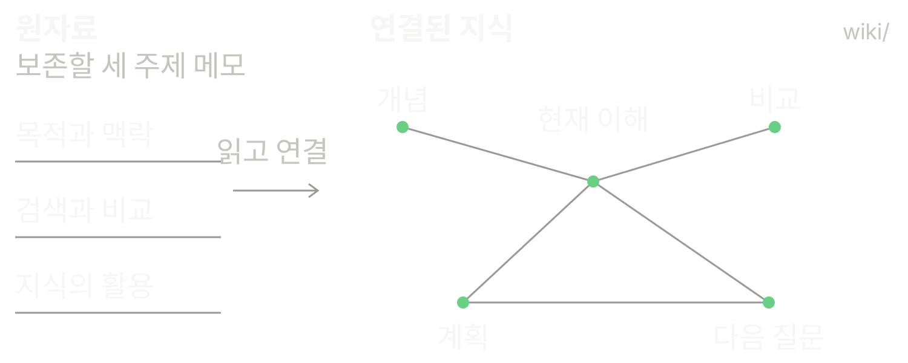
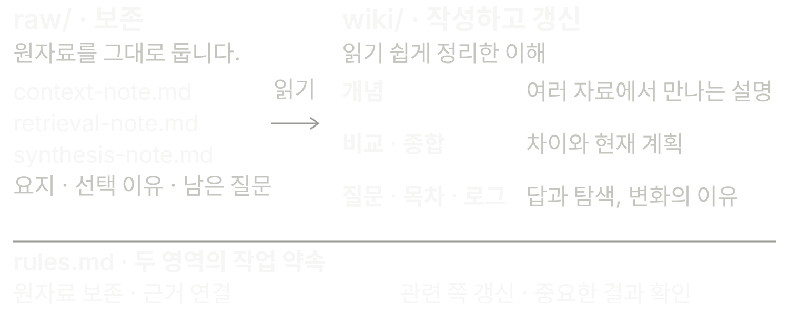
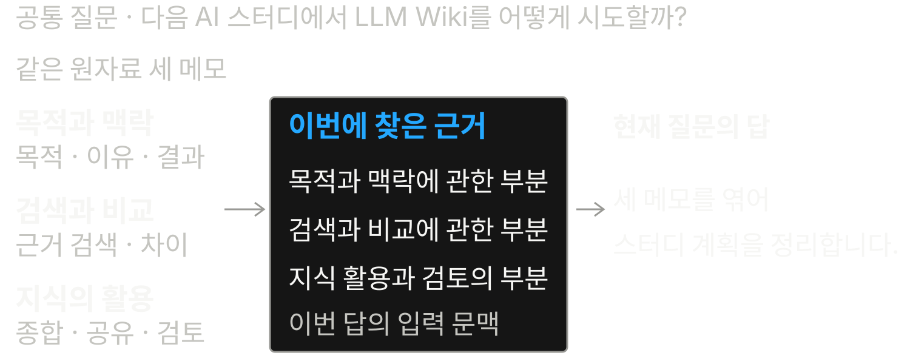
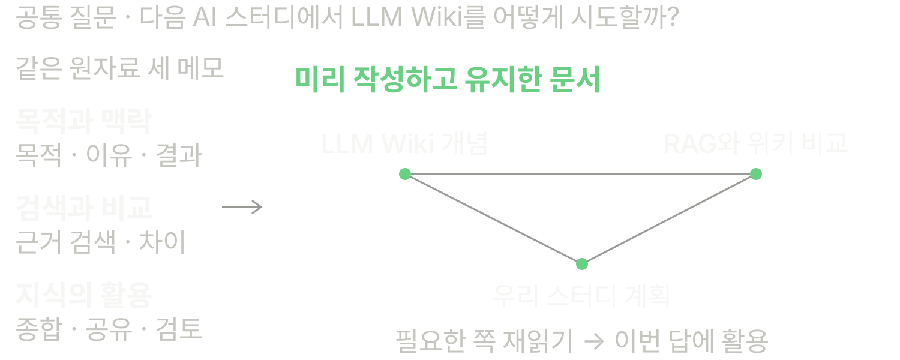
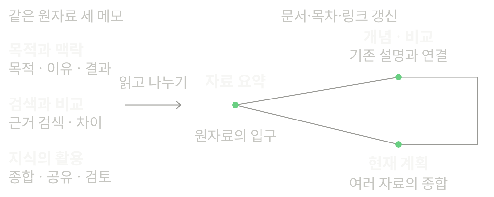
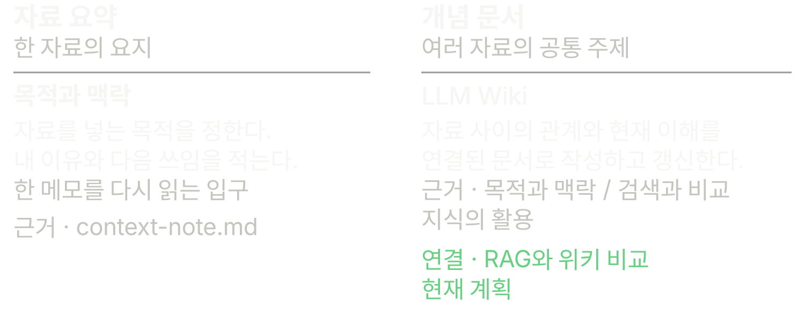
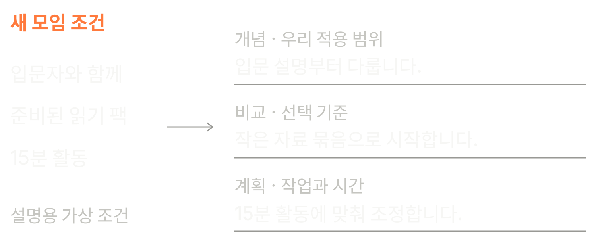
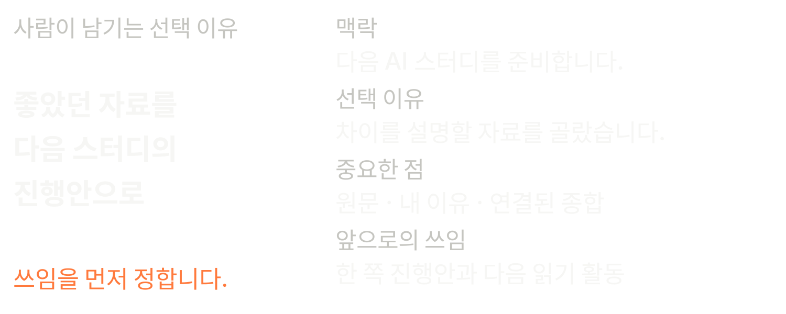
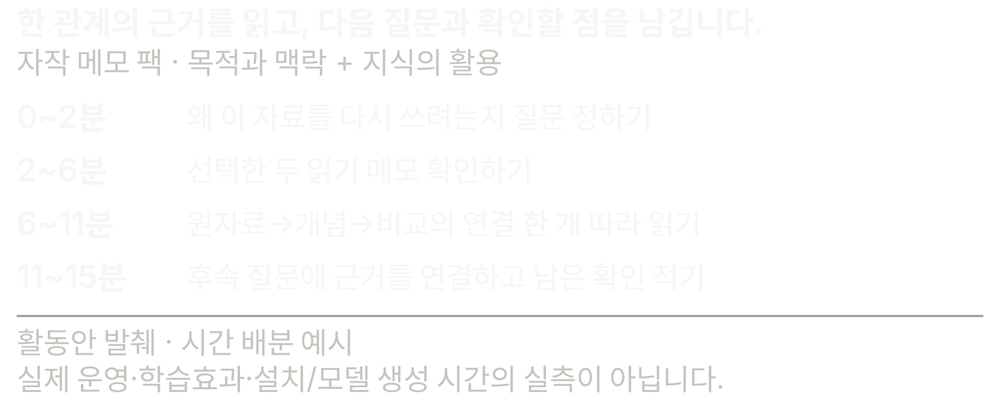

<!-- stage-slide
compose: message
tone: neutral
-->
# LLM Wiki

**내 자료를 AI와 함께 정리하는 방법**

모아 둔 자료를, 다음 질문에 다시 쓰기
---

<!-- stage-slide
compose: quote
tone: neutral
-->
# LLM Wiki는 무엇인가요?

> 내 자료를 AI와 함께 정리하고 연결하는\
> **나만의 마크다운 지식 베이스입니다.**

내가 읽고 고칠 수 있고, AI도 찾아 읽고 갱신합니다.

[Karpathy가 2026년 4월 공개한 설계 아이디어](https://gist.github.com/karpathy/442a6bf555914893e9891c11519de94f)
---

<!-- stage-slide
compose: media
fit: contain
tone: neutral
-->
# 왜 필요한가요?

**“AI가 내 자료를 좀 더 잘 이해해 줬으면.”**

자료를 개념과 관계로 정리해, 다음 질문에 다시 씁니다.

[그림의 관계 읽기](./materials/diagram-reading.md#3장-자료에서-연결된-지식으로)
---

<!-- stage-slide
compose: editorial
variant: centered
tone: neutral
-->
# 개인비서도 내 맥락이 필요합니다

[개인비서형 에이전트 예: OpenClaw](https://docs.openclaw.ai/concepts/memory) · [Hermes](https://github.com/NousResearch/hermes-agent)

## 알아야 할 맥락

내 상황 · 선호 · **이전에 선택한 이유**

## 위키가 돕는 일

흩어진 맥락을 문서로 정리해\
**필요할 때 다시 읽게 합니다.**
---

<!-- stage-slide
compose: media
fit: contain
tone: neutral
-->
# 무엇이 생기나요?

마크다운은 글과 링크를 적는 텍스트 파일입니다.

[그림의 관계 읽기](./materials/diagram-reading.md#5장-raw-wiki-rules의-역할)
---

<!-- stage-slide
compose: editorial
variant: centered
tone: neutral
-->
# 사람과 AI가 함께 편집합니다

사람도 같은 마크다운 문서를 읽고 고칠 수 있습니다.

## 사람

**목적을 정하고, 내 생각과 판단을 직접 적습니다.**

## AI

**자료를 읽고, 문서를 쓰고,**\
**연결과 목차를 갱신합니다.**
---

<!-- stage-slide
compose: document
tone: neutral
-->
# RAG와 무엇이 다른가요?

| 살펴볼 점 | RAG 구성 | 작은 LLM Wiki |
| --- | --- | --- |
| 중심 작업 | 자료를 검색해 답하기 | 문서를 정리하고 연결하기 |
| 준비할 것 | 검색 방법·색인 등 설계 | 파일·목차·링크부터 시작 |
| 질문할 때 | 찾은 근거를 참고 | 정리한 문서와 원자료를 참고 |
| 유지할 것 | 검색 품질·자료 변경 | 문서 내용·연결·자료 변경 |

**함께 쓸 수 있습니다. 규모가 커지면 위키에도 검색이 필요합니다.**
---

<!-- stage-slide
compose: media
fit: contain
tone: neutral
-->
# RAG는 필요한 근거를 찾아 답합니다

같은 자료에서 **지금 질문에 필요한 부분을 찾아** 답을 만듭니다.

[그림의 관계 읽기](./materials/diagram-reading.md#8장-질문에-따라-근거-찾기)
---

<!-- stage-slide
compose: media
fit: contain
tone: neutral
-->
# 위키는 정리해 둔 문서를 읽습니다

자료를 **개념·비교·계획으로 미리 정리**하고, 필요한 쪽을 다시 읽습니다.

[그림의 관계 읽기](./materials/diagram-reading.md#9장-미리-정리한-문서-다시-읽기)
---

<!-- stage-slide
compose: media
fit: contain
tone: neutral
-->
# Ingest는 자료를 소화하고 연결하는 일

자료 읽기 → 내용 나누기 → 문서·목차·링크 갱신하기

[그림의 관계 읽기](./materials/diagram-reading.md#10장-읽고-나누고-연결-갱신하기)
---

<!-- stage-slide
compose: media
fit: contain
tone: neutral
-->
# 요약 하나로 끝나지 않습니다

[그림의 관계 읽기](./materials/diagram-reading.md#11장-자료-요약과-개념-문서)
---

<!-- stage-slide
compose: editorial
variant: centered
tone: neutral
-->
# 나무위키처럼 문서들이 연결됩니다

## 주제별 문서

한 파일에 몰아넣지 않고\
**개념별로 나눕니다.**

## 목차와 링크

관련 개념과 원자료를\
**찾아 읽습니다.**

## 연결된 지식

새 자료가 오면\
**문서와 관계를 보완합니다.**
---

<!-- stage-slide
compose: document
tone: neutral
-->
# 질문하면 이렇게 씁니다

> 다음 AI 스터디에서 LLM Wiki를 어떻게 시도할까?

1. 정리한 **개념과 비교 문서**를 읽습니다.
2. **우리 목적과 조건**에 맞춰 답합니다.
3. 쓸 만한 답은 확인한 뒤 **문서로 남깁니다.**

발표용 스터디 사례입니다.
---

<!-- stage-slide
compose: media
fit: contain
tone: neutral
-->
# 새 자료가 오면 기존 문서도 고칩니다

**입문자와 15분 활동이라는 새 조건**으로 설명·선택 기준·계획을 함께 고칩니다.

[그림의 관계 읽기](./materials/diagram-reading.md#14장-새-조건과-세-문서의-변경)
---

<!-- stage-slide
compose: editorial
variant: centered
tone: neutral
-->
# 다 넣기보다, 다시 쓸 자료부터

## 내 목적에 필요한가

앞으로 만들 결과와\
**관련된 자료인가**

## 왜 골랐는가

가치 있다고 느낀 이유를\
**직접 적을 수 있는가**

## 작게 시작하기

같은 주제의\
**자료 두 개부터 연결합니다.**
---

<!-- stage-slide
compose: media
fit: contain
tone: neutral
-->
# 목적이 있어야 정리 기준이 생깁니다

**왜 골랐는지, 어디에 쓸지**를 적으면 정리할 기준이 생깁니다.

[그림의 관계 읽기](./materials/diagram-reading.md#16장-쓰임에서-선택-기준으로)
---

<!-- stage-slide
compose: quote
tone: neutral
-->
# 내 맥락을 정리하는 일은 어렵습니다

같은 자료라도 내 목적과 경험에 따라 묶는 기준이 달라집니다.

> 왜 골랐고,\
> **어떤 질문을 풀려는가?**

기준부터 적어 다시 쓸 방향을 잡습니다.
목적 없이 모으기만 하면 다시 쓰기 어렵습니다.
---

<!-- stage-slide
compose: quote
tone: neutral
-->
# 사람이 직접 남기는 맥락

> 목적과 내 판단은\
> **내가 적습니다.**

누구를 위해 무엇을 만들지 목적은 직접 정하고,\
감정 · 생각 · 판단 · 선택 이유를 직접 남깁니다.

기록은 구분합니다: 원문 · 내 기록 · AI가 쓴 요약과 해석.
---

<!-- stage-slide
compose: editorial
variant: centered
tone: neutral
-->
# 어디에 쓸 수 있나요?

## 공부

읽은 자료를\
**개념과 질문으로 연결하기**

## 프로젝트

배경과 결정 이유를 **함께 읽기**

## 글과 발표

모아 둔 근거로 **초안 만들기**
---

<!-- stage-slide
compose: media
fit: contain
tone: neutral
-->
# 정리한 지식으로 만든 15분 활동안

[15분 활동안 전체 읽기](./materials/session-plan.md)
---

<!-- stage-slide
compose: editorial
variant: centered
tone: neutral
-->
# 장점은 나도 AI도 읽고 고친다는 것

## 함께 읽기

설명과 근거가\
**마크다운 문서로 남습니다.**

## 함께 고치기

AI의 정리에\
**내 경험과 판단을 보탭니다.**

## 다시 활용하기

정리된 개념과 연결을\
**다음 질문에 씁니다.**
---

<!-- stage-slide
compose: editorial
variant: centered
tone: neutral
-->
# AI가 정리해도 확인은 필요합니다

## 내용

**잘못된 요약과**\
**근거 없는 연결**이\
생길 수 있습니다.

## 변화

새 자료와 예전 설명이\
**충돌할 수 있습니다.**

## 관리

확인하고 고치는 데\
**시간이 듭니다.**
---

<!-- stage-slide
compose: document
tone: neutral
-->
# 이럴 때 작게 시작하세요

| 내 상황 | 먼저 해 볼 일 |
| --- | --- |
| 같은 주제를 자주 다시 물음 | 관련 자료 두 개를 연결해 보기 |
| 내 경험과 판단도 함께 필요함 | 선택 이유와 현재 상황 적기 |
| 자료가 많고 자주 바뀜 | 검색·갱신·검토 비용 비교하기 |
| 한 번만 확인하면 됨 | 간단한 노트와 검색부터 시작하기 |
---

<!-- stage-slide
compose: document
tone: neutral
-->
# 첫 요청은 이 정도면 됩니다

**목적:** AI 스터디에서 LLM Wiki를 설명하고 싶어.

**자료:** 내가 고른 두 자료와 직접 쓴 생각·선택 이유를 읽어 줘.

**정리:** 원문·내 기록·AI 요약을 구분하고 개념과 근거를 연결해 줘.

**확인:** 원자료 링크, 바꾼 파일, 모르는 점을 알려줘.

[예제 팩](./assets/expanded-study.txt) · [자료 읽는 방법](./materials/workshop.md)

[원본 그림·48장 원고 보기](./materials/visual-appendix.md)
---

<!-- stage-slide
compose: closing
tone: neutral
-->
# 다음 질문에 쓸 자료 두 개부터

**목적을 정하고 → 연결하고 → 확인하고 → 다시 씁니다.**

내 자료를, 나와 AI가 함께 읽는 지식으로.
---

<!-- stage-slide
compose: message
tone: neutral
-->
# 어떤 자료로 시작하고 싶나요?

**내가 다시 묻는 질문 하나,**\
**그 질문에 쓸 자료 두 개는 무엇인가요?**

Q&A

[학습 자료](./materials/index.md) · [설계와 기술 원문](./materials/reference-library.md)

[원본 그림·48장 원고 보기](./materials/visual-appendix.md)
