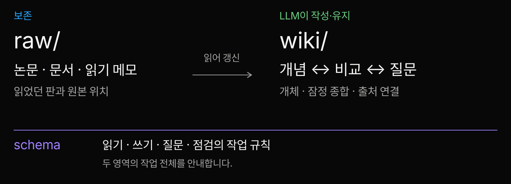
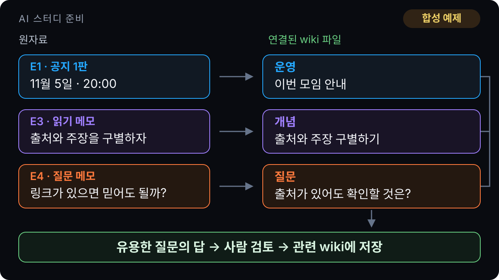
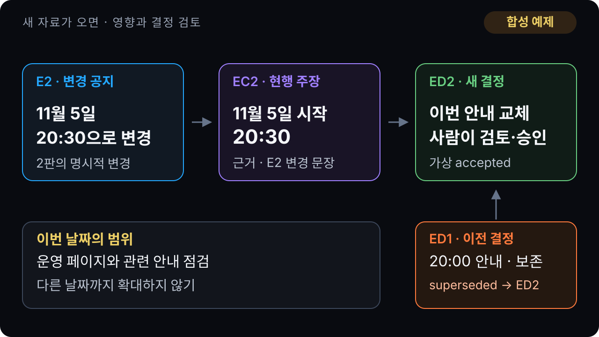

<!-- stage-slide
compose: message
tone: blue
-->
# 전에 찾은 답, 이유도 찾을 수 있나요?

**답과 함께 근거와 선택의 이유를 남겨 봅시다.**

LLM Wiki에서 출발하는 20분 AI 스터디

---

<!-- stage-slide
compose: message
tone: purple
-->
# 답을 이어 가는 파일 위키

LLM이 자료를 읽고, 서로 연결된 Markdown 페이지를 계속 갱신합니다.

Karpathy의 **설계 아이디어**입니다. 특정 완제품이나 표준은 아닙니다.

[S1 · LLM Wiki 원문](https://gist.github.com/karpathy/442a6bf555914893e9891c11519de94f)

---

<!-- stage-slide
compose: media
tone: blue
fit: contain
-->
# 자료와 위키, 옆에는 작업 규칙

raw는 보존, wiki는 갱신. schema는 **옆에서 작업법을 정하는 규칙**입니다. 규칙 준수는 보장되지 않습니다.

[도식 원본](./assets/wiki-layers.svg) · [S1 · 3층 설계 원문](https://gist.github.com/karpathy/442a6bf555914893e9891c11519de94f)

---

<!-- stage-slide
compose: media
tone: green
fit: contain
-->
# 일정뿐 아니라 개념과 질문도 연결

합성 공지 E1·읽기 메모 E3·질문 E4 → 운영·개념·질문 파일. 유용한 답은 **사람 검토 후 wiki에 저장**합니다.

페이지 구성과 검토 후 저장은 우리 제안입니다. [도식 원본](./assets/knowledge-map.svg)

---

<!-- stage-slide
compose: bento
tone: blue
-->
# 읽고, 묻고, 다시 점검하기

<!-- stage-group
icon: folder
tone: blue
-->
## ingest · 반영

새 자료를 읽고 관련 페이지에 연결합니다.

<!-- stage-group
icon: search
tone: purple
-->
## query · 질문

질문에 답하고, 유용한 결과를 다시 남깁니다.

<!-- stage-group
icon: check
tone: green
-->
## lint · 점검

낡은 주장·빠진 연결·모순을 살핍니다. 누락은 가능합니다.

<!-- stage-group
icon: record
tone: neutral
-->
## index · 찾기

`index`는 페이지 목록입니다.

<!-- stage-group
icon: record
tone: neutral
-->
## log · 변경 이력

`log`는 무엇을 언제 바꿨는지 남깁니다.

[S1 · 반복 작업 원문](https://gist.github.com/karpathy/442a6bf555914893e9891c11519de94f)

---

<!-- stage-slide
compose: bento
tone: purple
-->
# 유용한 답도 다음 질문의 바탕으로

<!-- stage-group
primary: true
tone: purple
icon: search
-->
## 질문 페이지 · E4

“답에 링크가 있으면 문장 전체를 믿어도 될까요?”

합성 예제

<!-- stage-group
tone: green
icon: book
-->
## 검토한 답 → 파일에 남김

“링크된 자료가 이 문장과 적용 범위를 실제로 지원하는지 확인합니다.”

개념 페이지에 연결하고 다음 질문에서 다시 씁니다. 합성 답안이며 자동 저장은 하지 않습니다.

<!-- stage-group
tone: orange
icon: check
-->
## 링크는 확인할 단서

출처 링크가 정답이나 신뢰를 보장하지는 않습니다.

[S11 · 출처 정보 개요](https://www.w3.org/TR/2013/NOTE-prov-overview-20130430/) · [S12 · 한계 참고](https://arxiv.org/abs/2005.11401)

---

<!-- stage-slide
compose: bento
tone: orange
-->
# 이 자료로 “매주”까지 말할 수 있을까요?

<!-- stage-group
tone: neutral
icon: record
-->
## 자료 · E1

“11월 5일 AI 스터디는 오후 8시에 시작한다.”

합성 공지 1판 · 2026-10-20

<!-- stage-group
tone: green
icon: check
-->
## 지원되는 주장 · EC1

“11월 5일 시작은 오후 8시.”

합성 주장 · 1판 기준 확인

<!-- stage-group
tone: orange
icon: search
-->
## 근거가 부족한 확장

“매주 오후 8시.” → 반복 주기는 **미확인**입니다.

자료 → 주장 → 결정 카드는 우리 제안이며 표준 양식이 아닙니다. [착안 S11](https://www.w3.org/TR/2013/NOTE-prov-overview-20130430/)

---

<!-- stage-slide
compose: bento
tone: yellow
-->
# 사실과 우리가 선택한 행동은 다릅니다

<!-- stage-group
tone: neutral
icon: record
-->
## 확인한 주장 · EC1

11월 5일 시작은 오후 8시.

합성 예제 · E1의 1판 기준

<!-- stage-group
tone: yellow
icon: select
-->
## 운영자의 선택

1판 기준 오후 8시 안내를 사용하기로 합니다.

합성 결정 ED1 · 당시 accepted · 담당 민지 · 2026-10-21

<!-- stage-group
tone: orange
icon: compare
-->
## 이유와 재검토도 남김

혼선을 줄이기 위해 선택. 대안은 확인까지 안내 보류. 공지가 바뀌면 재검토합니다.

[S10 · 결정 기록 원문](https://www.cognitect.com/blog/2011/11/15/documenting-architecture-decisions) · 스터디 적용은 우리 제안 · [전체 결정 카드](./assets/decision-example.txt)

---

<!-- stage-slide
compose: bento
tone: orange
-->
# 새 날짜보다, 명시적인 변경을 확인

<!-- stage-group
tone: orange
icon: mail
-->
## 새 자료 · E2

“이번 11월 5일 모임은 오후 8시 30분으로 변경한다.”

합성 변경 공지 2판 · 2026-10-27

<!-- stage-group
tone: green
icon: check
-->
## 새 주장 · EC2

“11월 5일 시작은 오후 8시 30분.”

합성 주장 · 해당 날짜만 지원합니다. 다른 날짜로 넓히지 않습니다.

<!-- stage-group
tone: purple
icon: search
-->
## 사람이 영향 범위 검토

운영 페이지·기존 주장·안내 결정을 함께 확인합니다.

우리 제안 · 나중 자료라는 이유만으로 자동 교체하지 않습니다.

---

<!-- stage-slide
compose: media
tone: green
fit: contain
-->
# 바꾸되, 예전 이유는 지우지 않습니다

합성 변경 공지 → 새 주장 → 새 안내 결정. 11월 5일 안내만 20:30으로. 이전 결정 ED1은 **superseded by ED2**로 보존합니다.

합성 ED2 · accepted · 2026-10-28. 초대장 등은 점검할 일이며 실제 수정 완료를 뜻하지 않습니다.

[도식 원본](./assets/change-trace.svg) · [S10 · 대체 이력 원문](https://www.cognitect.com/blog/2011/11/15/documenting-architecture-decisions) · 검토 절차는 우리 제안

---

<!-- stage-slide
compose: bento
tone: purple
-->
# 남기는 파일과 모델 학습은 구분합니다

<!-- stage-group
tone: blue
icon: folder
-->
## 파일 위키

이 사례에서 지속되는 것은 열어 볼 수 있는 Markdown 파일입니다.

설계 해석 · [S1 원문](https://gist.github.com/karpathy/442a6bf555914893e9891c11519de94f)

<!-- stage-group
tone: purple
icon: brain
-->
## 모델 학습

모델 가중치를 바꾸는 일입니다. 파일 저장 자체가 모델 학습은 아닙니다.

이 설계 범위의 구분입니다.

<!-- stage-group
tone: green
icon: search
-->
## RAG와도 함께

관련 자료를 검색해 답 생성에 씁니다. 위키도 검색과 함께 쓸 수 있습니다.

정의는 원문, 병행은 해석 · [S12 RAG 논문](https://arxiv.org/abs/2005.11401)

<!-- stage-group
tone: orange
icon: check
-->
## 확인은 계속 필요

출처가 있어도 오답·낡은 정보·검토 누락은 가능합니다.

<!-- stage-group
tone: neutral
icon: compare
-->
## 도입 효과는 미측정

정확도·절감 효과·유지비는 이번에 측정하지 않았습니다.

근거와 문장을 대조하는 검토 제안입니다.

---

<!-- stage-slide
compose: closing
tone: blue
-->
# 자료 하나, 주장 하나, 결정 하나부터

**무엇을 읽었고, 어디까지 알며, 왜 선택했나요?**

남은 2분: 내 메모에서 다시 찾고 싶은 질문을 나눠 봅시다.

[출처·근거](./assets/sources.txt) · [합성 결정 카드](./assets/decision-example.txt) · [시작 템플릿](./assets/starter-template.txt) · [진행 가이드 · 공개](./assets/speaker-guide.txt)
