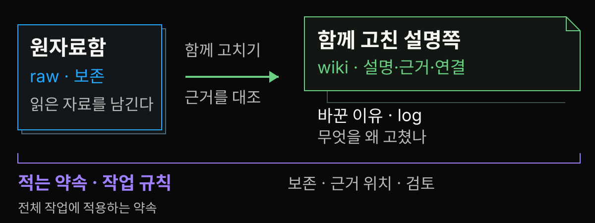
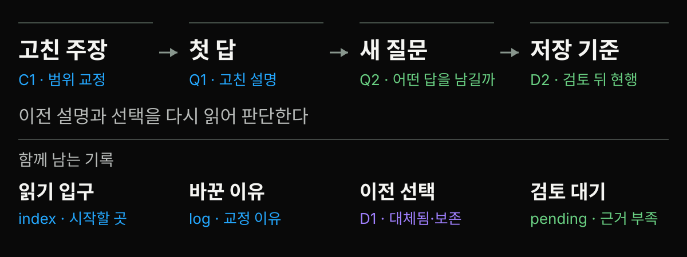

<!-- stage-slide
compose: media
tone: blue
fit: cover
focus: '50% 75%'
-->
# 이번 주 읽은 자료를 다음 주에도 쓸 수 있을까


**다음 질문에 다시 쓸 노트를 남겨 봅시다.**

---

<!-- stage-slide
compose: quote
tone: blue
-->
# LLM Wiki는 읽고 고치는 파일 노트

> LLM이 자료를 읽고 설명·연결·수정 후보를 제안합니다.

사람은 근거와 범위를 검토해 노트를 함께 고칩니다.

이 발표에서는 **공용 스터디 노트**처럼 생각해 봅니다.

---

<!-- stage-slide
compose: editorial
tone: blue
-->
# 고친 노트 한 쪽에 설명과 근거와 이유를 남긴다

<!-- stage-group
tone: green
-->
## 설명

이 데모의 파일 수정은 모델 매개변수 학습을 실행하지 않는다. 외부 파일을 쓰는 시스템에도 별도의 학습 과정이 있을 수 있다.

<!-- stage-group
tone: blue
-->
## 원문 위치

[RAG v4 §2.4](https://arxiv.org/html/2005.11401v4#S2.SS4)

[LoRA v2 §4.1](https://arxiv.org/html/2106.09685v2#S4.SS1)

<!-- stage-group
tone: orange
-->
## 바꾼 이유

외부 파일 사용이나 기본 가중치 고정만으로 학습의 부재를 일반화할 수 없다.

C1 파일의 문장·근거와 이유 발췌. [실제 파일 읽기](./materials/demo-log.md#4-실제-diff에서-달라진-문장)

---

<!-- stage-slide
compose: editorial
tone: blue
-->
# LLM이 제안하고 사람이 검토한다

<!-- stage-group
tone: purple
-->
## 운영 · LLM

설명 초안

연결 후보

수정 제안

<!-- stage-group
tone: green
-->
## 운영 · 사람

**원문·문장·범위**를 대조하고 채택

<!-- stage-group
tone: blue
-->
## 오늘의 예제

사람이 준비한 고정 승인안을 **Node로 파일에 반영**

오늘은 LLM을 호출하지 않았습니다.

[파일 역할 보기](#6) · [세 기록 구분](#5)

---

<!-- stage-slide
compose: message
tone: green
-->
# 다음 질문에 무엇을 다시 쓸까

**원문 · 설명 · 판단**

읽은 주소, 검토한 답, 바뀐 이유를 함께 남깁니다.

---

<!-- stage-slide
compose: media
tone: orange
fit: contain
-->
# 공용 노트를 파일로 옮기면



원자료함 raw는 보존하고, 설명쪽 wiki는 근거를 대조해 고칩니다. 작업 규칙은 전체에 적용하고 log에 바꾼 이유를 남깁니다.

[대응 그림 원본](./assets/study-notebook-map.svg)

---

<!-- stage-slide
compose: quote
tone: purple
-->
# 계속 남고 쌓여 가는 결과물

> 핵심 차이는 이것입니다. 위키는 계속 남고, 쌓여 가는 결과물입니다.

발표팀 번역

This is the key difference: the wiki is a persistent, compounding artifact.

Andrej Karpathy, *LLM Wiki* · [고정 원문](https://gist.github.com/karpathy/442a6bf555914893e9891c11519de94f/ac46de1ad27f92b28ac95459c782c07f6b8c964a#the-core-idea)

[실제 파일 확인하기](#10) · [노트 구조 더 보기](#8)

---

<!-- stage-slide
compose: media
tone: blue
fit: contain
-->
# 원자료 옆에 설명 노트를 둔다


[도식 원본 열기](./assets/wiki-layers.svg)

LLM이 읽고 연결한 Markdown을 유지하는 설계입니다. [Karpathy · Architecture](https://gist.github.com/karpathy/442a6bf555914893e9891c11519de94f/ac46de1ad27f92b28ac95459c782c07f6b8c964a)

---

<!-- stage-slide
compose: editorial
tone: green
-->
# 원문 위치와 메모와 해석을 나눈다

<!-- stage-group
tone: blue
-->
## 원문 위치

RAG v4 §2.4 Training

[실제 논문의 해당 절](https://arxiv.org/html/2005.11401v4#S2.SS4)

<!-- stage-group
tone: green
-->
## 한국어 읽기 메모

문서 인코더와 색인은 고정하고, 질의 인코더와 BART 생성기를 미세조정한다.

`source-notes/rag.md` 요약

<!-- stage-group
tone: orange
-->
## 우리 질문의 해석

외부 파일 사용만으로 학습 유무를 정할 수 없다.

메모의 근거와 범위를 다시 대조한다.

---

<!-- stage-slide
compose: editorial
tone: blue
-->
# 오늘은 승인한 교정안을 파일에 반영한다

<!-- stage-group
tone: orange
-->
## 사람이 준비한 승인안

학습용 오류가 있는 Q1 초안

원문을 대조한 고정 교정안

<!-- stage-group
tone: blue
-->
## Node로 반영한 결과

고친 답 · 새 질문 · 보류 · 대체 결정

`changes.diff`와 파일·링크·해시 검사

[실행 기록](./materials/demo-log.md) · [데모 ZIP](./demo/llm-wiki-demo.zip)

---

<!-- stage-slide
compose: quote
tone: yellow
-->
# 첫 질문의 초안을 연다

> 위키 파일을 고치는 것은 파일을 수정하는 작업이다. 외부 파일을 쓰는 시스템은 모델을 학습하지 않는다.

Q1 · 위키 파일을 고치면 모델도 그 내용을 학습하나요?

출처 후보: RAG 최초 읽기 메모 · **상태: 검토 전**

발표자가 심은 학습용 오류입니다. `before/wiki/questions/wiki-and-learning.md` 발췌.

---

<!-- stage-slide
compose: bento
tone: neutral
-->
# 링크가 있으면 충분할까

<!-- stage-group
tone: neutral
-->
## 판단할 초안

> 외부 파일을 쓰는 시스템은\
> 모델을 학습하지 않는다.

Zoom 채팅에 A/B를 적어 주세요.

이유 한 줄은 선택입니다.

[근거 확인하기](#13)

<!-- stage-group
tone: neutral
-->
## A

> [현행 노트로 저장한다.](#13)

<!-- stage-group
tone: neutral
-->
## B

> [원문 범위를 검토한다.](#13)

---

<!-- stage-slide
compose: editorial
tone: green
-->
# B · 링크와 문장 지원을 대조한다

<!-- stage-group
tone: orange
-->
## 초안의 일반화

외부 파일을 쓰는 시스템은
모델을 학습하지 않는다.

<!-- stage-group
tone: green
-->
## RAG 원논문 §2.4

질의 인코더와 생성기를 미세조정한다.

외부 파일 사용과 학습은 함께 있을 수 있다.

링크 다음에는 **문장과 근거의 범위**를 대조합니다.

[RAG v4 §2.4](https://arxiv.org/html/2005.11401v4#S2.SS4)

[질문으로 돌아가기](#12) · [교정 결과 보기](#17) · [읽은 범위 확인](#14)

---

<!-- stage-slide
compose: editorial
tone: blue
-->
# 최초 메모를 남기고 더 읽은 메모를 붙인다

<!-- stage-group
tone: yellow
-->
## 최초 · rag-initial.md

같은 RAG v4의 **§2.3**을 읽음

검색 문서를 생성에 쓰는 구조를 메모

<!-- stage-group
tone: blue
-->
## 확장 · rag.md

같은 RAG v4의 **§2.4까지** 읽음

학습 대상을 확인해 추가로 메모

원문이 교체된 사건이 아닙니다. **읽은 범위가 달라졌습니다.**

---

<!-- stage-slide
compose: editorial
tone: orange
-->
# 주장마다 근거와 범위를 맞춘다

<!-- stage-group
tone: orange
-->
## C1 · 고칠 문장

외부 파일을 쓰는 시스템은 모델을 학습하지 않는다.

<!-- stage-group
tone: purple
-->
## 근거 위치

RAG v4 §2.4

질의 인코더·생성기 학습

LoRA v2 §4.1

기본 가중치 고정 · 추가 행렬 학습

<!-- stage-group
tone: green
-->
## 고친 범위

이 파일 교정 데모는 모델 학습을 실행하지 않는다.

[RAG](https://arxiv.org/html/2005.11401v4#S2.SS4) · [LoRA](https://arxiv.org/html/2106.09685v2#S4.SS1)

---

<!-- stage-slide
compose: document
tone: purple
-->
# 검토는 고칠 문장과 이유를 정한다

`review/review.json`의 실제 승인 항목

```json
{
  "claim": "외부 파일을 쓰는 시스템은 모델을 학습하지 않는다.",
  "decision": "일반화 삭제 후 범위 교정",
  "source_ids": ["S-RAG", "S-LORA"]
}
```

이유: RAG의 학습과 LoRA의 추가 행렬 학습을 원문에서 확인했습니다. **의미 검토와 승인은 발표자가 했습니다.**

---

<!-- stage-slide
compose: bento
tone: blue
-->
# 모든 시스템에서 이 데모로 좁힌다

<!-- stage-group
tone: orange
-->
## 삭제 · [모든 시스템](./materials/demo-log.md#4-실제-diff에서-달라진-문장)

> 외부 파일을 쓰는 시스템은\
> 모델을 학습하지 않는다.

<!-- stage-group
tone: green
-->
## 추가 · 이 데모

> 이 데모의 파일 수정은 모델 매개변수 학습을 실행하지 않는다. 외부 파일을 쓰는 시스템에도 별도의 학습 과정이 있을 수 있다.

---

<!-- stage-slide
compose: quote
tone: green
-->
# 고친 답에는 다음 확인이 남는다

> 이 데모에서 바뀌는 것은 Markdown 파일이며 모델 매개변수 학습을 실행하지 않는다.

다음 질문에 반영하려면 고친 파일을 다시 찾아 읽어 답의 문맥에 넣어야 한다.

Q1 현행 답 발췌 · `after/wiki/questions/wiki-and-learning.md`

**다음 질문:** 고친 파일이 있어도 다음 답에서 읽지 않으면 어떻게 확인할까?

---

<!-- stage-slide
compose: media
tone: blue
fit: contain
-->
# 고친 설명을 새 질문과 판단에 다시 쓴다



고친 주장과 첫 답, 이전 선택을 다시 읽어 새 저장 기준을 정합니다.

[관계도 원본](./assets/reuse-route.svg) · [새 질문에 다시 쓰기](#21) · [목차와 이력 더 보기](#20)

---

<!-- stage-slide
compose: editorial
tone: green
-->
# index는 입구 log는 바뀐 이유

<!-- stage-group
tone: green
-->
## index.md · 어디서 읽지?

현행 답 저장 정책: 검토 후 갱신

다음 운영 질문 Q2: 어떤 답을 저장할까

검토 대기 답: 단정할 수 없는 부분

<!-- stage-group
tone: orange
-->
## log.md · 왜 고쳤지?

C1의 일반화를 교정했다.

Q2에서 C1 교정과 저장 정책을 재사용했다.

D1은 D2로 대체 표시했다.

실제 `after/wiki/index.md`와 `log.md`의 항목 발췌.

---

<!-- stage-slide
compose: message
tone: purple
-->
# 새 질문 · 우리 스터디는 어떤 답을 저장할까

**Q2 · 답의 저장 기준 정하기**

개념 설명을 고친 뒤에는, 다음 모임에서 쓸 답의 저장 기준을 정합니다.

불러올 기록: **교정된 C1 · Q1의 답 · 초기 결정 D1**

---

<!-- stage-slide
compose: media
tone: purple
fit: contain
-->
# 이전 설명과 판단을 함께 읽는다


[도식 원본 열기](./assets/reuse-inputs.svg)

C1의 교정, Q1의 다음 확인, D1의 기존 선택을 함께 놓고 **Q2를 판단**합니다.

---

<!-- stage-slide
compose: bento
tone: neutral
-->
# 이 답을 어디에 남길까

<!-- stage-group
tone: neutral
-->
## 판단할 초안

> 파일 위키를 만들면 필요한 파일을 언제나 찾을 수 있다.

Zoom 채팅에 A/B를 적어 주세요.

이유 한 줄은 선택입니다.

[이 예제의 선택 확인](#24)

<!-- stage-group
tone: neutral
-->
## A

> [현행 노트로 저장한다.](#24)

<!-- stage-group
tone: neutral
-->
## B

> [검토 대기에 보류한다.](#24)

---

<!-- stage-slide
compose: media
tone: green
fit: contain
-->
# B · 이 예제는 검토 뒤 현행으로 옮긴다


[도식 원본 열기](./assets/current-pending.svg)

**이 예제의 선택은 B.** 검토한 답은 현행, 근거 부족 답은 대기함에 남깁니다.

[질문으로 돌아가기](#23) · [보류 이유 읽기](#25)

---

<!-- stage-slide
compose: editorial
tone: yellow
-->
# 보류에도 이유와 다음 행동을 적는다

<!-- stage-group
tone: yellow
-->
## 상태 · 보류

필요한 파일을 **항상** 찾는다는 초안

<!-- stage-group
tone: orange
-->
## 보류 이유

검색 누락 여부는 미확인

<!-- stage-group
tone: green
-->
## 다음 행동

실제 질문 몇 개를 고른다.

읽은 파일과 빠진 근거를 점검한다.

[보류 기록 전문](./materials/demo-log.md#7-pending은-이유와-다음-행동을-남긴다)

---

<!-- stage-slide
compose: media
tone: orange
fit: contain
-->
# 옛 결정은 대체됨으로 남긴다


[도식 원본 열기](./assets/decision-transition.svg)

D1은 채팅 답을 모으려던 이유와 함께 보존합니다. **D2에는 새 선택과 검토 부담**을 적습니다.

[상충하는 근거 다루기](#29) · [결정 비용 더 보기](#27)

---

<!-- stage-slide
compose: editorial
tone: orange
-->
# 새 결정에는 검토 비용도 적는다

<!-- stage-group
tone: purple
-->
## 맥락

출처 링크가 있는 초안에도 미지원 일반화가 있었다.

<!-- stage-group
tone: green
-->
## 결정 · D2

문장·근거 위치·주장 범위를 대조한 뒤 현행 답을 갱신한다.

<!-- stage-group
tone: orange
-->
## 결과

수정 이유를 다시 읽는다.

검토 시간을 들여야 한다.

관련 페이지 누락도 살핀다.

D2 기록 요약 · [Nygard의 결정 기록 형식을 스터디에 응용](https://cognitect.com/blog/2011/11/15/documenting-architecture-decisions)

---

<!-- stage-slide
compose: editorial
tone: blue
-->
# 서로 다른 판은 같은 이름으로 덮지 않는다

<!-- stage-group
tone: blue
-->
## 자료에 새 판이 생기면

판·날짜·적용 범위 보존

<!-- stage-group
tone: purple
-->
## 주장으로 돌아가서

문장과 지원 범위 대조

<!-- stage-group
tone: green
-->
## 영향과 결정을 검토

현행 설명 갱신 · 과거 판단 보존

**원문이 바뀔 때 적용**

---

<!-- stage-slide
compose: message
tone: yellow
-->
# 상충하면 먼저 범위를 확인한다

**같은 대상? → 같은 시점? → 같은 조건?**

조건이 다르면 범위를 나눕니다. 같은 조건에서 충돌하면 근거를 대조하고, 아직 판단할 수 없으면 보류합니다.

[실행에서 확인한 것](#31) · [연결 질문의 배경](#30)

---

<!-- stage-slide
compose: quote
tone: purple
-->
# 자료 둘을 잇는 질문을 적는다

> 인간의 마음은 그런 방식으로 작동하지 않습니다. 연상으로 작동합니다.

발표팀 번역

The human mind does not work that way. It operates by association.

Vannevar Bush, *As We May Think*, 1945년, §6 · [출판사 원문](https://www.theatlantic.com/magazine/archive/1945/07/as-we-may-think/303881/)

분류 색인과 연상의 차이에서 지식 장치를 구상한 대목입니다.

---

<!-- stage-slide
compose: bento
tone: blue
-->
# 이번 실행에서 확인한 것

<!-- stage-group
tone: blue
-->
## 교정안 반영

**8** 쪽

기존 5쪽 갱신 + 신규 3쪽

[고친 문장](#17)

<!-- stage-group
tone: green
-->
## 로컬 링크 검사

**25** 링크

상대 경로의 연결 확인

[함께 바뀐 기록](#19)

<!-- stage-group
tone: orange
-->
## 보존 파일 해시

**10** 파일

읽기 메모 5개 + 초기 5쪽

[검사 범위](./materials/demo-log.md#10-zip에서-재현하기) · [다음 읽기](#33) · [역할](#32)

---

<!-- stage-slide
compose: editorial
tone: green
-->
# LLM에게 초안과 연결 후보를 맡긴다

<!-- stage-group
tone: purple
-->
## LLM에게 부탁할 일

읽기 메모 · 연결 후보 · 답 초안 · 수정안

<!-- stage-group
tone: green
-->
## 사람이 검토할 일

원문 위치 · 주장 범위 · 보류 · 현행 채택

실제 운영의 역할 제안입니다. 오늘 Node 스크립트는 사람이 승인한 안을 재현했습니다.

---

<!-- stage
layout: visual
quiet: true
-->
# 읽기·질문·점검을 반복한다

```stage
{
  "subtitle": "점검에서 찾은 문제는 다음 읽기와 질문으로 이어집니다.",
  "visual": {
    "kind": "flow",
    "items": ["읽고 엮기 · ingest", "답하고 남기기 · query", "점검하기 · lint"],
    "composition": "wide"
  },
  "source": "Karpathy, LLM Wiki · Operations: 자료를 반영하고 답을 남기고 내용·연결을 점검하는 반복 작업"
}
```

---

<!-- stage-slide
compose: gallery
tone: orange
variant: strip
fit: cover
focus: ['50% 75%', '44% 54%', '50% 72%']
-->
# 자료를 고르고 질문을 쓰고 대조한다


준비 예: 자료 3개 · 질문 1개 · 검토자 1명. 지금은 질문 한 줄부터.

---

<!-- stage-slide
compose: quote
tone: yellow
-->
# 내 질문 한 줄부터 적는다

> 내 질문 [한 줄]

자료 제목 [기억나는 만큼] → 근거 위치 [다음 모임에 확인]

**20초 동안 쓰기 · 채팅 공유는 선택**

예: 다음 답이 고친 노트를 읽었는지 어떻게 확인할까?

---

<!-- stage-slide
compose: document
tone: purple
-->
# 처음 부탁할 말은 짧게 정한다

`starter.txt`의 요청을 줄여 쓰면:

```text
원문은 보존하고, 이 자료가 기존 질문과 연결될 후보를 찾아 줘.
주장마다 근거 위치와 아직 지원하지 못한 부분을 표시해 줘.
반영 전에 바뀔 문장과 이유를 diff로 보여 줘.
```

원문과 작업 규칙은 [데모 ZIP](./demo/llm-wiki-demo.zip)에 있습니다. 실제 LLM 실행 결과가 아닌 시작 요청입니다.

[실행 파일과 공부 자료](#39) · [검토 규칙과 유지 부담](#37)

---

<!-- stage-slide
compose: document
tone: green
-->
# 다음 모임의 검토자를 정한다

**검토자 한 명과 네 규칙을 함께 읽습니다.**

- 원자료를 보존한다.
- 핵심 주장에 근거와 범위를 붙인다.
- 미확인 내용은 보류한다.
- 바뀐 결정과 이유를 남긴다.

---

<!-- stage-slide
compose: editorial
tone: orange
-->
# 다시 찾을 가치와 유지 부담을 같이 본다

<!-- stage-group
tone: green
-->
## 다시 쓸 가치

반복하는 질문

자주 바뀌는 자료

다른 사람과 나눌 설명

<!-- stage-group
tone: orange
-->
## 계속 드는 일

원문 대조와 검토

중복 설명과 낡은 링크 점검

목차·검색의 누락 확인

다음 모임에서 가치와 부담을 봅니다.

---

<!-- stage-slide
compose: editorial
tone: blue
-->
# 파일 묶음에서 다음 모임으로

<!-- stage-group
tone: blue
-->
## 실행해 보기

[데모 ZIP 내려받기](./demo/llm-wiki-demo.zip)

압축 해제 → apply → check

[실제 파일 읽기와 검증 범위](./materials/demo-log.md)

<!-- stage-group
tone: green
-->
## 깊이 공부하기

[공부 자료 목차](./materials/index.md)

학습서 · 실습 해설 · 대본 · 원문 안내

[고정 LLM Wiki 원문](https://gist.github.com/karpathy/442a6bf555914893e9891c11519de94f/ac46de1ad27f92b28ac95459c782c07f6b8c964a)

---

<!-- stage-slide
compose: closing
tone: purple
-->
# 어떤 노트부터 다시 쓰고 싶나요

**질문 · 내 자료 적용 · 검토 부담**

[공부 자료 목차](./materials/index.md) · [실행 가능한 데모 ZIP](./demo/llm-wiki-demo.zip)
