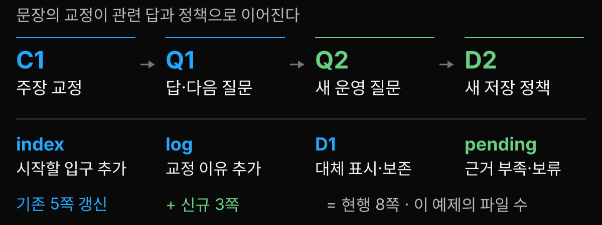
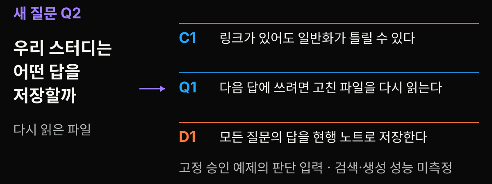
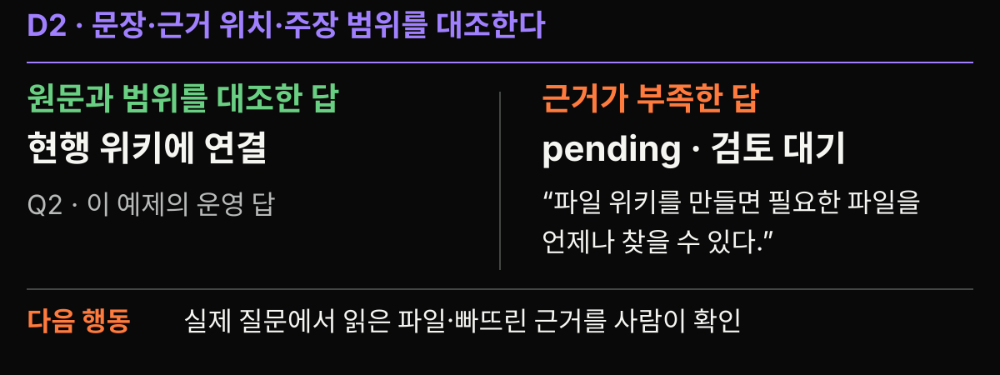
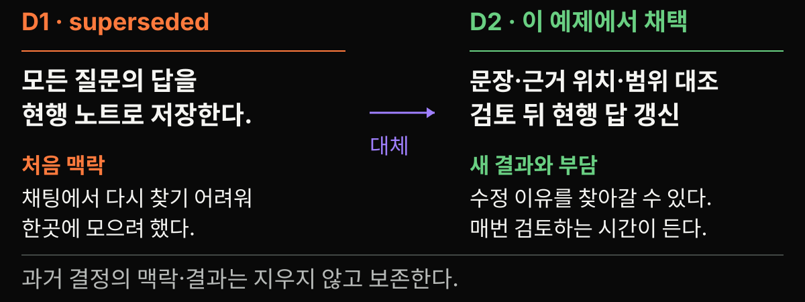

<!-- stage-slide
compose: media
tone: blue
fit: cover
focus: '50% 75%'
-->
# 이번 주 읽은 자료를 다음 주에도 쓸 수 있을까


**다음 질문에 다시 쓸 노트를 남겨 봅시다.**

---

<!-- stage-slide
compose: document
tone: yellow
-->
# 메모는 남았는데 어느 문장이 근거일까

읽은 흔적만 남은, 발표자가 만든 작은 메모입니다.

```text
RAG: 외부 자료를 찾아 답한다.
위키: 읽은 내용을 파일로 남긴다.
그러면 파일을 고치는 것도 모델 학습일까?
```

**마지막 질문에 답하려면, 앞 두 줄의 근거와 범위가 필요합니다.**

---

<!-- stage-slide
compose: split
tone: purple
fit: cover
focus: '50% 52%'
-->
# 자료를 모은 뒤에도 설명할 일이 남는다


- 자료 목록은 **무엇을 읽었는지** 알려줍니다.
- 설명 노트는 **무엇을 알았는지** 연결합니다.
- 판단 기록은 **왜 그렇게 했는지** 남깁니다.

---

<!-- stage-slide
compose: editorial
tone: purple
-->
# 다음 모임에는 다른 질문이 온다

<!-- stage-group
tone: purple
-->
## 이번 질문 · Q1

위키 파일을 고치면 모델도
그 내용을 학습하나요?

<!-- stage-group
tone: green
-->
## 다음 질문 · Q2

우리 스터디는
**어떤 답을 저장할까요?**

개념을 고친 결과가, 다음 운영 판단의 입력이 됩니다.

---

<!-- stage-slide
compose: message
tone: green
-->
# 다음 질문에 무엇을 다시 쓸까

**원문 · 설명 · 판단**

읽은 주소, 검토한 답, 바뀐 이유를 함께 남깁니다.

---

<!-- stage-slide
compose: message
tone: orange
-->
# 남길 것은 답과 근거와 바뀐 이유

**원자료 → 주장 → 검토 → diff → 다음 질문**

오늘의 끝에는 고친 답, 보류한 부분, 새 저장 규칙이 파일로 남습니다.

---

<!-- stage-slide
compose: quote
tone: purple
-->
# 계속 남고 쌓여 가는 결과물

> This is the key difference: the wiki is a persistent, compounding artifact.

“핵심 차이는 이것입니다. 위키는 계속 남고, 쌓여 가는 결과물입니다.” — 발표팀 번역

Andrej Karpathy, *LLM Wiki*, The core idea · [고정 원문](https://gist.github.com/karpathy/442a6bf555914893e9891c11519de94f/ac46de1ad27f92b28ac95459c782c07f6b8c964a#the-core-idea)

설계 아이디어의 설명입니다. 이제 남는 파일을 직접 보겠습니다.

---

<!-- stage-slide
compose: media
tone: blue
fit: contain
-->
# 원자료 옆에 설명 노트를 둔다


[도식 원본 열기](./assets/wiki-layers.svg)

LLM이 읽고 연결한 Markdown을 유지하는 설계입니다. [Karpathy · Architecture](https://gist.github.com/karpathy/442a6bf555914893e9891c11519de94f/ac46de1ad27f92b28ac95459c782c07f6b8c964a)

---

<!-- stage-slide
compose: split
tone: green
fit: cover
focus: '50% 72%'
-->
# 원문과 내 설명을 구분한다


- **원문:** RAG v4 §2.4
- **읽기 메모:** 질의 인코더와 생성기를 학습한다.
- **우리 해석:** 외부 파일 사용만으로 학습 유무를 정할 수 없다.

---

<!-- stage-slide
compose: editorial
tone: orange
-->
# 오늘은 승인한 교정안을 실행한다

<!-- stage-group
tone: orange
-->
## 발표자가 준비한 것

의도적으로 오류를 심은 초안

원문을 대조한 **고정 승인 교정안**

<!-- stage-group
tone: blue
-->
## Node가 실행하는 것

파일 수정 · diff · 링크 · 해시 검사

LLM 호출 없이 로컬에서 재현

[전체 파일과 실행 기록](./materials/demo-log.md) · [데모 ZIP](./demo/llm-wiki-demo.zip)

---

<!-- stage-slide
compose: quote
tone: yellow
-->
# 첫 질문의 초안을 연다

> 위키 파일을 고치는 것은 파일을 수정하는 작업이다. 외부 파일을 쓰는 시스템은 모델을 학습하지 않는다.

Q1 · 위키 파일을 고치면 모델도 그 내용을 학습하나요?

출처 후보: RAG 최초 읽기 메모 · **상태: 검토 전**

발표자가 심은 학습용 오류입니다. `before/wiki/questions/wiki-and-learning.md` 발췌.

---

<!-- stage-slide
compose: editorial
tone: yellow
-->
# 채팅 A 또는 B · 링크가 있으면 충분할까

<!-- stage-group
tone: orange
-->
## A

[출처 링크가 있으니 현행 답으로 저장한다.](#13)

<!-- stage-group
tone: green
-->
## B

[원문이 이 문장과 범위를 지원하는지 먼저 본다.](#13)

A 또는 B를 Zoom 채팅에 적어 주세요. 발표자가 직접 읽습니다.

[정답 보기 → 13장](#13)

---

<!-- stage-slide
compose: editorial
tone: green
-->
# B · 링크와 문장 지원을 대조한다

<!-- stage-group
tone: orange
-->
## 초안의 일반화

외부 파일을 쓰는 시스템은
모델을 학습하지 않는다.

<!-- stage-group
tone: green
-->
## RAG 원논문 §2.4

질의 인코더와 생성기를 미세조정한다.

외부 파일 사용과 학습은 함께 있을 수 있다.

링크의 유무 다음에는 **문장과 근거의 범위**를 대조합니다. [RAG v4 §2.4](https://arxiv.org/html/2005.11401v4#S2.SS4)

[질문으로 돌아가기](#12) · [읽기 메모 이어 보기 → 14장](#14)

---

<!-- stage-slide
compose: editorial
tone: blue
-->
# 최초 메모를 남기고 더 읽은 메모를 붙인다

<!-- stage-group
tone: yellow
-->
## 최초 · rag-initial.md

같은 RAG v4의 **§2.3**을 읽음

검색 문서를 생성에 쓰는 구조를 메모

<!-- stage-group
tone: blue
-->
## 확장 · rag.md

같은 RAG v4의 **§2.4까지** 읽음

학습 대상을 확인해 추가로 메모

원문이 교체된 사건이 아닙니다. **읽은 범위가 달라졌습니다.**

---

<!-- stage-slide
compose: editorial
tone: orange
-->
# 주장마다 근거와 범위를 맞춘다

<!-- stage-group
tone: orange
-->
## C1 · 고칠 문장

외부 파일을 쓰는 시스템은 모델을 학습하지 않는다.

<!-- stage-group
tone: purple
-->
## 근거 위치

RAG v4 §2.4: 질의 인코더·생성기 학습

LoRA v2 §4.1: 기본 가중치 고정, 추가 행렬 학습

<!-- stage-group
tone: green
-->
## 고친 범위

이 파일 교정 데모는 모델 학습을 실행하지 않는다.

[RAG](https://arxiv.org/html/2005.11401v4#S2.SS4) · [LoRA](https://arxiv.org/html/2106.09685v2#S4.SS1)

---

<!-- stage-slide
compose: document
tone: purple
-->
# 검토는 고칠 문장과 이유를 정한다

`review/review.json`의 실제 승인 항목

```json
{
  "claim": "외부 파일을 쓰는 시스템은 모델을 학습하지 않는다.",
  "decision": "일반화 삭제 후 범위 교정",
  "source_ids": ["S-RAG", "S-LORA"]
}
```

이유: RAG의 학습과 LoRA의 추가 행렬 학습을 원문에서 확인했습니다. **의미 검토와 승인은 발표자가 했습니다.**

---

<!-- stage-slide
compose: editorial
tone: orange
-->
# 실제 diff에서 한 문장을 고친다

<!-- stage-group
tone: orange
-->
## 삭제한 문장

외부 파일을 쓰는 시스템은 모델을 학습하지 않는다.

<!-- stage-group
tone: green
-->
## 추가한 문장

이 데모의 파일 수정은 모델 매개변수 학습을 실행하지 않는다. 외부 파일을 쓰는 시스템에도 별도의 학습 과정이 있을 수 있다.

`changes.diff`의 실제 문장 필드 발췌. [전체 diff와 범위 변경](./materials/demo-log.md#4-실제-diff에서-달라진-문장)

---

<!-- stage-slide
compose: quote
tone: green
-->
# 고친 답에는 다음 확인이 남는다

> 이 데모에서 바뀌는 것은 Markdown 파일이며 모델 매개변수 학습을 실행하지 않는다.

다음 질문에 반영하려면 고친 파일을 다시 찾아 읽어 답의 문맥에 넣어야 한다.

Q1 현행 답 발췌 · `after/wiki/questions/wiki-and-learning.md`

**다음 질문:** 고친 파일이 있어도 다음 답에서 읽지 않으면 어떻게 확인할까?

---

<!-- stage-slide
compose: media
tone: blue
fit: contain
-->
# 같이 바뀔 페이지를 따라간다



[도식 원본 열기](./assets/impact-map.svg)

C1·Q1·index·log·D1 갱신, Q2·D2·pending 생성: **이 예제의 8쪽**입니다.

---

<!-- stage-slide
compose: editorial
tone: green
-->
# index는 입구 log는 바뀐 이유

<!-- stage-group
tone: green
-->
## index.md · 어디서 읽지?

현행 답 저장 정책: 검토 후 갱신

다음 운영 질문 Q2: 어떤 답을 저장할까

검토 대기 답: 단정할 수 없는 부분

<!-- stage-group
tone: orange
-->
## log.md · 왜 고쳤지?

C1의 일반화를 교정했다.

Q2에서 C1 교정과 저장 정책을 재사용했다.

D1은 D2로 대체 표시했다.

실제 `after/wiki/index.md`와 `log.md`의 항목 발췌.

---

<!-- stage-slide
compose: message
tone: purple
-->
# 새 질문 · 우리 스터디는 어떤 답을 저장할까

**Q2 · 우리 스터디는 어떤 답을 저장할까**

개념 설명을 고친 뒤에는, 다음 모임에서 쓸 답의 저장 기준을 정합니다.

불러올 기록: **교정된 C1 · Q1의 답 · 초기 결정 D1**

---

<!-- stage-slide
compose: media
tone: purple
fit: contain
-->
# 이전 설명과 판단을 함께 읽는다



[도식 원본 열기](./assets/reuse-inputs.svg)

C1의 교정, Q1의 다음 확인, D1의 기존 선택을 함께 놓고 **Q2를 판단**합니다.

---

<!-- stage-slide
compose: editorial
tone: yellow
-->
# 채팅 A 또는 B · 근거 부족 답은 어디에 둘까

<!-- stage-group
tone: yellow
-->
## 근거 부족 초안

파일 위키를 만들면 필요한 파일을 **언제나** 찾을 수 있다.

<!-- stage-group
tone: orange
-->
## A

[다른 답과 함께 현행 노트에 바로 저장한다.](#24)

<!-- stage-group
tone: green
-->
## B

[이유와 다음 확인을 적어 검토 대기함에 둔다.](#24)

A/B를 Zoom 채팅에 적어 주세요. [이 예제의 선택 보기 → 24장](#24)

---

<!-- stage-slide
compose: media
tone: green
fit: contain
-->
# B · 이 예제는 검토 뒤 현행으로 옮긴다



[도식 원본 열기](./assets/current-pending.svg)

**이 예제의 선택은 B.** 검토한 답은 현행, 근거 부족 답은 대기함에 남깁니다.

[질문으로 돌아가기](#23) · [보류 이유 이어 보기 → 25장](#25)

---

<!-- stage-slide
compose: editorial
tone: yellow
-->
# 보류에도 이유와 다음 행동을 적는다

<!-- stage-group
tone: yellow
-->
## 상태 · 보류

필요한 파일을 **언제나** 찾을 수 있다는 답

<!-- stage-group
tone: orange
-->
## 보류 이유

이 파일 교정 실행은 우리 자료에서 검색 누락이 없다는 주장을 지원하지 않는다.

<!-- stage-group
tone: green
-->
## 다음 행동

실제 질문 몇 개를 정하고, 답이 읽은 파일과 빠뜨린 근거를 사람이 확인한다.

`after/wiki/pending/retrieval-coverage.md` 발췌.

---

<!-- stage-slide
compose: media
tone: orange
fit: contain
-->
# 옛 결정은 superseded로 남긴다



[도식 원본 열기](./assets/decision-transition.svg)

D1은 채팅 답을 모으려던 이유와 함께 보존합니다. **D2에는 새 선택과 검토 부담**을 적습니다.

---

<!-- stage-slide
compose: editorial
tone: orange
-->
# 새 결정에는 검토 비용도 적는다

<!-- stage-group
tone: purple
-->
## 맥락

출처 링크가 있는 초안에도 미지원 일반화가 있었다.

<!-- stage-group
tone: green
-->
## 결정 · D2

문장·근거 위치·주장 범위를 대조한 뒤 현행 답을 갱신한다.

<!-- stage-group
tone: orange
-->
## 결과

수정 이유로 돌아갈 수 있다. 매번 검토 시간이 들고 관련 페이지 누락도 점검해야 한다.

실제 D2 발췌 · [Nygard의 결정 기록 형식을 스터디에 응용](https://cognitect.com/blog/2011/11/15/documenting-architecture-decisions)

---

<!-- stage-slide
compose: editorial
tone: blue
-->
# 서로 다른 판은 같은 이름으로 덮지 않는다

<!-- stage-group
tone: blue
-->
## 자료에 새 판이 생기면

1판·2판의 날짜와 적용 범위를 따로 보존

<!-- stage-group
tone: purple
-->
## 주장으로 돌아가서

달라진 문장이 무엇을 지원하는지 대조

<!-- stage-group
tone: green
-->
## 영향과 결정을 검토

현행 설명을 고치고 과거 판단으로 돌아갈 길 유지

**앞으로 적용할 운영법입니다.** 오늘 데모는 같은 RAG v4의 읽기 범위만 확장했습니다.

---

<!-- stage-slide
compose: message
tone: yellow
-->
# 상충하면 어느 쪽인지 먼저 좁힌다

**같은 대상? → 같은 시점? → 같은 조건?**

조건이 다르면 범위를 나눕니다. 같은 조건에서 충돌하면 근거를 대조하고, 아직 판단할 수 없으면 보류합니다.

C1은 ‘모든 외부 파일 시스템’을 ‘이 데모’로 좁혔습니다. [충돌과 낡은 정보 더 읽기](./materials/study-guide.md#11-충돌오래된-정보삭제와-대체를-다루기)

---

<!-- stage-slide
compose: quote
tone: purple
-->
# 자료 둘을 잇는 질문을 적는다

> The human mind does not work that way. It operates by association.

“인간의 마음은 그런 방식으로 작동하지 않습니다. 연상으로 작동합니다.” — 발표팀 번역

Vannevar Bush, *As We May Think*, 1945년 7월, §6 · [출판사 원문](https://www.theatlantic.com/magazine/archive/1945/07/as-we-may-think/303881/)

분류 색인과 연상의 차이에서 지식 장치를 구상한 글입니다. 내 자료 두 개를 잇는 질문으로 이어갑니다.

---

<!-- stage-slide
compose: editorial
tone: blue
-->
# 검사 결과가 말하는 것

<!-- stage-group
tone: blue
-->
## 반영한 페이지

**8** 쪽

승인안 적용: 기존 5쪽 갱신 + 3쪽 생성

<!-- stage-group
tone: green
-->
## 검사한 로컬 링크

**25** 개

현행 파일의 상대 경로 연결 확인

<!-- stage-group
tone: orange
-->
## 보존한 파일

**10** 파일

읽기 메모 5개 + 초기 5쪽 SHA 보존

이 예제의 **파일 검사 수치**입니다. [실행과 범위](./materials/demo-log.md)

---

<!-- stage-slide
compose: editorial
tone: green
-->
# LLM에게 초안과 연결 후보를 맡긴다

<!-- stage-group
tone: purple
-->
## LLM에게 부탁할 일

읽기 메모 · 연결 후보 · 답 초안 · 수정안

<!-- stage-group
tone: green
-->
## 사람이 검토할 일

원문 위치 · 주장 범위 · 보류 · 현행 채택

실제 운영의 역할 제안입니다. 오늘 Node 스크립트는 사람이 승인한 안을 재현했습니다.

---

<!-- stage-slide
compose: icon-wall
tone: blue
icons: [{icon: folder, tone: blue}, {icon: voice, tone: purple}, {icon: check, tone: green}]
-->
# 읽기 질문하기 점검하기를 반복한다

- 읽고 엮기 · ingest
- 답하고 남기기 · query
- 점검하기 · lint

---

<!-- stage-slide
compose: gallery
tone: orange
variant: strip
fit: cover
focus: ['44% 54%', '50% 75%', '50% 72%']
-->
# 내 자료 세 개에서 시작한다


자료 3개 · 질문 1개 · 검토자 1명. 사진은 학습을 설명하는 스톡 장면입니다.

---

<!-- stage-slide
compose: message
tone: yellow
-->
# 내 질문 하나를 실제로 적는다

**내 자료 A + 내 자료 B → 다음 모임에 답할 질문**

20초 동안 자기 노트에 적어 보세요.

자료 두 개의 제목, 연결 질문 한 줄, 먼저 확인할 근거 한 곳.

예: RAG 메모 + 지난 Q1 → 다음 답이 어떤 파일을 읽었는지 어떻게 확인할까?

채팅에 공유하는 것은 선택입니다.

---

<!-- stage-slide
compose: document
tone: purple
-->
# 처음 부탁할 말은 짧게 정한다

`starter.txt`의 요청을 줄여 쓰면:

```text
원문은 보존하고, 이 자료가 기존 질문과 연결될 후보를 찾아 줘.
주장마다 근거 위치와 아직 지원하지 못한 부분을 표시해 줘.
반영 전에 바뀔 문장과 이유를 diff로 보여 줘.
```

원문과 작업 규칙은 [데모 ZIP](./demo/llm-wiki-demo.zip)에 있습니다. 실제 LLM 실행 결과가 아닌 시작 요청입니다.

---

<!-- stage-slide
compose: icon-wall
tone: green
icons: [folder, search, select, record]
-->
# 다음 모임 전, 파일을 읽을 사람을 정한다

작업 규칙 네 가지와 함께 시작합니다.

- 원자료를 보존하기
- 근거와 범위를 붙이기
- 모르는 것은 보류하기
- 결정 이력 남기기

---

<!-- stage-slide
compose: editorial
tone: orange
-->
# 다시 찾을 가치와 유지 부담을 같이 본다

<!-- stage-group
tone: green
-->
## 다시 쓸 가치

반복하는 질문

자주 바뀌는 자료

다른 사람과 나눌 설명

<!-- stage-group
tone: orange
-->
## 계속 드는 일

원문 대조와 검토

중복 설명과 낡은 링크 점검

목차·검색의 누락 확인

한 주제로 작게 시도하고, 다음 모임에서 재사용과 부담을 함께 확인합니다.

---

<!-- stage-slide
compose: editorial
tone: blue
-->
# 파일 묶음에서 다음 모임으로

<!-- stage-group
tone: blue
-->
## 실행해 보기

[데모 ZIP 내려받기](./demo/llm-wiki-demo.zip)

압축 해제 → apply → check

[실제 파일 읽기와 검증 범위](./materials/demo-log.md)

<!-- stage-group
tone: green
-->
## 깊이 공부하기

[공부 자료 목차](./materials/index.md)

학습서 · 실습 해설 · 대본 · 원문 안내

[고정 LLM Wiki 원문](https://gist.github.com/karpathy/442a6bf555914893e9891c11519de94f/ac46de1ad27f92b28ac95459c782c07f6b8c964a)

---

<!-- stage-slide
compose: closing
tone: purple
-->
# 어떤 노트부터 다시 쓰고 싶나요

**질문 · 내 자료 적용 · 검토 부담**

Q&A 별도 2분 추정

[공부 자료 목차](./materials/index.md) · [실행 가능한 데모 ZIP](./demo/llm-wiki-demo.zip)
