<!-- stage-slide
compose: message
tone: green
-->
# LLM Wiki

**자료가 지식으로, 지식이 결과물로**

세 영상의 읽기 메모에서 다음 스터디의 한 쪽 진행안까지

---

<!-- stage-slide
compose: quote
tone: green
-->
# 어제 읽은 내용을 오늘도 다시 찾고 있나요?

> “지난번에 읽었던 그 내용,
> **다음 질문에서도 다시 쓸 수 있을까요?**”

링크는 남았지만, 그때 이해한 관계는 어디에 있을까요?

---

<!-- stage-slide
compose: media
tone: green
fit: contain
-->
# 저장한 자료와 다시 쓸 지식은 다릅니다

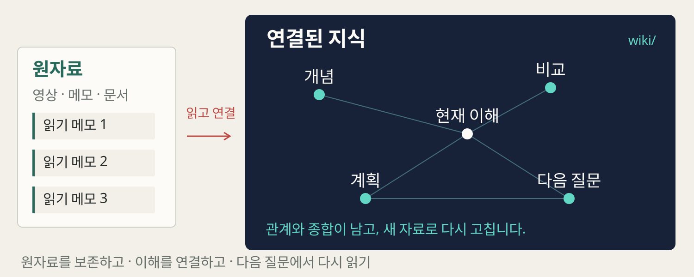

**수집한 자료** 사이에, **다시 읽을 개념·비교·종합**을 남깁니다.

---

<!-- stage-slide
compose: quote
tone: orange
-->
# 좋은 답에는 나의 맥락도 필요합니다

> **어떤 결과를 만들고 싶은가요?**

우리 목적: 다음 AI 스터디의 한 쪽 진행안 만들기

---

<!-- stage-slide
compose: editorial
tone: green
-->
# 파일을 읽고 쓰는 에이전트가 등장했습니다

## 파일을 다루는 에이전트

자료를 **읽고 쓰고 고칠** 수 있습니다.

## 다시 쓸 지식층

이전 이해를 **문서로 유지**할 수 있습니다.

[설계 원문](https://gist.github.com/karpathy/442a6bf555914893e9891c11519de94f/ac46de1ad27f92b28ac95459c782c07f6b8c964a)

---

<!-- stage-slide
compose: quote
tone: green
-->
# LLM이 공동 편집하는 지식 위키

> LLM이 원자료의 **개념·비교·종합을 연결된 문서로 작성하고 갱신**해,
> 다음 질문에서 그 정리를 다시 읽는 지식관리 방식입니다.

Karpathy의 공개 설계 아이디어를 풀어 쓴 정의

---

<!-- stage-slide
compose: editorial
tone: green
-->
# 연결하고, 쌓고, 다시 고칩니다

## 연결

자료 사이의 **개념과 조건**을 설명합니다.

## 축적

비교와 종합을 **문서로 남깁니다.**

## 갱신

새 자료와 질문으로 **기존 설명도 고칩니다.**

---

<!-- stage-slide
compose: message
tone: green
-->
# 왜 필요한지에서, 직접 쓰는 방법까지

**01 필요** → **02 비교** → **03 작동** → **04 적용**

도착점은 다음 스터디에 쓸 **한 쪽 진행안**입니다.

---

<!-- stage-slide
compose: editorial
tone: blue
-->
# RAG는 필요한 근거를 찾아 답합니다

## 검색

질문과 관련된 **외부 자료**를 찾습니다.

## 현재 문맥

찾은 내용을 모델의 **입력에 넣습니다.**

## 생성

그 근거를 참고해 **이번 답을 만듭니다.**

---

<!-- stage-slide
compose: document
tone: blue
-->
# 같은 자료와 질문으로 비교해 봅시다

**공통 질문**

> 다음 AI 스터디에서 LLM Wiki를 어떻게 시도할까?

| 같은 원자료 | 읽을 관점 |
| --- | --- |
| 영상 1의 메모 | 목적 · 연결 · 기록의 활용 |
| 영상 2의 메모 | 검색 · 위키 · 학습과의 구별 |
| 공동 세미나 메모 | 선별 · 사람의 생각 · 결과물과 검토 |

두 경로는 같은 **세 메모**를 쓰는 설명용 구성 예입니다.

---

<!-- stage-slide
compose: media
tone: blue
fit: contain
-->
# 질문할 때 근거를 모으는 흐름

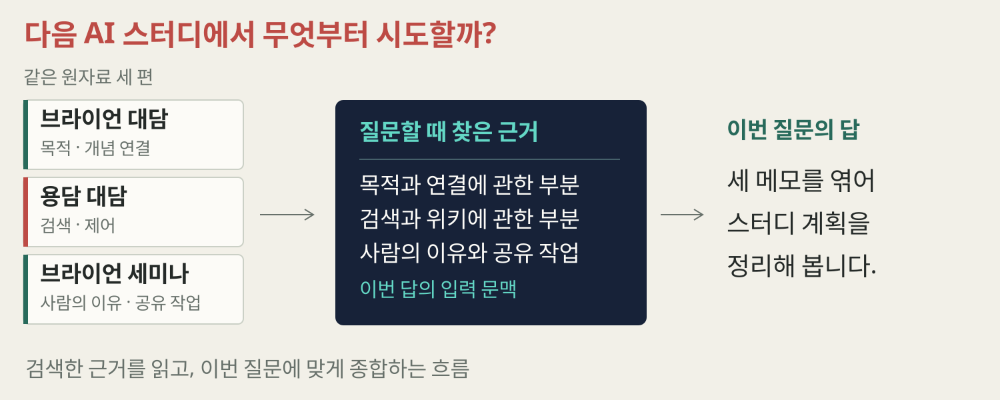

**이번 질문에 필요한 근거를 찾고**, 현재 입력에서 종합합니다.

---

<!-- stage-slide
compose: media
tone: blue
fit: contain
-->
# 먼저 연결된 설명을 써 두는 흐름

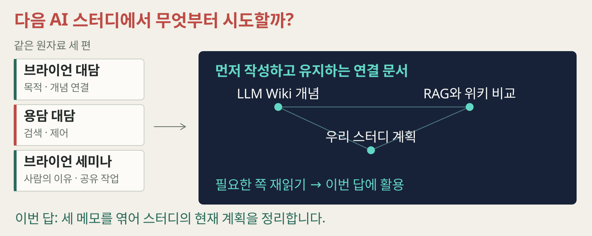

**이전에 정리한 개념·비교·계획**을 찾아 다시 읽습니다.

---

<!-- stage-slide
compose: editorial
tone: blue
-->
# 다음 질문의 출발점이 달라집니다

## 기본 검색·생성의 예

지금 질문에 맞춰 **근거를 찾아 종합**합니다.

## 위키를 유지하는 예

이미 남긴 **관계와 종합도 다시 읽습니다.**

둘 모두 필요한 자료를 찾고, 현재 질문에 맞게 답해야 합니다.

---

<!-- stage-slide
compose: document
tone: blue
-->
# 무엇을 남기고, 언제 고치는가

| 비교 축 | 기본 검색·생성의 예 | 위키를 유지하는 예 |
| --- | --- | --- |
| 남기는 결과 | 검색용 자료와 색인 등 | 읽을 수 있는 개념·비교·종합 |
| 자료 반영 때 | 정제·색인·변경 반영 | 관계 작성·관련 문서 갱신 |
| 질문할 때 | 근거 검색·현재 답 종합 | 관련 쪽 재읽기·현재 답 종합 |
| 계속 드는 일 | 검색·생성·접근 범위 관리 | 설명·연결·검색·접근 범위 관리 |

**비용과 정확도는 실제 자료와 질문으로 확인합니다.**

---

<!-- stage-slide
compose: media
tone: blue
fit: contain
-->
# 에이전틱 RAG는 검색 판단을 맡깁니다

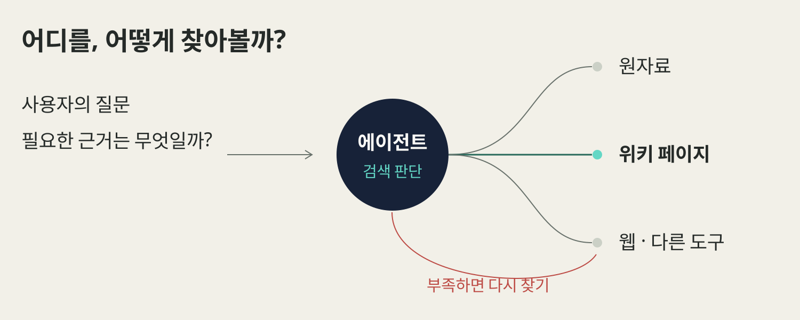

**어디를, 어떻게, 다시 찾을지** 에이전트가 판단합니다.

---

<!-- stage-slide
compose: editorial
tone: blue
-->
# 파인튜닝은 모델을 조정하는 작업입니다

## 문서와 문맥

위키 파일을 고치고,
필요한 내용을 **입력에 읽습니다.**

## 모델 조정

학습 예제로 **파라미터·어댑터**를 조정합니다.

---

<!-- stage-slide
compose: editorial
tone: blue
-->
# 위키를 검색하는 RAG도 가능합니다

## 지식 정리

원자료 → **연결된 위키**

## 필요한 쪽 찾기

위키와 원자료 → **검색·선별**

## 지금 답하기

선택한 근거 → **현재 답과 새 정리**

---

<!-- stage-slide
compose: document
tone: green
-->
# 사람이 읽고 고칠 수 있는 지식이 남습니다

| 구별할 내용 | 다시 읽을 질문 |
| --- | --- |
| 원자료의 요지 | 그 자료에서 실제로 무엇을 말했나? |
| 사람의 선택 이유·관찰 | 왜 골랐고 무엇을 중요하게 보았나? |
| 자료를 엮은 종합 | 무엇을 함께 해석했고 아직 모르는가? |

이번 팩의 이유와 종합은 **발표팀이 작성한 구성 예**입니다.

---

<!-- stage-slide
compose: quote
tone: orange
-->
# 좋은 위키는 사용 목적부터 시작합니다

> “다음 AI 스터디의
> **한 쪽 진행안을 만들고 싶어요.**”

**03 · 작동** — 세 영상으로 만드는 작은 위키

---

<!-- stage-slide
compose: media
tone: green
fit: contain
-->
# 원자료·위키·작업 규칙을 나눕니다

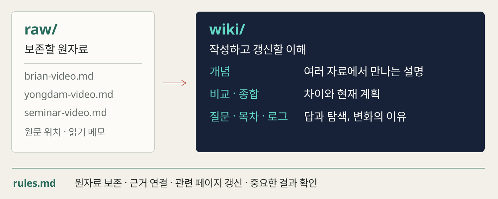

**원자료 · 사람의 이유 · 종합**을 구별하며, 규칙으로 전체 작업을 안내합니다.

---

<!-- stage-slide
compose: editorial
tone: green
-->
# 보는 도구와 쓰는 도구는 다릅니다

## 문서를 보는 도구

페이지를 읽고 **연결을 탐색**합니다.

## 파일을 다루는 에이전트

관련 자료를 **읽고·쓰고·갱신**합니다.

Obsidian + Claude Code는 가능한 한 조합입니다.

---

<!-- stage-slide
compose: editorial
tone: green
-->
# 모든 자료보다 다시 쓸 자료부터

## 목적에 관련 있는가

어떤 질문·결과에 **다시 쓸 자료**인가

## 지금 필요한가

현재 조건에 맞는 **읽을 범위**인가

## 내 판단이 있는가

선택 이유·경험·관찰을 **직접 남길 수 있는가**

---

<!-- stage-slide
compose: media
tone: orange
fit: contain
-->
# 넣는 이유와 앞으로의 쓰임을 묻습니다

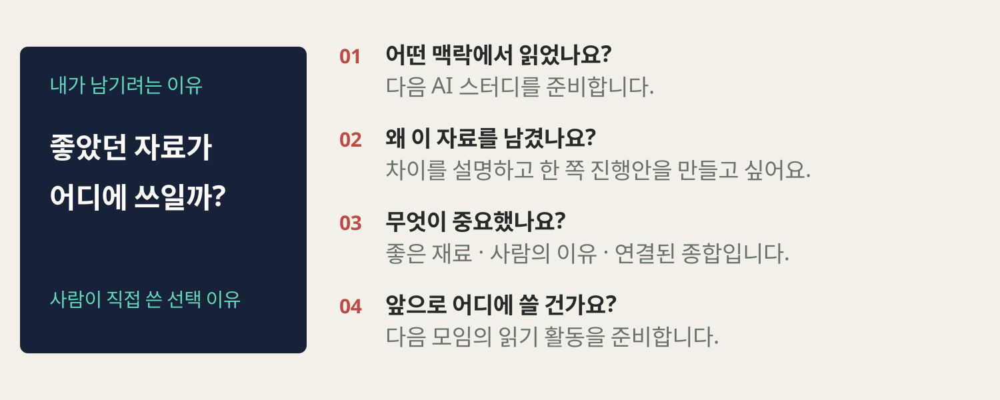

**“차이를 설명하고 다음 스터디의 진행안을 만들고 싶어서 골랐습니다.”**

---

<!-- stage-slide
compose: document
tone: green
-->
# 세 영상에서 읽기 메모를 만듭니다

| 원자료 메모 | 원문에서 확인할 내용 |
| --- | --- |
| 맥락과 연결 | [영상 1 · 09:41](https://www.youtube.com/watch?v=t4XEda3CB3Q&t=581s) |
| 검색과 위키 | [영상 2 · 13:34](https://www.youtube.com/watch?v=vvOuhfgH02E&t=814s) |
| 선별과 결과물 | [공동 세미나 · 16:37](https://www.youtube.com/watch?v=Ef4AGnSU8UE&t=997s) |

**원문 요지 · 내 이유 · 기술 보완 · 남은 질문**을 나눕니다.

---

<!-- stage-slide
compose: media
tone: green
fit: contain
-->
# 인제스트는 변환에 연결을 더합니다

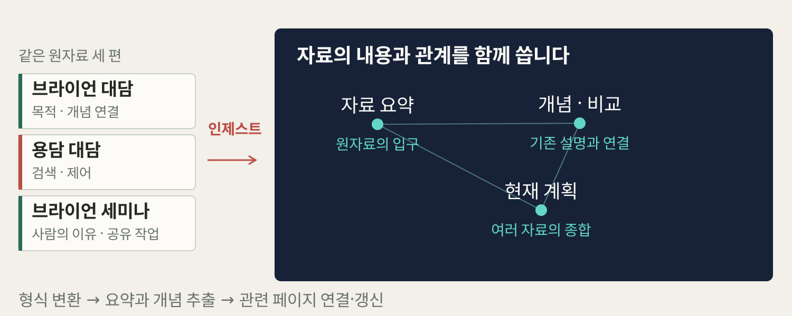

자료를 읽고, **기존 개념·비교·종합과의 관계**를 작성합니다.

---

<!-- stage-slide
compose: media
tone: green
fit: contain
-->
# 자료 요약과 개념 페이지를 나눕니다

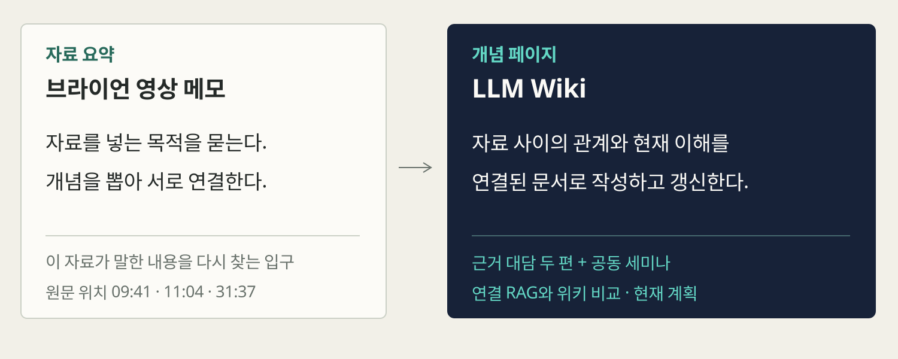

**자료 요약은 그 자료**, 개념 페이지는 **여러 자료의 공통 주제**를 설명합니다.

---

<!-- stage-slide
compose: media
tone: green
fit: contain
-->
# 비교와 종합은 여러 자료를 함께 씁니다

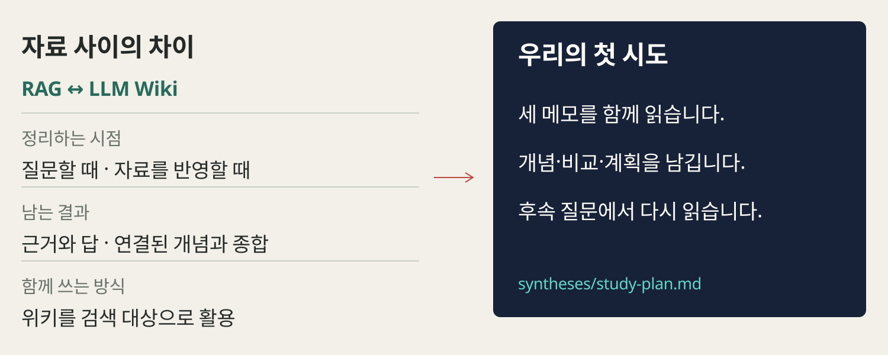

개념을 비교하고, **우리 목적에 맞는 현재 계획**으로 종합합니다.

---

<!-- stage-slide
compose: editorial
tone: green
-->
# 목차와 로그는 탐색과 이력을 맡습니다

## 목차

**지금 무엇이 있는가?**

페이지와 한 줄 설명으로 들어갑니다.

## 로그

**언제 무엇을 왜 바꿨는가?**

변경 이유와 확인할 점을 남깁니다.

---

<!-- stage-slide
compose: media
tone: green
fit: contain
-->
# 그래프는 연결, 규칙은 정리의 기준

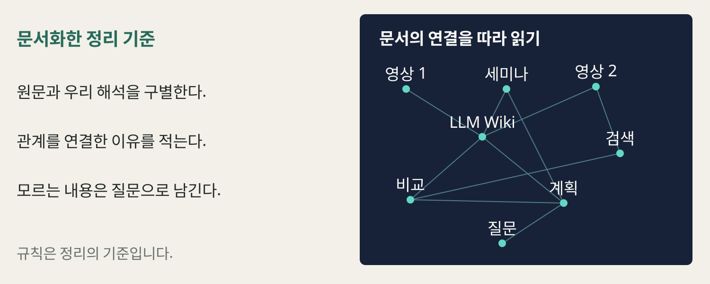

**연결을 보는 방법**과 **지식을 정리하는 기준**을 구별합니다.

---

<!-- stage-slide
compose: quote
tone: orange
-->
# 새로운 조건 하나가 들어오면

> 다음 모임에는 **입문자도 함께**하고,
> 별도 **15분 활동**으로 시작하고 싶습니다.

미리 준비한 세 메모 중 두 개 선택 · 연결과 다음 질문 읽기

다음 모임을 위한 **가상 조건 메모**입니다.

---

<!-- stage-slide
compose: media
tone: green
fit: contain
-->
# 관련 설명과 현재 계획을 함께 갱신합니다

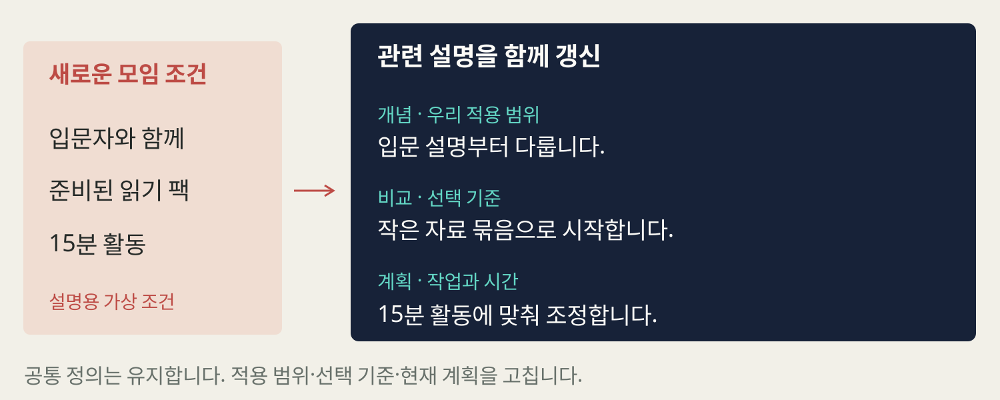

새 조건에 맞춰 **적용 범위·선택 기준·15분 활동 계획**을 함께 보완합니다.

---

<!-- stage-slide
compose: media
tone: green
fit: contain
-->
# 질문할 때 필요한 페이지를 실제로 읽습니다

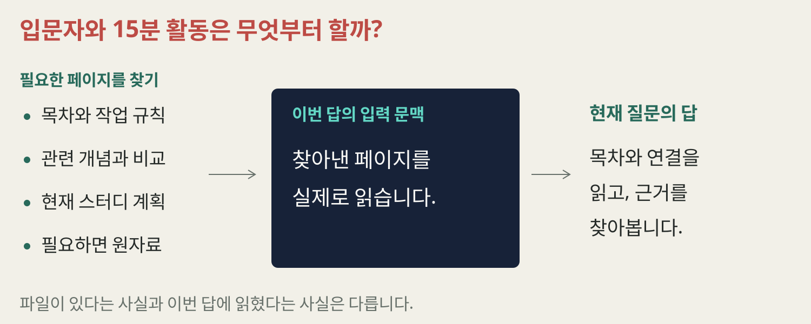

**“입문자와 15분 활동은 무엇부터 할까?”**

---

<!-- stage-slide
compose: media
tone: green
fit: contain
-->
# 유용한 답도 다음 탐색의 입구가 됩니다

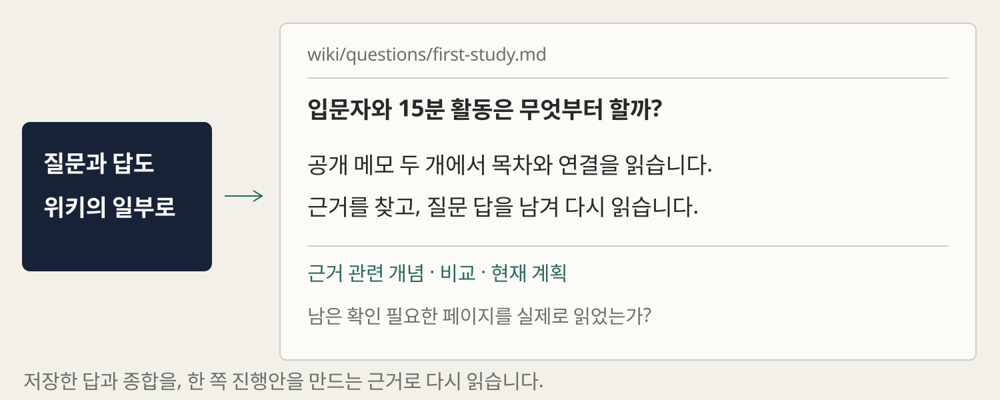

검토한 답과 근거를 저장해 **앞으로 만들 진행안의 재료**로 씁니다.

---

<!-- stage-slide
compose: editorial
tone: green
-->
# 낡은 설명과 빠진 연결을 점검합니다

## 점검 예 · 예전 초안이 남아 있다면

**참여자·활동 시간이 미정**인 문장을 찾습니다.

## 다시 읽고 고치기

새 조건을 확인해 **적용 범위와 계획을 갱신**합니다.

끊긴 연결 · 빠진 근거 · 오래된 설명도 함께 봅니다.

---

<!-- stage-slide
compose: editorial
tone: green
-->
# 읽기·질문·점검이 같은 위키로 돌아옵니다

## 반영 · Ingest

새 자료와 **기존 설명을 연결**합니다.

## 질문 · Query

관련 쪽을 읽고 **유용한 결과를 남깁니다.**

## 점검 · Lint

낡은 설명을 찾아 **재읽고 고칩니다.**

---

<!-- stage-slide
compose: editorial
tone: green
-->
# LLM은 정리하고 사람은 방향을 정합니다

## 사람의 세 행동

**쓰임 정하기 · 내 이유와 판단 적기 · 종합을 대조하고 고치기**

## LLM과 함께할 작업

관련 쪽 읽기 · 작성·연결 · 갱신 · 점검 후보

**04 · 적용** — 같은 지식으로 어떤 결과를 만들까요?

---

<!-- stage-slide
compose: editorial
tone: green
-->
# 학습에서는 질문을 이어 갈 수 있습니다

## 이번에 남길 것

개념의 뜻 · 자료 사이의 비교 · 남은 의문

## 다음에 다시 쓸 것

후속 질문 · 발표 설명 · 다음 읽기 계획

---

<!-- stage-slide
compose: media
tone: green
fit: contain
-->
# 여러 작업자가 같은 위키를 읽습니다

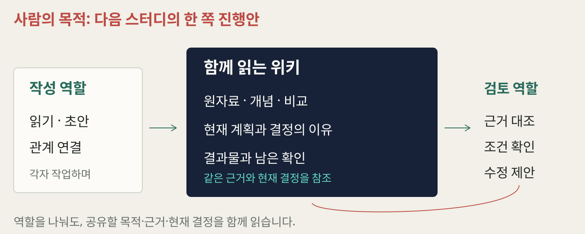

같은 근거와 현재 결정을 **작성·검토 역할**이 함께 읽습니다.

---

<!-- stage-slide
compose: media
tone: green
fit: contain
-->
# 맥락·요청·논의·결과를 연결합니다

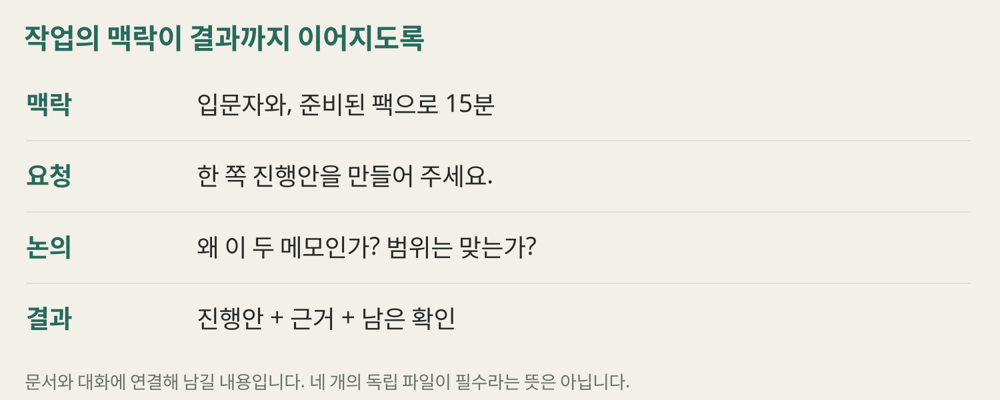

**왜 필요한가 → 무엇을 만들까 → 왜 선택했나 → 무엇이 남았나**

---

<!-- stage-slide
compose: media
tone: green
fit: contain
-->
# 정리한 지식으로 한 쪽 진행안을 만듭니다

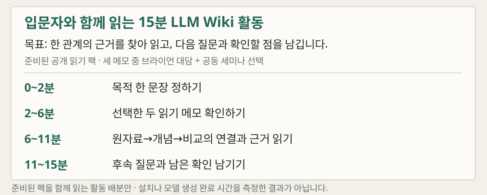

[**15분 활동 진행안 읽기**](./materials/session-plan.md) · 준비된 팩에서 세 메모 중 두 개를 선택합니다.

---

<!-- stage-slide
compose: media
tone: green
fit: contain
-->
# 검토한 결과와 이유를 다시 남깁니다

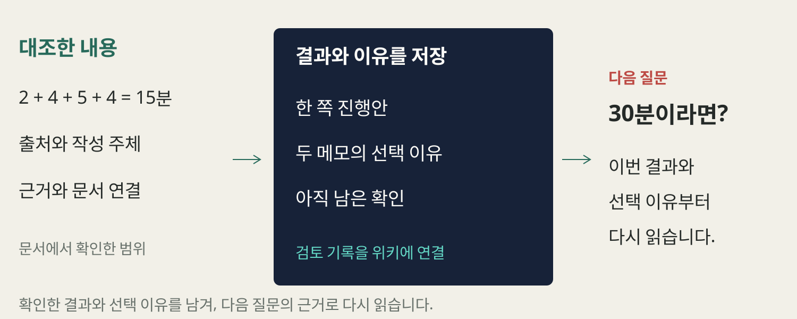

[**결과·확인 범위·다음 질문 읽기**](./materials/session-plan.md) · “다음에는 30분이라면?”

---

<!-- stage-slide
compose: quote
tone: green
-->
# 지식의 무덤은 목적 없이 커집니다

> “다 모아 뒀는데,
> **무엇에 다시 쓸지는 정하지 않았어요.**”

목적 없는 수집 · 과한 분류 · 다시 읽지 않는 정리

---

<!-- stage-slide
compose: editorial
tone: green
-->
# 연결된 문서도 틀리고 낡을 수 있습니다

## 의미

잘못된 종합 · 빠진 조건

## 최신성

새 자료 미반영 · 서로 다른 설명

## 운영

읽을 범위 · 검토·갱신 비용

---

<!-- stage-slide
compose: document
tone: green
-->
# 반복 질문의 가치와 유지 비용을 봅니다

| 내 상황 | 먼저 살펴볼 것 |
| --- | --- |
| 같은 주제와 질문이 반복됨 | 개념·비교·종합을 유지할 가치 |
| 자료가 많고 자주 바뀜 | 검색·변경 반영·접근 범위·검토 비용 |
| 가끔 한 자료만 확인함 | 단순 노트와 검색으로 충분한지 |

**작게 써 보고, 다음 질문에서 다시 읽히는지 확인합니다.**

---

<!-- stage-slide
compose: quote
tone: orange
-->
# 내 자료에서 다음 질문 하나를 정해 봅시다

> 누구를 위해, 어떤 자료로,
> **무슨 결과를 만들고 싶나요?**

**20초 · 자기 노트에 한 문장** · 공유는 원하는 분만 해 주세요.

---

<!-- stage-slide
compose: document
tone: orange
-->
# 목적·자료·연결·검토를 함께 요청합니다

```text
목적: 이 대상을 위해 이런 결과를 만들고 싶어.
이유·입력: 왜 골랐는지 적고, 규칙과 자료 두 개를 읽어 줘.
작업: 원문·내 이유·종합을 구별하고 근거·관련 쪽을 연결해 줘.
검토: 바뀐 파일·모르는 점을 알려줘. 결과와 근거를 함께 볼게.
```

[예제 팩](./assets/expanded-study.txt) · [작게 따라 하기](./materials/workshop.md)

---

<!-- stage-slide
compose: closing
tone: green
-->
# 다음 질문이 이전 이해에서 출발하도록

**연결**한 지식으로 결과를 만들고, **이유**와 함께 다음 질문에 씁니다.

---

<!-- stage-slide
compose: quote
tone: green
-->
# 어떤 지식을 다음 질문으로 이어 갈까요?

> 내 자료로 **어떤 결과를 만들고, 무엇을 이어 묻고 싶나요?**

[학습서](./materials/study-guide.md) · [실습](./materials/workshop.md) · [15분 진행안](./materials/session-plan.md)

[세 영상과 원문 안내](./materials/reference-library.md)
