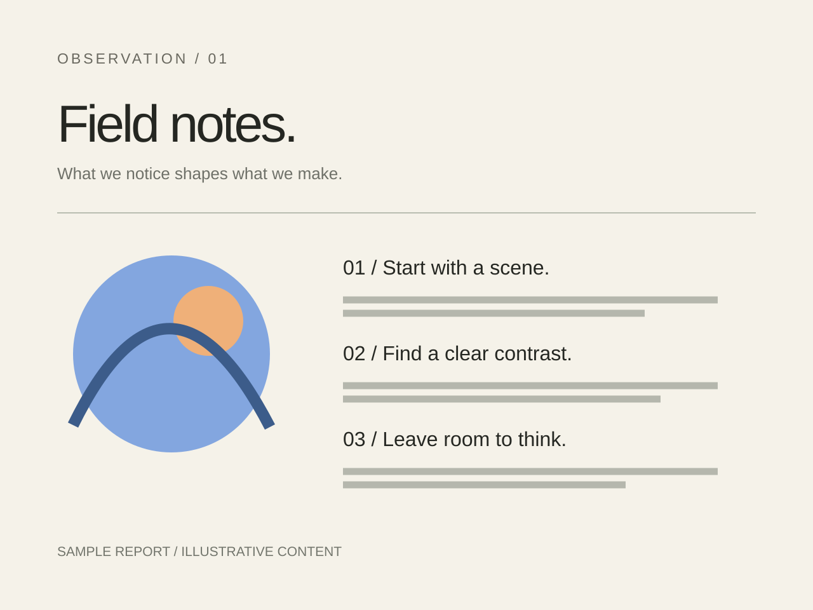

<!-- stage-slide
tone: orange
-->
# 작은 관찰에서, **다음 행동으로.**

가상 제품 개선 이야기 · 관찰한 장면을 작은 결정으로 연결합니다.

사진은 실제 참여자와 무관한 스톡 이미지입니다.

---

<!-- stage-slide
fit: cover
focus: '45% 43%'
-->
# 답을 내기 전에, 장면을 남깁니다.

- 어떤 일을 시작하려는지 묻습니다.
- 멈춘 순간을 짧게 적습니다.
- 해결책보다 **실제 행동**을 먼저 봅니다.

---

# 관찰과 다음 행동을 구분합니다.

| 장면 | 가상 검토에서 남긴 관찰 | 다음에 확인할 일 |
| --- | --- | --- |
| 설정 찾기 | 메뉴를 두 번 오감 | 이름을 쉽게 바꾸기 |
| 결과 확인 | 완료 상태를 다시 질문함 | 상태 문구 비교하기 |

설명을 위한 가상 기록입니다. 사진 속 인물의 행동을 조사한 결과가 아닙니다.

---

<!-- stage-slide
compose: editorial
-->
# 기록을, 결정할 수 있는 모양으로.

<!-- stage-group
primary: true
fit: contain
-->
## 함께 읽을 한 장

<!-- stage-group
tone: blue
-->
## 남겨 둔 관찰

**24** 개

장면을 다시 찾을 기록입니다.

<!-- stage-group
tone: orange
-->
## 다음에 확인할 행동

**2** 개

이름과 상태 문구를 확인합니다.

가상 수치 · 서로 다른 작업 단위 · 전환율이나 성과가 아닙니다.

---

> 무엇을 만들었는지보다,
> 무엇을 이해했는지부터 이야기합니다.

가상 팀이 정한 검토 원칙

---

<!-- stage-slide
tone: green
-->
# 이번에는 **상태 문구 하나**를 바꿉니다.

완료 여부를 묻지 않아도 다음 행동을 알 수 있는지 확인합니다.

작은 변경 뒤에도 같은 질문으로 다시 살핍니다.

---

# 바꾸고, 같은 장면으로 돌아갑니다.

1. [검토 체크리스트](./checklist.txt)에서 관찰과 해석을 나눕니다.
2. 상태 문구를 바꾸고 다음 행동이 분명한지 함께 읽습니다.
3. 모르는 점은 [팀 학습 발표](../team-learning/slides.md)의 질문으로 남깁니다.

---

<!-- stage-slide
compose: closing
tone: orange
-->
# 작게 바꾸고, **다시 봅니다.**

다음 검토에서는 같은 장면과 같은 질문으로 돌아옵니다.

[사진·자체 제작 자료의 출처](https://github.com/OU9999/stage-presentation-kit/blob/main/assets/CREDITS.md)
